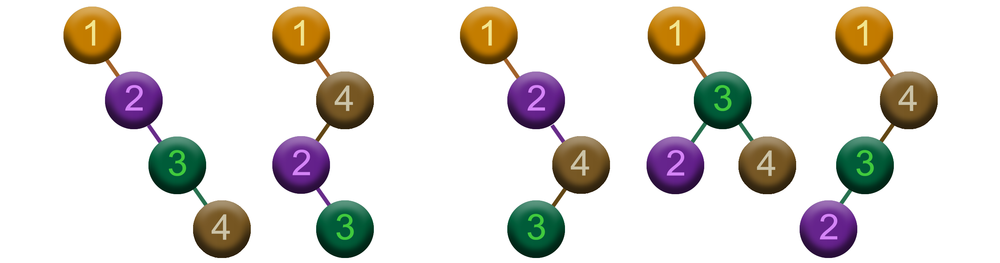
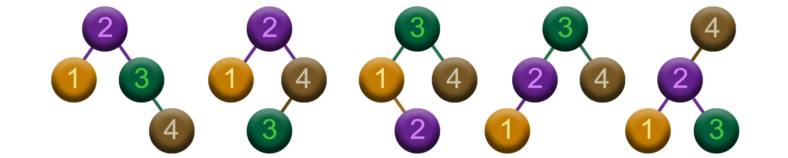
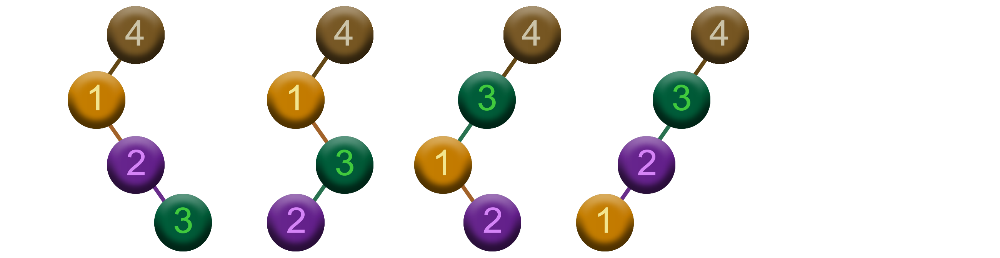
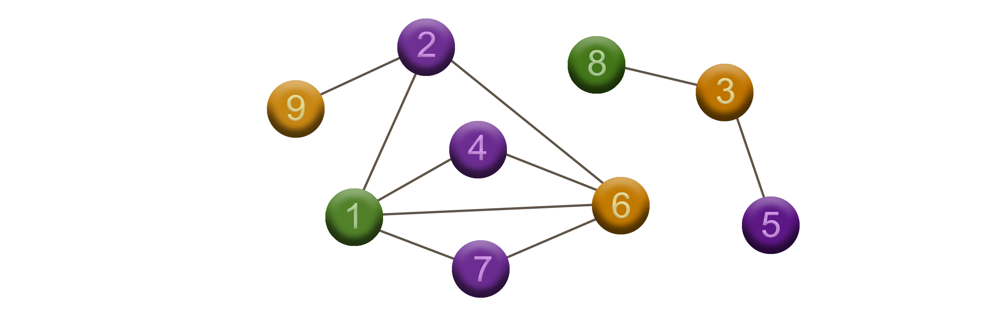
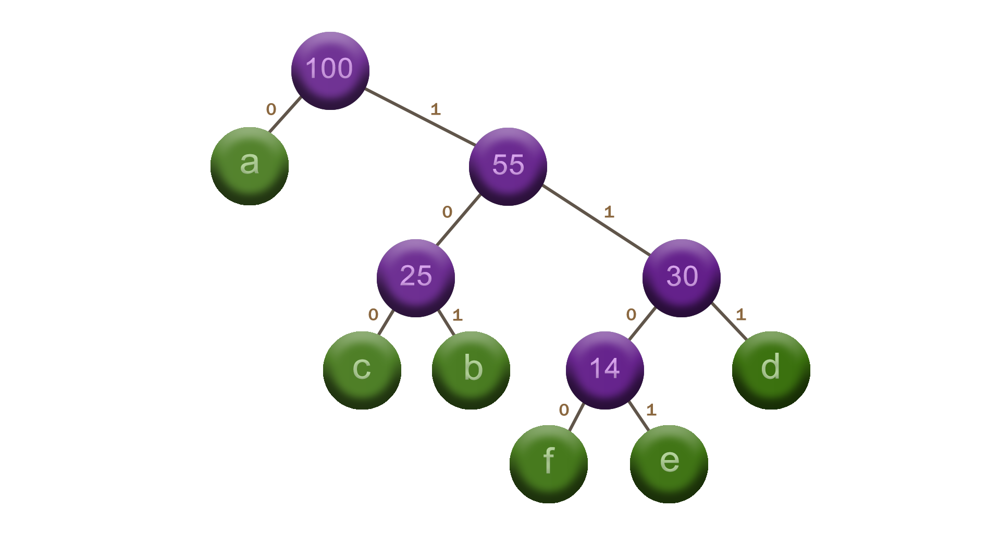
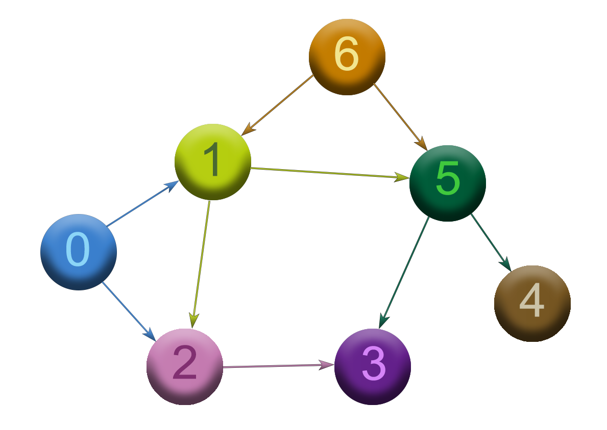
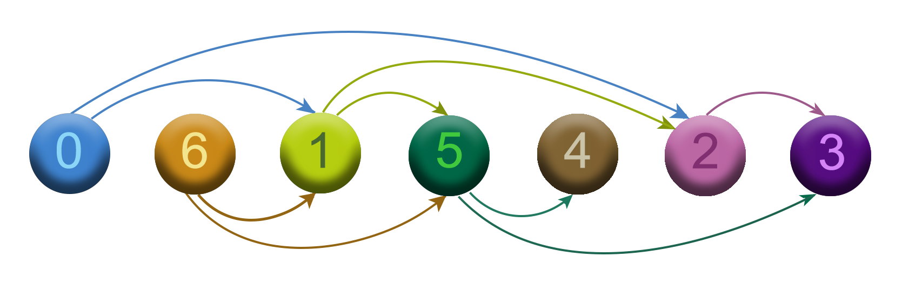
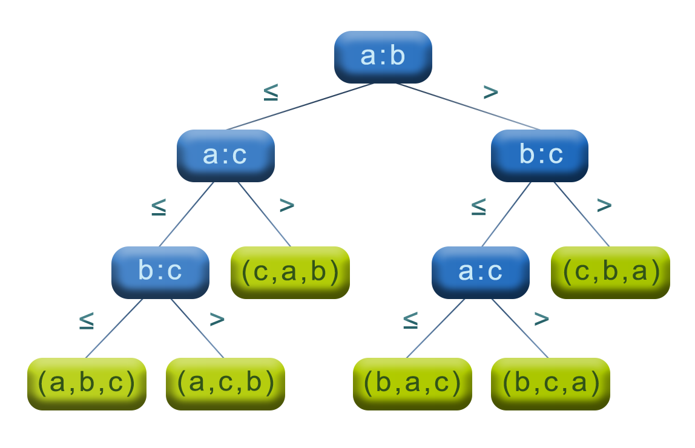

# CLRS: Data Structures and Algorithms

C implementations of the algorithms and data structures from *Introduction to Algorithms* (Cormen, Leiserson, Rivest & Stein), 3rd and 4th editions.

## Contents

- [Algorithms](#algorithms)
  - [Divide and conquer](#algorithms-divide-and-conquer)
    - [Binary Search](#algorithms-divide-and-conquer-binsearch)
    - [Closest Pair of Points](#algorithms-divide-and-conquer-closest-pair-of-points)
    - [Inversion count](#algorithms-divide-and-conquer-inversion-count)
    - [Integer multiplication](#algorithms-divide-and-conquer-karatsuba)
    - [Maximum Subarray](#algorithms-divide-and-conquer-max-subarray)
    - [Quickselect](#algorithms-divide-and-conquer-quickselect)
    - [Matrix Multiplication](#algorithms-divide-and-conquer-strassen)
  - [Dynamic programming](#algorithms-dynamic-programming)
    - [Rod cutting](#algorithms-dynamic-programming-rod-cutting)
    - [Matrix Chain Multiplication (MCM)](#algorithms-dynamic-programming-matrix-chain-mult)
    - [Longest Common Subsequence (LCS)](#algorithms-dynamic-programming-longest-common-sub)
    - [Longest palindromic subsequence (LPS)](#algorithms-dynamic-programming-longest-palin-sub)
    - [Longest Increasing Subsequence (LIS)](#algorithms-dynamic-programming-longest-increasing-sub)
    - [0-1 Knapsack problem](#algorithms-dynamic-programming-knapsack)
    - [Minimum Edit Distance (MED)](#algorithms-dynamic-programming-min-edit-dist)
    - [Optimal Binary Search Trees (OBST)](#algorithms-dynamic-programming-opt-bsts)
    - [Minimal Palindromic Partitioning (MPP)](#algorithms-dynamic-programming-min-pal-part)
    - [Wildcard Pattern Matching (WPM)](#algorithms-dynamic-programming-wd-matching)
  - [Greedy algorithms](#algorithms-greedy)
    - [Activity-selection problem](#algorithms-greedy-activity-selection)
    - [Lecture Hall Scheduling (LHS)](#algorithms-greedy-lct-hall-scheduling)
    - [Fractional knapsack](#algorithms-greedy-fract-knapsack)
    - [Huffman codes](#algorithms-greedy-huffman)
    - [Coin Changing Problem (CCP)](#algorithms-greedy-coin-changing)
    - [Minimum number of jumps](#algorithms-greedy-min-jumps)
  - [Graph algorithms](#algorithms-graphs)
    - [Breadth-first search](#algorithms-graphs-bfs)
    - [Depth-first search](#algorithms-graphs-dfs)
    - [Topological sort](#algorithms-graphs-top-sort)
    - [Strongly connected components](#algorithms-graphs-scc)
    - [MST - Kruskal](#algorithms-graphs-mst-kruskal)
    - [MST - Prim](#algorithms-graphs-mst-prim)
    - [SSSP - Bellman-Ford](#algorithms-graphs-sssp-bellman-ford)
    - [SSSP - DAG shortest paths](#algorithms-graphs-sssp-dag)
    - [SSSP - Dijkstra](#algorithms-graphs-sssp-dijkstra)
    - [APSP - Matrix multiplication](#algorithms-graphs-apsp-matrix-mult)
    - [Floyd-Warshall](#algorithms-graphs-apsp-floyd)
    - [APSP - Transitive closure](#algorithms-graphs-apsp-transitive-closure)
    - [APSP - Johnson](#algorithms-graphs-apsp-johnson)
    - [MF - Ford-Fulkerson - Edmonds-Karp](#algorithms-graphs-mf-edmonds-karp)
    - [MF - Ford-Fulkerson - Capacity Scaling](#algorithms-graphs-mf-cap-scaling)
    - [MF - Ford-Fulkerson - Dinitz](#algorithms-graphs-mf-dinitz)
    - [MF - Push-relabel](#algorithms-graphs-mf-push-relabel)
    - [MCBM - unweighted - Dinitz](#algorithms-graphs-mcbm-dinitz)
    - [MCBM - unweighted - Hopcroft-Karp](#algorithms-graphs-mcbm-hopcroft-karp)
    - [MCBM - preferred - Gale-Shapley](#algorithms-graphs-mcbm-gale-shapley)
    - [MCBM - weighted - mcmf](#algorithms-graphs-mcbm-mcmf)
    - [MCBM - weighted - hungarian](#algorithms-graphs-mcbm-hungarian)
    - [ETP - Fleury](#algorithms-graphs-etp-fleury)
    - [ETP - Hierholzer](#algorithms-graphs-etp-hierholzer)
  - [String matching](#algorithms-string-matching)
    - [Naive string-matching](#algorithms-string-matching-naive-matching)
    - [Rabin-Karp algorithm](#algorithms-string-matching-rabin-karp)
    - [String-matching Automata](#algorithms-string-matching-finite-automata)
    - [Knuth Morris Pratt](#algorithms-string-matching-knuth-morris-pratt)
    - [Suffix arrays](#algorithms-string-matching-suffix-arrays)
  - [Sorting](#algorithms-sorting)
    - [Counting sort](#algorithms-sorting-counting-sort)
    - [Radix sort](#algorithms-sorting-radix-sort)
    - [Bucket sort](#algorithms-sorting-bucket-sort)
    - [Merge sort](#algorithms-sorting-merge-sort)
    - [Heapsort](#algorithms-sorting-heap-sort)
    - [Quicksort](#algorithms-sorting-quick-sort)
    - [Insertion sort](#algorithms-sorting-insertion-sort)
    - [Selection sort](#algorithms-sorting-selection-sort)
    - [Bubble sort](#algorithms-sorting-bubble-sort)
  - [Fast Fourier Transform](#algorithms-fft)
  - [Theory](#algorithms-theory)
    - [Recurrence relations](#algorithms-theory-recurrences)
- [Data Structures](#datastructures)
  - [Stacks](#datastructures-stacks)
  - [Queues](#datastructures-queues)
  - [Lists](#datastructures-lists)
  - [Trees](#datastructures-trees)
    - [Binary Search Trees](#datastructures-trees-bstrees)
    - [Red-black Trees](#datastructures-trees-rbtrees)
    - [AVL Trees](#datastructures-trees-avltrees)
  - [Hash tables](#datastructures-htables)
  - [Heaps](#datastructures-heaps)
    - [Binary Heaps](#datastructures-heaps-binheaps)
    - [Priority queues using binary heaps](#datastructures-heaps-bpqueues)
    - [Fibonacci heaps](#datastructures-heaps-fibheaps)
  - [Graphs](#datastructures-graphs)
  - [Disjoint sets](#datastructures-union-find)

## Code

Each source file contains only the core of an algorithm or data structure: self-contained C99 functions without `main`, input/output or comments. Graph algorithms take the graph as an edge list over vertices `0..n-1`; data structures come as a `.h`/`.c` pair.

```sh
gcc -std=c99 -Wall -c algorithms/sorting/quick-sort/quicksort.c
```

---

<a id="algorithms"></a>

## Algorithms

An algorithm is a well-defined computational procedure that takes some value, or set of values, as *input* and produces some value, or set of values, as *output* in a finite number of steps. An algorithm is thus a sequence of computational steps that transform the input into the output.

An algorithm can also be seen as a tool for solving a well-specified *computational problem*. The statement of the problem specifies in general terms the desired input/output relationship and the algorithm describes a specific computational procedure for achieving that relationship.

The input to an algorithm is called an *instance* of the problem that the algorithm solves and the output obtained is called the *solution* to the problem instance.

An algorithm is said to be *correct* if, for every input instance, it halts and outputs the correct solution to the problem instance. An algorithm is said to be *incorrect* if it halts with an incorrect output or fails to halt at all for some input instance.

The efficiency of an algorithm is measured by the *running time* of the algorithm, which is the number of primitive operations or "steps" executed. This running time is affected by many factors, including the programming language, the compiler, the input, the hardware platform, and the quality of the implementation. For the study of algorithms, however, we want to abstract away all these factors and focus on the intrinsic efficiency of the algorithm.

Usually, we are interested in how the running time of an algorithm increases with the size of the input in the limit, as the size of the input increases without bound. This approach is called the *asymptotic analysis* of algorithms. We often focus on the *worst-case running time* of an algorithm, which gives an upper bound on the running time for any input of size $n$.

---

<a id="algorithms-divide-and-conquer"></a>

### Divide and conquer

Cuando un problema es demasiado difícil de resolver directamente, a menudo es posible atacarlo dividiéndolo en subproblemas que son a su vez instancias más pequeñas del mismo problema y luego resolver estos subproblemas ${\color{peru}\text{recursivamente}}$. Tal enfoque se conoce como *divide y vencerás*, y normalmente se describe mediante una ${\color{peru}\text{relación de recurrencia}}$, que expresa la solución de un problema en términos de las soluciones de instancias más pequeñas del mismo problema. Después de suficientes niveles de recursión, la recursión toca fondo y los subproblemas se vuelven tan pequeños que pueden resolverse directamente. A medida que la recursión se desenrolla, las soluciones de los subproblemas se combinan para dar una solución al problema original.

Ten en cuenta que si los subproblemas no son independientes (es decir, las soluciones de los subproblemas dependen de las soluciones de otros subproblemas), el enfoque de divide y vencerás no es adecuado, ya que el mismo subproblema se resolvería varias veces. En tales casos, la [programación dinámica] es el enfoque recomendado.

---

<a id="algorithms-divide-and-conquer-binsearch"></a>

#### Binary Search

Source: [`algorithms/divide-and-conquer/binsearch/`](algorithms/divide-and-conquer/binsearch)

$\Large{\color{rosybrown}\text{Problem}}$

Given a sorted array $A$ of $n$ elements, find a given element $x$ in $A$ in $\Theta(\log n)$ time.

<br/>

$\Large{\color{darkseagreen}\text{Solution}}$

The fact that the array is sorted is crucial to designing an algorithm in which we can search for $x$ in $\Theta(\log n)$ time. For this, we compare $x$ with the middle element $A[\lfloor n/2 \rfloor]$. If $x$ is equal to the middle element, we are done. If $x$ is less than the middle element, we search the left half of the array, and in the other case, we search the right half of the array. This process is repeated until we find $x$ or have narrowed the search to an empty subarray, in which case we conclude that $x$ is not in the array.

Since the array is halved at each step and comparing takes constant time, the recurrence for the running time is given by:

$$
\color{saddlebrown}\boxed{\color{rosybrown}\space T(n) = T(n/2) + \Theta(1) \space}
$$

According to the [master theorem](#algorithms-theory-recurrences-master-method), case 2, the solution is then $T(n) = \Theta(\log n)$.

Implementation: [Binary search](algorithms/divide-and-conquer/binsearch/binsearch.c)

<br/>

$\Large{\color{yellowgreen}\text{Example 1:}}$ $\Large{\color{olive} \text{n-th magical number}}$

Binary search can also be used to search a ${\color{darkseagreen}\text{solution space}}$. For example, consider the problem of finding the $n$-th magical number, given two positive integers $a$ and $b$. A magical number is a number that is divisible by either $a$ or $b$. We can use a binary search in this case because the set of magical numbers is ${\color{darkseagreen}\text{monotonically increasing}}$ (forming a virtual sorted array we can search through), and we are able to set upper and lower bounds on the solution space.

Since a magical number is divisible by either $a$ or $b$, the sharpest upper bound can be set to $n \cdot \min(a, b)$, and the lower bound to 1. At each step, we then check the middle number, and count the number of magical numbers up to and including the middle number. This total number of magical numbers can be computed by simply taking the sum of the quotients of the middle number divided by $a$ and $b$ minus the quotient of the middle number divided by the least common multiple of $a$ and $b$ (subtracting this last term is necessary to account for the fact that otherwise we would have counted the numbers divisible by *both* $a$ and $b$ twice: this is in fact an application of the principle of ${\color{darkseagreen}\text{inclusion-exclusion}}$).  

If the found number of magical numbers is less than $n$, we know that the $n$-th magical number is greater than the current middle number, and we set the lower bound to the middle number plus 1 and search the right half of the solution space. If the number of magical numbers is greater than $n$, we set the upper bound to the middle number and search the left half of the solution space. This process is repeated until we find the number of magical numbers to be exactly $n$.


<br/>

$\Large{\color{yellowgreen}\text{Example 2:}}$ $\Large{\color{olive} \text{Aggressive cows}}$

In the following problem, we want to find the ${\color{darkseagreen}\text{upper bound}}$ on the solution space, i.e. the pivot point above which there are no solutions anymore. For this, we use a function that specifically checks whether the new mid point still yields a solution and then refine the upper bound accordingly.

The problem involves $k$ aggressive cows and $n$ stalls. Each stall can hold at most one cow, and each cow must be put into a stall. The stalls are located on a straight line at positions $x_1, x_2, \dots, x_n$, and the goal is to assign the cows to the stalls such that the minimum distance between any two of them is as large as possible and the cows, being aggressive, are as far apart as possible and cannot attack each other.  

The solution space consists of the increasing sequence of minimum distances $d_i$ between the stalls. The lower bound is 0, and the upper bound is the distance between the first and last stall. Using a binary search, we can then find the largest distance $d$ such that each cow can be assigned to a stall and that the distance between any two of them is *at least* $d$.


<br/>

$\Large{\color{yellowgreen}\text{Example 3:}}$ $\Large{\color{olive} \text{Minimum maximum sum}}$

An example in which we want to find the ${\color{darkseagreen}\text{lower bound}}$ of the solution space is the problem of splitting an array into $k$ subarrays such that the maximum sum of the elements in each subarray is minimized. An implementation for $k = 3$ can be found here: [3-split](https://github.com/pl3onasm/Imperative-programming/blob/main/IP-Finals/2018/problem4/prob4-2.c).

---

<a id="algorithms-divide-and-conquer-closest-pair-of-points"></a>

#### Closest Pair of Points

Source: [`algorithms/divide-and-conquer/closest-pair-of-points/`](algorithms/divide-and-conquer/closest-pair-of-points)

$\Large{\color{rosybrown}\text{Problem}}$

Given a set of points in the plane $P$, find the closest pair of points, where closeness is measured in terms of Euclidean distance.

<br/>

$\Large{\color{darkseagreen}\text{Quadratic Solution}}$

A brute-force approach to solving this problem would be to compute the distance between all pairs of points in $P$ and return the closest pair. This would take $\mathcal{O}(n^2)$ time.

Implementation: [closest pair of points (brute-force)](algorithms/divide-and-conquer/closest-pair-of-points/cpp-1.c)

<br/>

$\Large{\color{darkseagreen}\text{Linearithmic Solution}}$

A divide and conquer strategy starts by sorting all the points in the plane $P$ by their x-coordinate. Next, we recursively keep dividing $P$ at each step into two equal-sized subplanes $P_L$ and $P_R$ around the median x-coordinate in $P$ at that step. Once we reach the base case of a subplane having only two or three points, we simply compute the distance between all these points and return the closest pair in constant time using a brute-force approach. As recursive calls then start to return, we obtain the closest pairs in the right and left subplanes, with minimum distances $d_L$ and $d_R$, respectively.  

Now, let $\delta$ be the minimum of the two closest distances from the recursive calls at each level of the recursion tree: $\color{peru}\delta = \min(d_L, d_R)$. In order to find the closest pair in the entire plane $P_L \cup P_R$, we then still need to consider those pairs of points where one point lies in $P_L$ and the other in $P_R$. Since the distance between any two points that lie both in $P_L$ or both in $P_R$ is at least $\delta$, the only points that really still need to be considered to find a pair of points closer than $\delta$ are those within a strip of width $2\delta$ around the median x-coordinate, through which the dividing line between $P_L$ and $P_R$ passes. To find the closest pair in this strip, we first sort the points in the strip by their y-coordinate, and then scan through them by sliding ${\color{peru}\text{a window of size}}$ $\color{peru} 2 \delta \times \delta$ over the strip, each time checking the distance between the current point and its neighboring points within the window [^1] whilst keeping track of the closest pair and the minimum distance found so far as we go. The closest pair in the plane $P_L \cup P_R$ is then the pair of points that has the minimum distance between the closest pair in the left and right subplanes and the closest pair in the strip. As recursion unwinds, we thus eventually find the closest pair of points in the entire plane $P$.

If we choose to only presort the points by their x-coordinate, in order to be able to repeatedly find the median x-coordinate as we divide the points into subsets, this means that we would need to sort the points in the strip by their y-coordinate at each level of the recursion in order to find the closest pair in the strip. This would take $\Theta(n \space \log(n))$ time at each recursive step, resulting in a recurrence relation of the form $T(n) = 2T(n/2) + \Theta(n \space \log(n))$, which yields a total running time of $\Theta(n \space \log^2 n)$ by case 2 of the [master theorem](#algorithms-theory-recurrences-master-method).

However, if we preprocess the points by sorting them once by x-coordinate and once by y-coordinate, we can find the closest pair in the strip in linear time. This results in a recurrence relation of the form:

$$
\color{saddlebrown}\boxed{\color{rosybrown}\space T(n) = 2T(n/2) + \Theta(n) \space}
$$

By case 2 of the [master theorem](#algorithms-theory-recurrences-master-method), we then get a much better total running time of $\Theta(n \space \log(n))$. Since preprocessing the points also takes $\Theta(n \space \log(n))$ time, the overall running time of the entire algorithm is then $\Theta(n \space \log(n))$.

Implementation: [closest pair of points (divide and conquer)](algorithms/divide-and-conquer/closest-pair-of-points/cpp-2.c)

<br/>

$\Large{\color{darkseagreen}\text{Video}}$

[](https://www.youtube.com/watch?v=6u_hWxbOc7E)

[^1]: A window of size 2δxδ is chosen because we already obtained a minimum distance δ from the recursive calls on P<sub>L</sub> and P<sub>R</sub>, and we are now checking the strip to look for points that are closer than δ. In such a window, there can be at most eight points, given that the points in both window halves (of size δxδ), which entirely lie in P<sub>L</sub> or P<sub>R</sub>, are spaced at least δ apart and that points on the dividing line between P<sub>L</sub> and P<sub>R</sub> can be in both window halves. In practice, this means that we can just scan through the points in the strip and check the distance between the current point and its next seven neighbors at each step. This is possible because the points in the strip are already sorted by their y-coordinate.

---

<a id="algorithms-divide-and-conquer-inversion-count"></a>

#### Inversion count

Source: [`algorithms/divide-and-conquer/inversion-count/`](algorithms/divide-and-conquer/inversion-count)

$\Large{\color{rosybrown}\text{Problem}}$

Given an array of integers, find the number of ${\color{peru}\text{inversions}}$, i.e. the number of pairs of indices $i < j$ such that $A[i] > A[j]$. In other words, find the number of pairs of elements that are ${\color{peru}\text{out of order}}$. For example, given the array $[2,3,8,6,1]$, the number of inversions is 5, since the pairs $(2,1)$, $(3,1)$, $(8,6)$, $(8,1)$, and $(6,1)$ are all inversions.

<br/>

$\Large{\color{darkseagreen}\text{Solution}}$

A solution in linearithmic time that makes use of the divide-and-conquer paradigm can be realized by a modified [merge sort](#algorithms-sorting-merge-sort). It draws on the observation that the merge step in this sorting algorithm is in fact already checking for inversions when merging two subarrays into a single sorted array. After all, merging is done with the left and right subarrays already sorted on their own, comparing at each step the current element in the left subarray to the one in the right subarray to determine which element to add next to the combined sorted array.  

Now, if the element in the left subarray turns out to be less than (or equal to) the element in the right subarray, it is in fact less than (or equal to) all the remaining elements in the right subarray (because this subarray is already sorted in increasing order) and so the element from the left subarray is added to the combined sorted array without counting any inversions. If, however, the next element in the right subarray is less than the current element in the left subarray, it is less than all the remaining elements in the left subarray (because this subarray is also already sorted in increasing order), meaning that the element in the right subarray forms an inversion with all those elements. In this case, the number of inversions is therefore incremented by the number of remaining elements in the left subarray.[^1]

Since merge sort recursively ${\color{peru}\text{divides}}$ the array into smaller subarrays in order to merge the conquered, sorted subarrays back together in the end, we are able to count the total number of inversions in the input array by counting the number of inversions in each (${\color{peru}\text{conquered}}$) subarray, which are themselves a result of the merge step, and in the ${\color{peru}\text{recombination}}$ of these subarrays. This can be done by adding a counter to the merge procedure that increments by the number of remaining elements in the left subarray whenever an inversion is found. The total number of inversions in the input array is then the sum of the number of inversions in each recursively divided subarray and the number of inversions in the recombination of these subarrays.  

The time complexity of this algorithm is $\mathcal{O}(n \log n)$, since the merge step takes $\mathcal{O}(n)$ time and the recursion bottoms out after $\mathcal{O}(\log n)$ levels of recursion. Just like merge sort, the recurrence for the running time is given by:

$$
\color{saddlebrown}\boxed{\color{rosybrown}\space T(n) = 2T(n/2) + \Theta(n) \space}
$$

The solution to this recurrence is $T(n) = \Theta(n \log n)$, as shown in the [master method](#algorithms-theory-recurrences-master-method).

Implementation: [Inversion count](algorithms/divide-and-conquer/inversion-count/inversioncount.c)

[^1]: Note that this is true in the case where we understand an inversion as a violation of an increasing order. If, instead, we were to work with a decreasing order, inversions would only occur if the next element in the right subarray is greater than the next element in the left subarray: this would then be the case where the number of inversions would be incremented by the number of remaining elements in the left subarray.

---

<a id="algorithms-divide-and-conquer-karatsuba"></a>

#### Integer multiplication

Source: [`algorithms/divide-and-conquer/karatsuba/`](algorithms/divide-and-conquer/karatsuba)

$\Large{\color{rosybrown}\text{Problem}}$

Given two numbers $x$ and $y$ of $m$ and $n$ digits, respectively, and where $m$ and $n$ may become arbitrarily large, we want to compute their product $z = x \cdot y$.

<br/>

$\Large{\color{darkseagreen}\text{Long multiplication}}$

The most straightforward way to solve this problem is to use the elementary school algorithm for multiplication, also known as the long multiplication algorithm. This algorithm is based on the distributive property of multiplication over addition.

Writing the numbers in base 10, we have:

$\quad x \space = x_{m-1} \cdot 10^{m-1} + \ldots + x_1 \cdot 10 + x_0$  

$\qquad = \sum\limits_{i=0}^{m-1} x_i \cdot 10^i$  
  
$\quad y \space = y_{n-1} \cdot 10^{n-1} + \ldots + y_1 \cdot 10 + y_0$  

$\qquad = \sum\limits_{i=0}^{n-1} y_i \cdot 10^i$  

The product $z = x \cdot y$ is then given by:

$\quad z \space = x \cdot y$  

$\qquad = \left(\sum\limits_{i=0}^{m-1} x_i10^i\right) \cdot \left(\sum\limits_{i=0}^{n-1} y_i10^i\right)$  

$\qquad = \sum\limits_{i=0}^{m-1} \sum\limits_{j=0}^{n-1} x_i \cdot y_j \cdot 10^{i+j}$  

The product $z$ is thus obtained by multiplying each digit of $x$ by each digit of $y$, and then adding the results, taking into account the position of each digit.

In the worst case, we have $m = n$, so that the complexity of the long multiplication algorithm is in $\mathcal{O}{(n^2)}$. Note that it does not really matter in which base we represent the numbers since changing the base only changes the number of digits by a constant factor (the number of binary digits is at most about 3.322 times the number of decimal digits), which does not affect the asymptotic complexity of the algorithm. This is different from pseudo-polynomial algorithms, where the complexity depends on the actual value of the numbers, not just their size in digits. An example of such an algorithm is a primality test that checks for factors up to the square root of the number: this algorithm runs in time polynomial in the value of the number ($\mathcal{O}{(\sqrt{n})}$), but exponential in the number of digits ($\mathcal{O}{(2^{n/2})}$).

The implementation represents the numbers as arrays of decimal digits in little-endian order, as a way to handle numbers of arbitrary size. A better approach would be to use an array of computer words (e.g. 32 or 64 bits), where each word represents a chunk (also called a limb) of the number in base $2^{32}$ or $2^{64}$, respectively. For simplicity, we stick to decimal digits, but it would be interesting to make another module for natlib that implements this representation, and then compare the performance of both implementations.

Implementation: [Long multiplication](algorithms/divide-and-conquer/karatsuba/imp-1.c)

<br/>

$\Large{\color{darkseagreen}\text{Karatsuba multiplication}}$

The Karatsuba algorithm is a divide-and-conquer algorithm and was the first multiplication algorithm to break the $\mathcal{O}{(n^2)}$ barrier. The idea is, just like in most divide-and-conquer algorithms, to reduce the original problem into subproblems of half the size, and then combine the results of the subproblems to obtain the final result. Splitting the digit strings into two halves, we have:

$\quad x = x_1 \cdot 10^{n/2} + x_0$  
$\quad y = y_1 \cdot 10^{n/2} + y_0$  

The product $z = x \cdot y$ is then given by:

$\quad z \space = x \cdot y$  
$\qquad = (x_1 \cdot 10^{n/2} + x_0) \cdot (y_1 \cdot 10^{n/2} + y_0)$  
$\qquad= x_1 \cdot y_1 \cdot 10^n + (x_1 \cdot y_0 + x_0 \cdot y_1) \cdot 10^{n/2}$  
$\qquad\quad+ \space x_0 \cdot y_0$  

Merely turning standard multiplication into a recursive problem like this, does not yield any improvement in the complexity of the algorithm. In fact, the complexity of the algorithm would be the same as the long multiplication algorithm, $\mathcal{\Theta}{(n^2)}$. This is because we would need to perform four multiplications of numbers of half the size at each step, namely $x_1 \cdot y_1$, $x_1 \cdot y_0$, $x_0 \cdot y_1$, and $x_0 \cdot y_0$. Since we are dividing the problem into four subproblems of half the size, and the cost of combining the results is linear, the recurrence relation for the running time would be:

$$
\color{saddlebrown}\boxed{\color{rosybrown}\space T(n) = 4T(n/2) + \Theta(n)\space}\\
$$

Using the [master theorem](#algorithms-theory-recurrences-master-method), case 1, yields the solution $\Theta(n^2)$, which is no improvement over the long multiplication algorithm.

However, the key insight of Anatoly Karatsuba was to observe that we can compute the middle coefficient using only 1 multiplication instead of 2, after we have computed the other two coefficients. This is done by using the following identity:  

$\quad x_1 \cdot y_0 + x_0 \cdot y_1$ $= (x_1 + x_0) \cdot (y_1 + y_0)$  
$\qquad \qquad \qquad \qquad \quad - \space x_1 \cdot y_1 - x_0 \cdot y_0$

This way, we can compute, at each step, the product $z$ using only three multiplications instead of four, at the cost of a few additions and subtractions, which are much cheaper as they are linear operations.  
By continually dividing the numbers into halves, we eventually reach the base case, when the numbers have only one digit, in which case the product is simply the product of the two digits. As the recursion unwinds, the results of the subproblems are then combined to obtain the final result.

It is precisely the combination of dividing the problem into subproblems half the size and reducing the cost of each recursive step from four multiplications to three that makes the Karatsuba algorithm perform asymptotically faster than the long multiplication algorithm (though in practice only for sufficiently large numbers). Since at each step we divide the problem into three independent subproblems of the same type, each of half the size, and the cost of combining is linear, the recurrence relation is given by:

$$
\color{saddlebrown}\boxed{\color{rosybrown}\space T(n) = 3T(n/2) + \Theta(n)\space}\\
$$

Using the [master theorem](#algorithms-theory-recurrences-master-method), case 1, yields the solution $\Theta(n^{\log 3}) \approx \Theta(n^{1.585})$.

Just as above, it is worth noting that the algorithm only depends on the size of the numbers in digits, and not on their actual value, and is therefore a truly polynomial-time algorithm for integer multiplication.

Also note the similarity between the Karatsuba algorithm and [Strassen's matrix multiplication algorithm](#algorithms-divide-and-conquer-strassen): both algorithms succeed in reducing the cost of each recursive step by swapping one multiplication for a few additions and subractions, which are linear operations. Whereas Strassen's algorithm reduces the cost of each recursive step to seven-eighths of the original cost, Karatsuba's algorithm reduces the cost of each recursive step to three-quarters of the original cost.

Just like before, the implementation uses arrays of decimal digits to represent numbers of arbitrary size. The same remarks as before apply here as well, regarding a more efficient representation using an array of computer words.

Implementation: [Karatsuba multiplication](algorithms/divide-and-conquer/karatsuba/imp-2.c)

For even faster integer multiplication, in $\mathcal{O}{(n \log{n} \log{\log{n}})}$ time, see the polynomial multiplication in the [Fast Fourier Transform](#algorithms-fft) section.

---

<a id="algorithms-divide-and-conquer-max-subarray"></a>

#### Maximum Subarray

Source: [`algorithms/divide-and-conquer/max-subarray/`](algorithms/divide-and-conquer/max-subarray)

$\Large{\color{rosybrown}\text{Problem}}$

Given an array of numbers, find a contiguous subarray with the largest sum. For example, given the array $[-2, 1, -3, 4, -1, 2, 1, -5, 4]$, the contiguous subarray with the largest sum is $[4, -1, 2, 1]$, with sum 6. Note that there may be multiple subarrays with the same maximum sum; in this case, we only return one of them.

Note that when all the numbers are negative, the maximum subarray will consist of a single element: the maximum number in the input array. Also, if the array contains only positive numbers, the maximum subarray will always be the entire input array.

<br/>

$\Large{\color{darkseagreen}\text{Quadratic Solution}}$

A naive solution is to try all possible subarrays and find the one with the largest sum. This can be done in $\Theta(n^2)$ time by using two nested loops and keeping track of the largest sum found so far.

Implementation: [Quadratic MSP](algorithms/divide-and-conquer/max-subarray/msp-1.c)

<br/>

$\Large{\color{darkseagreen}\text{Linearithmic Solution}}$

Using a divide-and-conquer approach, the problem can be solved in $\Theta(n \log n)$ time. If we ${\color{orchid}\text{divide}}$ the array into two halves at each recursive step, the maximum subarray can then be in the left half, in the right half, or it can span these two halves. The first two cases are two instances of the original problem, and can be solved (${\color{orchid}\text{conquered}}$) recursively. The third case is part of the ${\color{orchid}\text{combination}}$ step, and can be solved in linear time by finding the maximum subarray that starts from the middle element and stretches to the left as far as possible, and the maximum subarray that starts from the middle element and stretches to the right as far as possible, and then adding these two parts together. Finally, after solving the three cases, we finish by comparing the three solutions and return the maximum of the three.

Since the problem is divided into two subproblems of half the size at each step, and the cost of combining the solutions is linear, the recurrence relation is given by:

$$
\color{saddlebrown}\boxed{\color{rosybrown}\space T(n) = 2T(n/2) + \Theta(n) \space}
$$

Using the  [master theorem](#algorithms-theory-recurrences-master-method), case 2, yields the solution $\Theta(n \log n)$.

Implementation: [Linearithmic MSP](algorithms/divide-and-conquer/max-subarray/msp-2.c)

<br/>

$\Large{\color{darkseagreen}\text{Linear Solution}}$

To solve the problem in linear time, we can resort to Kadane's algorithm. The idea is to iterate over the array while keeping track of both a running sum and the maximum sum found so far, along with the corresponding subarray bounds for these two sums (by storing their start and end indices). At the start of the algorithm, the running sum is initialized to zero, and the maximum sum is initialized to the smallest possible value.  

At each iteration, the running sum is updated by adding the current element to it only if the resulting sum is non-negative. If adding the current element would turn the running sum negative, then the running sum is reset to zero, and the lower bound of the running subarray is reset to the next element to start a new running subarray in order to get a fresh start at finding the maximum sum.

As the algorithm iterates over the array, the running sum is continuously compared to the maximum sum found so far and if at any point the running sum is found to be greater, the maximum sum is updated to the running sum, and the maximum subarray bounds are updated to the running subarray bounds.

The algorithm is implemented using a single loop that travels the array once, performing a constant amount of work at each iteration. The time complexity is therefore in $\Theta(n)$.

Implementation: [Linear MSP](algorithms/divide-and-conquer/max-subarray/msp-3.c)

---

<a id="algorithms-divide-and-conquer-quickselect"></a>

#### Quickselect

Source: [`algorithms/divide-and-conquer/quickselect/`](algorithms/divide-and-conquer/quickselect)

$\Large{\color{rosybrown}\text{Problem}}$

Given an array of numbers, find the $k$-th order statistic, i.e. the $k$-th smallest element. In other words, find the element that would be at index $k - 1$ if the array were sorted. For example, given the array $[5, 1, 4, 2, 3]$ and $k = 3$, the third smallest element is $3$ at index $2$ if the array were sorted in increasing order.

<br/>

$\Large{\color{darkseagreen}\text{Expected linear time}}$

The name quickselect is derived from the fact that it uses the same partitioning procedure as the [quicksort algorithm](#algorithms-sorting-quick-sort) in order to select the $k$-th smallest element. Quickselect's key idea is that it is not necessary to sort the entire input array, however, but only to recursively partition the array until the pivot is the $k$-th smallest element.

At each recursive step, the array is partitioned around a randomly picked pivot element such that in the resulting partition all elements to the left of the pivot are smaller (or equal), and all elements to the right are larger than the pivot. As we are looking for the $k$-th smallest element, the number $i$ of elements less than or equal to the pivot is then compared to the order statistic $k$. If they are equal, the pivot is the $k$-th smallest element and the algorithm terminates. If $k$ is smaller, the algorithm is recursively called on the left subarray. If $k$ is larger, the order statistic is updated to be $k - i$, since $i$ elements were found to be smaller than (or equal to) the pivot and can thus be discarded from the search for the $k$-th smallest element, followed by a recursive call on the right subarray. This process is repeated until the pivot is the $k$-th smallest element.

The algorithm is expected to run in linear time, since the partitioning is expected not to be skewed, meaning that on average we get a balanced partitioning around the random pivot at each recursive step. The worst-case running time is quadratic, however, as it is possible that the pivot happens to be the smallest or largest element at each recursive step, resulting in a subarray of size $n - 1$ each time and an overall running time of $T(n)$ $= T(n - 1) + \Theta(n)$ $= \Theta(n^2)$.

Implementation: [Quickselect 1](algorithms/divide-and-conquer/quickselect/qselect-1.c)

<br/>

$\Large{\color{darkseagreen}\text{Worst-case linear time}}$

The worst-case running time of the algorithm can be improved from quadratic to linear by using a different partitioning scheme. Instead of picking a random pivot, the idea here is to pick a very specific pivot which guarantees that the size of the subarray on which the algorithm is recursively called is at most $7n/10$ long at each step, ensuring that the partitioning is balanced enough to avoid the quadratic worst-case running time. This particular pivot is chosen as the ${\color{peru}\text{median of medians}}$ of groups of $5$ elements, which is guaranteed to be close to the median of the array and thus ensures a balanced partitioning. The ingenuity of the algorithm lies in the way it finds this pivot, which is done in linear time, by first calling itself to find the median of the medians of groups of $5$ elements, and then using this median as the pivot to partition the array around it in search of the $k$-th order statistic.

Thus, the algorithm starts by recursively finding the median of the medians of 5-element groups. In order to do this, the array is first trimmed so that the size of the remaining array becomes a multiple of $5$. This trimming is done by extracting at most $4$ minima and putting them at the leftmost positions of the array. The remaining elements are then partitioned into groups of 5 elements, which are sorted to find the median of each group, after which the algorithm is recursively called to find the median of the group medians. This median is then used as the pivot to partition the array around it, after which the algorithm is recursively called on the left or right subarray depending on how the order statistic $k$ compares to the number of elements smaller than or equal to the pivot: if $k$ is larger than this number, the algorithm is called on the right subarray, if $k$ is smaller, the algorithm is called on the left subarray, and if $k$ is equal to the number of elements smaller than or equal to the pivot, the pivot is the $k$-th order statistic and the algorithm terminates.

Using this particular partitioning scheme ensures that the size of the subarray on which the algorithm is recursively called is at most $7n/10$ long, with $n$ being the size of the current array at each step. This is because the number $g$ of groups of 5 elements is such that $g \leq n/5$ (since the array is trimmed to be a multiple of $5$), and because the pivot is the median of the medians of these $g$ groups of 5 elements, so that $3g/2$ elements are sure to be smaller than (or equal to) the pivot, and another $3g/2$ to be larger. The latter ensures that $3g/2$ elements can be discarded from the search at each step, and that the size of the subarray (be it at the left or right of the pivot) on which the algorithm is recursively called is thus at most $5g - 3g/2$ $= 7g/2 \leq 7n/10$.

Taking this into account, we get the following recurrence relation for the worst-case running time:

$${\color{saddlebrown}\boxed{\color{rosybrown}\space T(n) = T(n/5) + T(7n/10) + \Theta(n) \space}}$$

The first term represents the time needed to find the median of the medians, the second term stands for the time spent on recursive calls on subarrays of size at most $7n/10$, and the last term represents the time spent outside of recursive calls, i.e. on partitioning the array around the pivot, extracting at most $4$ minima to make the size of the array a multiple of $5$, and the sorting of $g$ subarrays of size 5 (all three of these operations being linear in the size of the array).  

In order to solve the above recurrence relation, we need to show that $T(n) = \mathcal{O}(n)$. This can be done using the ${\color{peru}\text{substitution method}}$. The base case is $T(1) = \Theta(1)$, and we assume that $T(n/5) \leq cn/5$ and $T(7n/10) \leq c7n/10$ for some constant $c$. Using this induction hypothesis, we need to show that $T(n) \leq cn$ for large enough $c$. We have:

$$
\begin{align*}
\color{olive}{T(n)} &= T(n/5) + T(7n/10) + \Theta(n) \\
&\leq c(n/5) + c(7n/10) + \Theta(n) \\
&= cn/5 + 7cn/10 + \Theta(n) \\
&= 9cn/10 + dn \\
&\color{olive}{\leq cn}
\end{align*}
$$

where the last inequality holds for $c \geq 10d$. This shows that $T(n) = \mathcal{O}(n)$, and thus the worst-case running time of the algorithm is indeed linear.

Note that we can also use the [Akra-Bazzi method](#algorithms-theory-recurrences-akra-bazzi) to solve the above recurrence relation, which gives the same result.

Implementation: [Quickselect 2](algorithms/divide-and-conquer/quickselect/qselect-2.c)

---

<a id="algorithms-divide-and-conquer-strassen"></a>

#### Matrix Multiplication

Source: [`algorithms/divide-and-conquer/strassen/`](algorithms/divide-and-conquer/strassen)

$\Large{\color{rosybrown}\text{Problem}}$

Given two square matrices $A$ and $B$ of size $n \times n$, we want to compute their product $C = A \cdot B$. The result should be a square matrix of size $n \times n$.

<br/>

$\Large{\color{darkseagreen}\text{Standard Matrix Multiplication}}$

If we want to multiply two $n \times n$ matrices $A$ and $B$, we can do so by taking the ${\color{peru}\text{dot product}}$ of each row of $A$ with each column of $B$. This is the naive approach, which is shown in the following pseudocode:

```c
  matrixMultiply(A, B, C, n)
    for i = 1 to n
      for j = 1 to n
        Cᵢⱼ = 0
        for k = 1 to n
          Cᵢⱼ += Aᵢₖ * Bₖⱼ
    return C
```

In the above pseudocode, $Cᵢⱼ$ is the element in the $i$-th row and $j$-th column of $C$. Since we have three nested loops iterating over $n$ elements, the time complexity of this algorithm is in $\mathcal{O}(n^3)$.

We can turn this algorithm into a divide and conquer algorithm by splitting the matrices $A$ and $B$ into four $n/2 \times n/2$ ${\color{peru}\text{block-matrices}}$ and then multiplying them recursively. Doing so, we make use of the fact that the standard rule for matrix multiplication is also true for block-matrices:  

$$ \begin{align*}
   &\quad
   \begin{pmatrix}
   A_{11} & A_{12}\\
   A_{21} & A_{22}\\
   \end{pmatrix}
   \cdot
   \begin{pmatrix}
   B_{11} & B_{12}\\
   B_{21} & B_{22}\\
   \end{pmatrix}\\
   \quad\\
    &=
  \begin{pmatrix}
  A_{11}B_{11} + A_{12}B_{21} & A_{11}B_{12} + A_{12}B_{22}\\
  A_{21}B_{11} + A_{22}B_{21} & A_{21}B_{12} + A_{22}B_{22}\\
  \end{pmatrix}\\
  \quad\\
    &=
  \begin{pmatrix}
  C_{11} & C_{12}\\
  C_{21} & C_{22}\\
  \end{pmatrix}
  \end{align*}
$$

Repeatedly dividing the matrices in submatrices of size $n/2 \times n/2$ in order to be able to apply a divide and conquer algorithm, however, presumes that $n$ is a power of two. Only this way can we keep halving the matrix dimensions until we reach the base case, where we have matrices of size $1 \times 1$, which is nothing but ${\color{peru}\text{scalar multiplication}}$. If $n$ is not a power of two, we can simply pad the original matrices with zeros until we get a matrix of size $2^k \times 2^k$, where $k$ is the smallest integer such that $2^k \geq n$. Padding the matrices this way makes it even possible to generalize the algorithm to input matrices of arbitrary dimensions, while the core algorithm works for matrices of size $2^k \times 2^k$. The padding does not affect the time complexity either, since padding can at most increase $n$ to the next power of two, so the blow-up factor is less than 2, and the asymptotic time complexity remains the same. This can be formally proven by using the [Akra-Bazzi method](#algorithms-theory-recurrences-akra-bazzi), where we can set the perturbation functions $h_i(n)$ to $\Theta(1)$.

Looking at the above formula, we can see that we need to compute 8 products of matrices of size $n/2 \times n/2$ at each dividing step. If we use index calculations to partition the matrices at each step, the partitioning itself only takes $\Theta(1)$ time. All this leads to the following recurrence relation:

$$
\color{saddlebrown}\boxed{\color{rosybrown}\space T(n) = 8T(n/2) + \Theta(1)\space}\\
$$

By case 1 of the  [master theorem](#algorithms-theory-recurrences-master-method), we can conclude that $T(n) = \Theta(n^3)$, which is the same time complexity as the naive algorithm, and so the question arises whether it is possible to break this cubic barrier.

Implementation: [Matrix Multiplication - D&C](algorithms/divide-and-conquer/strassen/mmp-1.c)

<br/>

$\Large{\color{darkseagreen}\text{Strassen's Matrix}}$ $\Large{\color{darkseagreen}\text{Multiplication}}$

The idea behind Strassen's algorithm is to reduce the number of (quadratic time) multiplications performed at each dividing step from 8 to 7 by substituting one of the multiplications with a number of (linear time) additions and subtractions. This way, it is possible to reduce the time complexity of the matrix multiplication algorithm to below $\Theta(n^3)$.

The reduction of the number of multiplications at each recursive step is achieved by first computing the following 10 sums of matrices of size $n/2 \times n/2$:

$$
\begin{align*}
  S_1 &= B_{12} - B_{22}\quad&
  S_2 &= A_{11} + A_{12} \\
  S_3 &= A_{21} + A_{22}\quad&
  S_4 &= B_{21} - B_{11} \\
  S_5 &= A_{11} + A_{22}\quad&
  S_6 &= B_{11} + B_{22} \\
  S_7 &= A_{12} - A_{22}\quad&
  S_8 &= B_{21} + B_{22} \\
  S_9 &= A_{11} - A_{21}\quad&
  S_{10} &= B_{11} + B_{12}
\end{align*}
$$

Next, we compute the following 7 products of matrices of size $n/2 \times n/2$:

$$
\begin{align*}
  P_1 &= A_{11} \cdot S_1\quad& P_2 &= S_2 \cdot B_{22}\\
  P_3 &= S_3 \cdot B_{11}\quad& P_4 &= A_{22}\cdot S_4\\
  P_5 &= S_5 \cdot S_6\quad& P_6 &= S_7 \cdot S_8\\
  P_7 &= S_9 \cdot S_{10}\quad& &
\end{align*}
$$

Finally, we conclude the recursive step by using the results of the above calculations to update the following 4 submatrices of the final matrix $C$:

$$
\begin{align*}
  C_{11} &= P_5 + P_4 - P_2 + P_6\\
  C_{12} &= P_1 + P_2\\
  C_{21} &= P_3 + P_4\\
  C_{22} &= P_5 + P_1 - P_3 - P_7\\
\end{align*}
$$

Steps 1 and 3 of the procedure both take $\Theta(n^2)$ time. In step 2, we compute seven multiplications of $n/2 \times n/2$ matrices. Thus we get the following recurrence relation:

$$
\color{saddlebrown}\boxed{\color{rosybrown}\space T(n) = 7T(n/2) + \Theta(n^2) \space}
$$

By case 2 of the  [master theorem](#algorithms-theory-recurrences-master-method), we conclude that $T(n)$ $= \Theta(n^{\log{7}})$ $= \mathcal{O}(n^{2.8074})$, which is a significant improvement over the naive algorithm. 

Implementation: [Matrix Multiplication - Strassen](algorithms/divide-and-conquer/strassen/mmp-2.c)

---

<a id="algorithms-dynamic-programming"></a>

### Dynamic programming

$\Large{\color{Rosybrown}\text{Overview}}$

| ${\color{peru}\text{CLRS (3/4)}}$ | ${\color{peru}\text{Topic}}$ |
|:---|:---|
| 15/14.1 | [Rod Cutting](#algorithms-dynamic-programming-rod-cutting) |
| 15/14.2 | [Matrix Chain Multiplication](#algorithms-dynamic-programming-matrix-chain-mult) |
| 15/14.4 | [Longest Common Subsequence](#algorithms-dynamic-programming-longest-common-sub) |
| Prob 15/14-2 | [Longest Palindromic Subsequence](#algorithms-dynamic-programming-longest-palin-sub) |
| Ex 15/14.4-5,6 |[Longest Increasing Subsequence](#algorithms-dynamic-programming-longest-increasing-sub) |
| Ex 16/15.2-2 | [0-1 Knapsack Problem](#algorithms-dynamic-programming-knapsack) |
| Prob 15/14-5 | [Minimum Edit Distance](#algorithms-dynamic-programming-min-edit-dist) |
| 15/14.5 | [Optimal Binary Search Trees](#algorithms-dynamic-programming-opt-bsts) |
| –/– | [Minimal Palindromic Partitioning](#algorithms-dynamic-programming-min-pal-part) |
| –/– | [Wildcard Pattern Matching](#algorithms-dynamic-programming-wd-matching) |
| 25/23.2 | [Floyd-Warshall](#algorithms-graphs-apsp-floyd) |

<br/>

$\Large{\color{Rosybrown}\text{The DP approach}}$

Dynamic programming is most suited for optimization problems: this is clear from the type of problems in the list above, which all involve finding a solution that is optimal in some sense, most often the maximum or minimum of some function. Such problems should have two main properties in order to justify the use of dynamic programming:

1. ${\color{Mediumorchid}\text{Optimal substructure}}$  
   The optimal solution to a problem consists of optimal solutions to its subproblems. Mind that the subproblems of the *same* problem should be ${\color{peru}\text{\it independent}}$ of each other, i.e. the optimal solution to one of its subproblems should not depend on the optimal solution to another of its subproblems.
2. ${\color{Mediumorchid}\text{Overlapping subproblems}}$  
   Subproblems share subsubproblems, and the same subsubproblems are encountered multiple times when solving different subproblems. Dynamic programming takes advantage of this property by solving each part of the problem only once and then storing the solution in a table where it can be looked up when needed. In other words, the slogan of dynamic programming is a
   resounding ${\color{peru}\text{DRY}}$: Don't Repeat Yourself, and compute each problem only once!  

A good test for the second property is to see if the recursive solution has repeated calls for the same inputs. Note that this is different from the type of subproblems that [divide-and-conquer](#algorithms-divide-and-conquer) algorithms solve, where recursive calls typically generate new (but of the same type as the original) subproblems each time. A divide-and-conquer approach for a problem whose subproblems overlap would be inefficient, since it would solve the same subproblem each time it reappears in the recursion tree.

---

<a id="algorithms-dynamic-programming-rod-cutting"></a>

#### Rod cutting

Source: [`algorithms/dynamic-programming/rod-cutting/`](algorithms/dynamic-programming/rod-cutting)

$\Large{\color{rosybrown}\text{Problem}}$

Given a rod of length $n$ meters and a table $P$ of prices for rod lengths from $0$ to $m$ meters, where $m \geq n$, determine the maximum revenue obtainable by cutting up the rod and selling the pieces. Note that if the price $P[n]$ for a rod of length $n$ is large enough, an optimal solution may require no cutting at all.

<br/>

$\Large{\color{darkseagreen}\text{The key idea}}$

The idea is to cut the rod into two pieces, and then solve the problem for each of the two pieces. The optimal solution for the original rod is then the sum of the optimal solutions for the two pieces. In other words, the optimal solution for a rod of length $n$ is the maximum of the following two values:

1. The price $P[n]$ for a rod of length $n$  
2. The sum of the optimal solutions (maximum revenues) for the two pieces of lengths $i$ and $n - i$ obtained by cutting the rod into two pieces of lengths $i$ and $n - i$, respectively, where $1 \leq i \leq n$

A slightly different and easier way of approaching the problem is to think of each subproblem as the combination of an uncut piece of length $i$ and the optimal solution for the remaining piece of length $n-i$, a ${\color{peru}\text{suffix}}$ of the original rod, which becomes our new subproblem, the new rod to be cut. The optimal solution (maximum revenue) for the original rod is then the maximum sum of all optimal solutions for the subproblems of lengths $1, 2, ..., n-1$.

Clearly, the subproblems are ${\color{peru}\text{overlapping}}$, since the same subproblem of finding the optimal cuts for a particular rod length is sure to be encountered multiple times during the recursive calls. They also show an ${\color{peru}\text{optimal substructure}}$, since the optimal solution for the original rod can be constructed from the optimal solutions for the subproblems: the optimal solution for a rod of length $n$ is the maximum sum of the optimal solutions for the subproblems of lengths $1, 2, ..., n-1$.

Thus, we can define a function $r(n)$ that yields the maximum revenue obtainable from a rod of length $n$ as follows:

$$
\color{darkslateblue}\boxed{\color{rosybrown}\space
r(n) = \begin{cases}
0 & \scriptsize \text{if } n = 0 \\
\text{max} \lbrace P[i] + r(n-i)  & \scriptsize \text{otherwise}\\
\qquad \space : \space 1 \leq i \leq n \rbrace
\end{cases}\space}
$$

<br/>

where $P[i]$ is the price for an uncut piece of length $i$, readily available from the table of prices, and $r(n-i)$ represents the recursive call to the function, which yields the maximum revenue obtainable from a rod of length $n-i$. The base case occurs when the rod length is $0$, in which case the revenue is $0$, since the maximum revenue obtainable from a rod of length $0$ is $0$.

<br/>

$\Large{\color{darkseagreen}\text{Brute force}}$

The brute force approach simply implements the recursive formula above as is, without any optimization. Of course, this approach is very inefficient, since it completely ignores the overlapping nature of the subproblems, meaning that the same subproblem of finding the optimal cuts for a particular rod length recurs multiple times during the recursive calls.

The running time of this approach is in $\mathcal{O}(2^n)$, and it is easy to see why: each possible solution is a permutation of cut decisions, and there are $2^{n-1}$ such permutations, all of which need to be checked.  

Implementation: [Naive recursive solution](algorithms/dynamic-programming/rod-cutting/cut-rod1.c)

<br/>

$\Large{\color{darkseagreen}\text{Top-down}}$

As said, the brute force approach ignores the fact that to compute the optimal solution for rods of different lengths, we repeatedly need the optimal solutions for the same smaller rod lengths, and so it ends up recomputing the same subproblems multiple times. This flaw can be repaired, however, by storing the optimal solution for each rod length in a table as soon as it is computed, and checking this table to see if the solution is already available before computing anything. This strategy is called ${\color{peru}\text{memoization}}$: we literally keep a memo of each solution to a subproblem, and use this memo instead of recomputing the solution again when we need it. Obviously, this saves a lot of time, since we only compute each subproblem once, resulting in a dramatic drop to an overall running time of $\mathcal{O}(n^2)$. The approach is called ${\color{peru}\text{top-down}}$ because we start with the problem we want to solve and recursively break it down into smaller subproblems until we reach the base case, which is the smallest subproblem that can be solved directly.

Implementation: [Top-down DP](algorithms/dynamic-programming/rod-cutting/cut-rod2.c)

<br/>

$\Large{\color{darkseagreen}\text{Bottom-up}}$

The bottom-up DP approach also uses a table to store the optimal solutions for subproblems, but it does not use recursion. Instead, subproblems are solved iteratively, starting with the smallest subproblems and working up to the original problem, while storing the solution to each subproblem when it is first solved. Thus, the maximum revenues for subproblems of size $1, 2, ..., n$ are computed in order of increasing piece size, in a ${\color{peru}\text{bottom-up}}$ fashion, ensuring that all required partial solutions are readily available to solve the next subproblem in line. The running time of this approach is also in $\mathcal{O}(n^2)$.  

Implementation: [Bottom-up DP](algorithms/dynamic-programming/rod-cutting/cut-rod3.c)

<br/>

$\Large{\color{darkseagreen}\text{Extended bottom-up}}$

The extended bottom-up approach not only computes the maximum revenue, but also an optimal solution: a list of piece sizes that together yield the maximum revenue. This is done by keeping track of the ${\color{peru}\text{optimal first cut}}$ for each rod length, which is the length of the first piece to be cut off in an optimal solution. These optimal first cuts are stored in an extra array, which is used to reconstruct the optimal solution after the maximum revenue has been computed. The running time of this approach is also in $\mathcal{O}(n^2)$, since the extra array that stores the optimal first cuts is updated in the same way as the revenue table. An optimal solution is reconstructed in $\mathcal{O}(n)$ time after the total revenue has been computed.

Implementation: [Extended bottom-up DP](algorithms/dynamic-programming/rod-cutting/cut-rod4.c)

---

<a id="algorithms-dynamic-programming-matrix-chain-mult"></a>

#### Matrix Chain Multiplication (MCM)

Source: [`algorithms/dynamic-programming/matrix-chain-mult/`](algorithms/dynamic-programming/matrix-chain-mult)

$\Large{\color{rosybrown}\text{Problem}}$

Given a sequence (chain) of (not necessarily square) matrices $A_1, A_2, \dots, A_n$, by means of a table $D$ holding their dimensions such that the $i$-th matrix $A_i$ has dimensions $D[i-1] \times D[i]$, find the most efficient way to multiply these matrices together. The aim is not to actually perform the matrix multiplications, but rather to determine in which order to perform them so as to minimize the total number of scalar multiplications and thus minimize the total cost of the operation.  

In other words, the task is to find the ${\color{peru}\text{optimal parenthesization}}$ of the matrix product. A matrix product is associative, so the order in which the products are performed does not affect the final result. However, the chosen order may dramatically affect the total number of scalar multiplications required to obtain that result and thus affect the overall cost of the entire operation on the chain of matrices.

As an example, consider the chain of matrices $A_1, A_2, A_3$ with dimensions $D = [10, 100, 5, 50]$. The number of scalar multiplications needed to compute the product $(A_1 A_2) A_3$ is $10 \times 100 \times 5 + 10 \times 5 \times 50 = 7500$. However, if we parenthesize the product as $A_1 (A_2 A_3)$, the number of scalar multiplications needed is $10 \times 100 \times 50 + 100 \times 5 \times 50 = 75000$, which is ten times as many as in the first case. So, the goal we are trying to achieve in every given chain of matrices is to find the parenthesization that ${\color{peru}\text{minimizes the cost}}$ of the operation, i.e. minimizes the total number of scalar multiplications required to compute the product of the entire chain.

<br />

$\Large{\color{darkseagreen}\text{The key idea}}$

The problem has some similarities with the [rod cutting problem](#algorithms-dynamic-programming-rod-cutting): while in that problem we tried to find the optimal cuts for a rod of length $n$ in order to maximize the total revenue, here we try to find the optimal points $k$ to split the matrix chain $A_1 \dots A_n$ into subchains (marked by parentheses) so as to minimize the overall cost to compute the product of the entire chain.  

Given any such subchain of matrices $A_i \dots A_j$, we can find its optimal parenthesization by considering all possible split points $k$ between $i$ and $j$ and then choosing the one that minimizes the total cost. We then recursively apply this strategy to each of the two resulting subchains, until we reach the base case of a chain consisting of only one matrix. This way of working is possible because the problem exhibits the property of ${\color{peru}\text{optimal substructure}}$: the optimal solution to the original problem can be found by combining the optimal solutions to the subproblems.

In other words, the optimal solution for a chain $A_i \dots A_j$ of length $j - i + 1$ is the optimal solution for a chain of length $k - i + 1$ followed by the optimal solution for a chain of length $j - k$, where $i\leq k < j$ is the optimal split point. The total cost to compute the product of the chain is then given by the sum of the costs for each of the two subchains plus the cost of multiplying the two subchains together.  

Thus, for a subchain of matrices $A_i \dots A_j$, the cost of parenthesizing it optimally is given by the following ${\color{peru}\text{recurrence}}$:
<br />

$$
\color{darkslateblue}\boxed{\color{rosybrown}\space
m(i,j) =
\begin{cases}
0 & \scriptsize \text{if } i = j  \\
\text{min} \lbrace m(i,k) + m(k+1,j) \\
\qquad  +\space D[i-1] \cdot D[k] \cdot D[j] \\
\qquad \space : \space i \leq k < j\rbrace& \scriptsize \text{if } i < j  \\
\end{cases}\space}
$$

<br />

where $m(i,j)$ is the minimum number of scalar multiplications needed to compute the product of the matrices $A_i \dots A_j$, and $D[i]$ is the column dimension of the $i$-th matrix in the chain, i.e. $A_i$ is a $D[i-1] \times D[i]$ matrix, with $D[0]$ being the row dimension of the first matrix $A_1$ in the chain, and $D[n]$ being the column dimension of the last matrix $A_n$ in the chain.

The base case occurs when the chain consists of only one matrix, in which case the cost is zero. From the recurrence, it is also clear that the subproblems actually correspond to all possible ${\color{peru}\text{substrings}}$ of the original chain: in order to compute the optimal solution for a chain of matrices $A_i \dots A_j$, we need to compute the optimal solutions for all subchains $A_i \dots A_k$ and $A_{k+1} \dots A_j$ for all possible values of $k$ between $i$ and $j$. In the end, the solution to the original problem is then the solution to the subproblem $m(1,n)$, which is the optimal cost to compute the product of the entire chain $A_1 \dots A_n$.  

In contrast to the rod cutting problem, subproblems may vary at both ends of the chain: both $i$ and $j$ need to vary in order to be able to find an optimal parenthesization for the chain $A_1 \dots A_n$. This is why the DP solution to the matrix chain multiplication problem is more complex than the one to the rod cutting problem, and why we need a two-dimensional table to store the solutions to the subproblems instead of a one-dimensional array as in the rod cutting problem.  

<br />

$\Large{\color{darkseagreen}\text{Brute force}}$

The brute force solution tackles the problem by implementing the above recurrence directly without any optimization. It just tries all possible split points at each step, and recursively applies the same strategy to each of the two resulting subchains, whilst ignoring the fact that identical subproblems are encountered multiple times during the recursive calls. This leads to an exponential running time, as the same subproblems are recomputed over and over again. The brute force solution is therefore not practical for large instances of the problem, as it is extremely slow.

Implementation: [MCM - Brute Force](algorithms/dynamic-programming/matrix-chain-mult/mcm-1.c)

<br />
 
$\Large{\color{darkseagreen}\text{Top-down}}$

This approach seeks to preserve the top-down strategy of the ${\color{peru}\text{recursive}}$ brute force solution, but also to avoid recomputing the same subproblems over and over again. It does this by storing the solutions to the subproblems in a table as soon as they are computed, and checking this table to see if the solution is already available before computing anything. This strategy is called ${\color{peru}\text{memoization}}$: we keep a memo of each solution to a subproblem, and use this memo instead of recomputing the solution again when we encounter the same subproblem. Using this approach, the running time of the algorithm drops to $\mathcal{O}(n^3)$.  

Implementation: [MCM - Top-down DP](algorithms/dynamic-programming/matrix-chain-mult/mcm-2.c)

<br />

$\Large{\color{darkseagreen}\text{Bottom-up}}$

The bottom-up approach is similar to the top-down approach, but does not use recursion, and works the other way around: it does not start with the original problem and recursively breaks it down into smaller subproblems until it reaches the base case, but it actually starts from the base cases and gradually builds up from there to the original problem. The subproblems are thus solved in order of ${\color{peru}\text{increasing subchain length}}$, so that at each step all subsolutions needed to solve the current subproblem are readily availabe. This is achieved by maintaining a table, where the solution to each subproblem—its minimal cost in terms of scalar multiplications—is stored in a bottom-up fashion. The solution to the original problem is then the solution to the last subproblem in the table. The running time of this approach is also in $\mathcal{O}(n^3)$.

If we also want to return an optimal parenthesization, and not only the minimal cost, we need to keep track of the optimal split point for each subproblem. We can do this by maintaining an extra table for each choice of an optimal split point $k$, which is then used to reconstruct the optimal parenthesization after the minimal cost has been computed. Note that such an optimal parenthesization is not necessarily unique, but the total cost of the chain multiplication will be the same for all optimal parenthesizations.

Implementation: [MCM - Bottom-up DP](algorithms/dynamic-programming/matrix-chain-mult/mcm-3.c)

---

<a id="algorithms-dynamic-programming-longest-common-sub"></a>

#### Longest Common Subsequence (LCS)

Source: [`algorithms/dynamic-programming/longest-common-sub/`](algorithms/dynamic-programming/longest-common-sub)

$\Large{\color{rosybrown}\text{Problem}}$

Given two sequences $X_m = \langle x_0, x_1, ..., x_{m-1} \rangle$ and $Y_n = \langle y_0, y_1, ..., y_{n-1} \rangle$, find the length of their longest common subsequence. A ${\color{peru}\text{subsequence}}$ is derived from a given sequence by deleting some elements from it (possibly none) without changing the order of the remaining elements. For example, the sequence $\langle A, B, D \rangle$ is a subsequence of $\langle A, B, C, D, B, A \rangle$, but $\langle B, D, A, B \rangle$ is not, since the order of the elements is not preserved.  

However, we do not care about just any subsequence, but about the longest one that is present in both sequences $X$ and $Y$. In other words, the problem is to find the maximum length of a subsequence $Z_k = \langle z_0, z_1, ..., z_{k-1} \rangle$ such that $z_i = x_j$ and $z_i = y_h$ for each $0 \leq i < k$ and for some $0 \leq j < m$ and $0 \leq h < n$.  

For example, the longest common subsequence of the sequences $X = \langle A, B, C, B, D, A, B \rangle$ and $Y = \langle B, D, C, A, B, A \rangle$ is $Z = \langle B, C, A, B \rangle$, which has length $4$. Mind that the longest common subsequence is not necessarily unique: $Z = \langle B, D, A, B \rangle$ and $Z = \langle B, C, B, A \rangle$ are also valid solutions. Its length of course is unique, and in this case it is $4$.

<br />

$\Large{\color{darkseagreen}\text{The key idea}}$

The main idea is to think of the subproblems in terms of ${\color{peru}\text{prefixes}}$ of the input sequences $X$ and $Y$: the length of the LCS of $X$ and $Y$ can be found by considering the LCS of the prefixes $X_{m-1}$ and $Y_{n-1}$, and then adding $1$ to the LCS length if $X[m-1] = Y[n-1]$. If they are not equal, we need to consider two subproblems: finding the LCS of $X_{m-1}$ and $Y$, and finding the LCS of $X$ and $Y_{n-1}$, so that we can take the maximum of the two solutions. Clearly, these subproblems overlap and also exhibit the property of ${\color{peru}\text{optimal substructure}}$: the optimal solution to any of them can be found by combining the optimal solutions to their subproblems.  

As we keep repeating the process for the remaining elements of $X$ and $Y$, we continually reduce the size of the problem to smaller subproblems, i.e. to smaller prefixes of $X$ and $Y$. Eventually, we will reach the base case of an empty sequence, when we reach the beginning of one of the original sequences, at which point the maximum length of the LCS is fully computed.  

This process can be formulated as a recurrence, which defines the length of the LCS in terms of the *lengths* $m$ and $n$ of the prefixes of $X$ and $Y$ respectively:
<br />

$$
\color{darkslateblue}\boxed{\color{rosybrown}\space
L(m,n) = \begin{cases}
0 & \scriptsize \text{if } m = 0 \\
& \scriptsize \space \space \lor \space n = 0 \\
L(m-1, n-1) + 1 & \scriptsize \text{if } X[m-1] \\
& \scriptsize \space \space = Y[n-1] \\
\text{max}\lbrace L(m-1, n), & \scriptsize \text{otherwise } \\
\qquad \space  L(m, n-1) \rbrace
\end{cases}\space}
$$

<br />

$\Large{\color{darkseagreen}\text{Brute force}}$

The brute force solution simply implements the recurrence without any optimization, and ignores the fact that identical subproblems (finding longest common subsequences for the same prefixes of $X$ and $Y$) are encountered multiple times during the recursive calls. This leads to an exponential running time, as the same subproblems are recomputed over and over again. The running time of this approach is in $\mathcal{O}(2^{m+n})$.

Implementation: [LCS - Brute Force](algorithms/dynamic-programming/longest-common-sub/lcs-1.c)

<br />

$\Large{\color{darkseagreen}\text{Top-down}}$

The top-down DP approach fixes the flaw of the brute force solution by using a ${\color{peru}\text{memoization table}}$ to avoid recomputing the LCS for the same prefixes of $X$ and $Y$ multiple times. This memoization table stores the length of the LCS for each pair of prefixes of $X$ and $Y$ as soon as it is computed, so that it can be used again when encountering the same subproblem. The space complexity of the table is in $\mathcal{O}(mn)$, since it has $m \cdot n$ entries: one for each possible pair of prefixes of $X$ and $Y$, plus two additional rows and columns filled with zeros for the base cases of empty sequences. The final solution is then the value stored in the memoization table for the pair $X$ and $Y$ itself which is the entry found at the last row and last column of the table. As the memoization table ensures that each subproblem is computed only once, the running time of the algorithm is able to drop from exponential to $\mathcal{O}(mn)$.  

Implementation: [LCS - Top-Down DP](algorithms/dynamic-programming/longest-common-sub/lcs-3.c)

<br />

$\Large{\color{darkseagreen}\text{Bottom-up}}$

The bottom-up DP approach also uses a memoization table, but does not use recursion. Instead, subproblems are solved iteratively, starting with the base case of a pair of empty sequences, and computing the LCS for all possible pairs of prefixes of $X$ and $Y$ in a bottom-up fashion, until we reach the original problem of finding the LCS for the pair $X$ and $Y$ itself. The running time of this approach is also in $\mathcal{O}(mn)$.

${\color{peru}\text{Reconstruction}}$ of an actual LCS from the memoization table is also possible. We can do this by starting at the last row and last column of the table, and moving backwards through the table, literally tracing the steps of the recurrence that was used to fill the table in the first place. The idea is as follows: if the value in the current cell is equal to the value in the cell above or the cell to the left, we move to that cell, otherwise we add the corresponding element from $X$ or $Y$ to the LCS and move diagonally up and to the left. We continue this process until we reach the first row or the first column of the table, at which point an actual LCS has been reconstructed in reverse order and in $\mathcal{O}(m+n)$ time.  

As multiple LCSs are possible, this process does not necessarily yield a unique solution. If we want to return all possible LCSs, we can use a recursive backtracking algorithm to explore all possible paths through the table.

Implementation: [LCS - Bottom-up DP](https://github.com/pl3onasm/Algorithms/blob/main/algorithms/dynamic-programming/longest-common-sub/lcs-4.c)

---

<a id="algorithms-dynamic-programming-longest-palin-sub"></a>

#### Longest palindromic subsequence (LPS)

Source: [`algorithms/dynamic-programming/longest-palin-sub/`](algorithms/dynamic-programming/longest-palin-sub)

$\Large{\color{rosybrown}\text{Problem}}$

Given a sequence $X = \langle x_0, x_1, \ldots, x_{n-1} \rangle \space$, we want to find the longest palindromic subsequence of $X$. A ${\color{peru}\text{subsequence}}$ is derived from a given sequence by deleting some or no elements from it without changing the order of the remaining elements. Such a sequence is ${\color{peru}\text{palindromic}}$ if it reads the same forwards and backwards.

For example, the sequence $X = \langle C, A, D, B, D, C, B, E, A, B \rangle$ has a longest palindromic subsequence of length 5, which is $\langle A, B, C, B, A \rangle$. The subsequence itself does not have to be unique, however: the input sequence $X$, has also $\langle A, D, B, D, A \rangle$ and $\langle C, D, B, D, C \rangle$ as palindromic subsequences of length 5. The length of the LPS is of course unique.

<br />

$\Large{\color{darkseagreen}\text{The key idea}}$

The idea is to think of each subproblem in terms of a ${\color{peru}\text{substring}}$ with indices $i$ and $j$ of the sequence $X$. The subproblem is then to find the LPS of the substring $X[i \ldots j]$. We start with the substring $X[0 \ldots n-1]$, the input sequence itself, and work our way down to the base cases, which are substrings of length $1$ or $0$.

At each step, we can choose to include the first and last characters of the substring in the palindromic subsequence if they are identical. If they are, we add $2$ to the length of the LPS so far and consider the LPS of the substring $X[i+1 \ldots j-1]$, which is the substring without the first and last characters. If they are different, however, we need to consider the maximum of the LPSs we can get by excluding either the first or the last character of the current substring, that is, we need to consider the lenghts of the LPSs of the substrings $X[i+1 \ldots j]$ and $X[i \ldots j-1]$ and the length of the LPS of the original substring is then the maximum of these two lengths.

Clearly, the subproblems are ${\color{peru}\text{overlapping}}$ because we are very likely to reencounter the same substrings in multiple subproblems, especially when the first and last characters are different and the subproblems are getting smaller. The subproblems also have the ${\color{peru}\text{optimal substructure}}$ property because the optimal solution to a particular subproblem can be obtained by combining the optimal solutions to its own subproblems.

Thus, a recursive solution to the problem can be found by defining a function $L(i,j)$ that returns the length of the longest palindromic subsequence of the substring $X[i \ldots j]$ as follows:
<br />

$$
\color{darkslateblue}\boxed{\color{rosybrown}\space
L(i,j) = \begin{cases} 1 & \scriptsize \text{if } i = j \\
0 & \scriptsize \text{if } i > j \\
2 + L(i+1,j-1) &\scriptsize \text{if } X[i] = X[j] \\
\text{max}\lbrace L(i+1,j), & \scriptsize \text{otherwise} \\
\qquad \space L(i,j-1) \rbrace  \\
\end{cases}\space}
$$

<br />

The solution to the original problem is then obtained by calling $L(0,n-1)$. The base cases occur when the substring has only one or no characters left: in the first case, the length of the LPS is $1$ (since a single character is a palindrome), and in the second case, its length is $0$. If, at a given step, the first and last characters of the substring are the same, we update the optimal solution of the previous subproblem by increasing the LPS length by 2. If the characters are different, we compute the maximum LPS length between excluding the first character and excluding the last character of the substring at the current step.

<br />

$\Large{\color{darkseagreen}\text{Brute force}}$

The brute force solution implements the recursive function $L(i,j)$ as described above without any optimization. It ignores the fact that the subproblems overlap and recomputes the length of the LPS of the same substrings multiple times. The time complexity of the brute force solution is therefore exponential.

Implementation: [LPS - brute force](algorithms/dynamic-programming/longest-palin-sub/lps-1.c)

<br />

$\Large{\color{darkseagreen}\text{Top-down}}$

The top-down DP solution implements the same recursive function $L(i,j)$ but uses a ${\color{peru}\text{memoization table}}$ to store the length of the LPS of each substring once it is computed. After initializing this table with a special value that indicates the subproblem has not been computed yet (e.g. $0$), the program is modified to check at each recursive step if the length of the LPS of the substring has already been computed. If it has, the stored length is returned. Otherwise, the length is computed as before and stored in the table. As each subproblem is thus guaranteed to be computed only once, the time complexity of the top-down solution is reduced to $\mathcal{O}(n^2)$.

${\color{peru}\text{Reconstruction}}$ of an optimal solution from the memoization table $T$ is possible by starting from the cell $T[0][n-1]$ and moving to the left or down if the value of the current cell is equal to the value of the cell to the left or the cell below, respectively. Otherwise, we add the first and last characters of the substring to the solution and move diagonally to the cell $T[i+1][j-1]$. This process is repeated until we reach the base case where $i \geq j$.

Implementation: [LPS - top-down DP](algorithms/dynamic-programming/longest-palin-sub/lps-2.c)

<br />

$\Large{\color{darkseagreen}\text{Bottom-up}}$

In the bottom-up DP approach, we start by setting the base cases of the memoization table $T$ and then fill the table in a bottom-up manner, starting from the smallest substrings and working our way up to the original problem by gradually increasing the length of the substrings we consider. The time complexity of the bottom-up solution is $\mathcal{O}(n^2)$, the same as the top-down solution. Reconstruction of an optimal solution is done in the same way as in the top-down solution.

Implementation: [LPS - bottom-up DP](algorithms/dynamic-programming/longest-palin-sub/lps-3.c)

---

<a id="algorithms-dynamic-programming-longest-increasing-sub"></a>

#### Longest Increasing Subsequence (LIS)

Source: [`algorithms/dynamic-programming/longest-increasing-sub/`](algorithms/dynamic-programming/longest-increasing-sub)

$\Large{\color{rosybrown}\text{Problem}}$

Given an array of integers, find the length of the longest ${\color{peru}\text{monotonically increasing}}$ (so not necessarily strictly increasing) subsequence. A ${\color{peru}\text{subsequence}}$ is a sequence that can be derived from the original array by deleting some elements (possibly none) from it without changing the order of the remaining elements.  

In other words, given an array $X$ of length $n$, find the maximum length $m$ of a sequence $X'$ where $X'[i] = X[j]$ for all $0 \leq i < m$ and some $0 \leq j < n$, such that $X'[i] \leq X'[i+1]$ for all $0 \leq i < m-1$. Note that the elements of the subsequence can but do not have to be adjacent in the original array.  

For example, given the array $X = [12, 8, 1, 4, 2, 9, 10, 18, 15, 7, 20]$, the length of the LIS is $6$. A possible LIS is for example $X' = [1, 2, 9, 10, 15, 20]$. This LIS is not unique, however. For example, $X'' = [1, 4, 9, 10, 18, 20]$ is also a valid LIS. Note that if the array $X$ is sorted in ascending order, then we have $m = n$ and $X' = X$.  

<br />

$\Large{\color{darkseagreen}\text{The key idea}}$

Just as in the case of the [longest common subsequence problem](#algorithms-dynamic-programming-longest-common-sub), the key idea is to think of the subproblems in terms of ${\color{peru}\text{prefixes}}$ of the input array $X$. In other words, we want to think of each subproblem as finding the longest increasing subsequence of the prefix $X_i$ of length $i$ for some $0 < i \leq n$. We start with the subproblem for the prefix of length $n$, which is the original problem, assuming that we have already solved the subproblems for the prefixes of length $n-1, n-2, \ldots, 1$, and work our way down to the subproblem for the prefix of length $0$, which is the base case.

The subproblem for a prefix $X_i$ can be solved by considering the possible choices for its last element $X[i - 1]$: we can either choose to include this element in the subsequence or not. The choice to exclude the element $X[i - 1]$ is always valid. Including the element, on the other hand, can be done in two ways: either we prepend $X[i - 1]$ to an empty subsequence to start a new increasing subsequence or we prepend $X[i - 1]$ to an existing increasing subsequence that is starting with an element $X[j]$ such that $X[j] \geq X[i - 1]$.  

Clearly, the subproblems ${\color{peru}\text{overlap}}$, as the same subproblem is encountered multiple times during the computation of the optimal solution to the original problem. They also exhibit ${\color{peru}\text{optimal substructure}}$: the optimal solution to a subproblem can be constructed from the optimal solutions to its subproblems.

As a result, we can define the following recurrence to compute the length $L(i,j)$ of the longest increasing subsequence of the prefix $X_i$, and where $j$ is the index of the previous element that was included in the subsequence (or $\infty$ if no element was included yet and we start from an empty subsequence):

$$
\color{darkslateblue}\boxed{\color{rosybrown}\space
L(i,j) = \begin{cases}  0 & \scriptsize \text{if } i = 0 \\
\text{max}\lbrace L(i-1,j), & \scriptsize \text{if } j = \infty \\
\quad \space 1 + L(i-1,i-1) \rbrace &\scriptsize \space  \lor \space X[i - 1] \leq X[j] \\
L(i-1,j) &\scriptsize \text{otherwise}
\end{cases}\space}
$$

<br />

To find the length of the LIS of the entire input array $X$, we need to compute $L(n,\infty)$. The base case occurs when the prefix length is $0$, in which case the length of the LIS is $0$. In the recursive case, we first need to check if including the current element in the subsequence is a valid choice or not. If it is not, then the length of the LIS remains the same and we move on to the next smaller prefix. If it is valid, then we need to take the maximum of the two possible choices of excluding or including the current element. In the latter case, the length of the LIS is incremented by $1$ and the index of the last element that was included in the subsequence is updated to the current index.

<br />

$\Large{\color{darkseagreen}\text{Brute force}}$

The brute force solution simply implements the recurrence without any optimization, and ignores the fact that identical subproblems (finding longest increasing subsequences for the same prefixes of $X$) are encountered multiple times during the recursive calls. This leads to an exponential running time, as the same subproblems are recomputed over and over again. The running time of this approach is in $\mathcal{O}(2^n)$.

Implementation: [LIS - Brute Force](algorithms/dynamic-programming/longest-increasing-sub/lis-1.c)

<br />

$\Large{\color{darkseagreen}\text{Top-down}}$

The top-down approach uses ${\color{peru}\text{memoization}}$ to store the results of the subproblems in a table $T$ so that they need not be recomputed. At the beginning, this table is initialized with $\infty$ values to indicate that the subproblems have not been solved yet. At each recursive call, the table $T$ is consulted to see if the result of the subproblem has already been computed. If it has, then the result is simply returned. If it has not, then the subproblem is solved recursively and the result is stored in the table $T$ for future reference. The final result is then found in the cell $T[n][n]$, which contains the length of the longest increasing subsequence of the entire input array $X$. The total running time of this approach is in $\mathcal{O}(n^2)$.

${\color{peru}\text{Reconstruction}}$ of an actual LIS can be done from the table $T$: starting from the cell $T[n][n]$, we can backtrack to the cell $T[0][0]$ by following the choices that were made during the computation of the optimal solution. If the value in the cell $T[i][j]$ is equal to the value in the cell $T[i-1][j]$, then the element $X[i-1]$ was not included in the subsequence. If, however, the value in the cell $T[i][j]$ is equal to $1 + T[i-1][i-1]$, then the element $X[i-1]$ was included in the subsequence. The running time of this reconstruction is in $\mathcal{O}(n)$.

Implementation: [LIS - top-down DP](algorithms/dynamic-programming/longest-increasing-sub/lis-2.c)

<br />

$\Large{\color{darkseagreen}\text{Bottom-up}}$

Instead of solving the subproblems recursively, the bottom-up approach solves them iteratively, starting from the subproblem for the prefix $X[0]$ of length $1$ and working all the way up to the subproblem for the prefix $X[0..n-1]$ of length $n$. As the subproblems are solved in order of increasing prefix length, all the subproblems needed to solve the next subproblem are already available in the table $T$. This means that we do not need to store the choices that were made for the index $j$ of the last element that was included in the subsequence, thus reducing the space complexity of the table $T$ from $n \times n$ to $n$. Although this approach is thus more efficient in terms of space and overhead, the total running time is still in $\mathcal{O}(n^2)$.

${\color{peru}\text{Reconstructing}}$ an actual LIS can be done by following the path of an optimal solution in the table $T$: starting from the cell $T[n-1]$, we can backtrack to the cell $T[0]$ by following the choices that were made during the computation. If the value in the cell $T[i]$ is equal to the value in the cell $T[i-1]$, then the element $X[i]$ was not included in the subsequence. If, however, the value in the cell $T[i]$ is equal to $1 + T[i-1]$, then the element $X[i]$ was included in the subsequence. The running time of this reconstruction is in $\mathcal{O}(n)$.

Implementation: [LIS - bottom-up DP](algorithms/dynamic-programming/longest-increasing-sub/lis-3.c)

<br />

$\Large{\color{darkseagreen}\text{Linearithmic (Ex 14.4-6)}}$

A linearithmic solution to the LIS problem is achieved by maintaining a one-dimensional table $T$ of length $n$ where $T[i]$ represents a candidate for the last element of the LIS of length $i+1$. At the beginning, the table $T$ is initialized with the first element of the input array $X$ and the length of the LIS is set to $1$. The remaining elements of the input array $X$ are then processed one by one in a greedy manner. For each element $X[i]$, the table $T$ is searched, using binary search, for the leftmost element $T[j]$ that is greater than or equal to $X[i]$. If such an element is found, then $T[j]$ is replaced by $X[i]$. If no such element is found, then $X[i]$ is appended to the table $T$ and the length of the LIS is incremented by $1$. The final length of the LIS is then equal to the length of the table $T$.

This whole process can be thought of as ${\color{peru}\text{patience sorting}}$: the table $T$ represents the piles of cards that are formed when playing the patience card game, and the aim at each step is to find the leftmost pile where the current card can be placed. If no such pile is found, then a new pile is created to the right of the last pile and the card is placed there, while the total number of piles is kept to a minimum at all times. It is actually thanks to a theorem by Hammersley (1972) that we can be sure that the length of the LIS is equal to the number of piles at the end of the game. The total running time of this approach is in $\mathcal{O}(n \log n)$, as the binary search operation takes $\mathcal{O}(\log n)$ time and is performed $n$ times.

${\color{peru}\text{Reconstruction}}$ of an actual LIS can be done if we also maintain an auxiliary table $P$ of length $n$ where $P[j]$ stores the index of the element on top of the pile $T[j-1]$ at the time when the element $X[i]$ was added to the pile $T[j]$. This way, we can reconstruct the indices of the elements that form an actual LIS. Starting from the last element of the table $T$, we can then backtrack to the first element of the LIS by following the indices stored in the table $P$. The running time of this reconstruction is in $\mathcal{O}(n)$.

Implementation: [LIS - linearithmic](algorithms/dynamic-programming/longest-increasing-sub/lis-4.c)

---

<a id="algorithms-dynamic-programming-knapsack"></a>

#### 0-1 Knapsack problem

Source: [`algorithms/dynamic-programming/knapsack/`](algorithms/dynamic-programming/knapsack)

$\Large{\color{rosybrown}\text{Problem}}$

We are given a knapsack of a given capacity $W \in \mathbb{N}$ and a set of $n$ items. Each item has a certain weight and value. The aim is to fill the knapsack with items such that the total weight is less than or equal to the capacity of the knapsack and the total value is maximized. The problem is called 0-1 knapsack because for each item, we can either choose to include it entirely in the knapsack or exclude it. It is not allowed to include a fraction of an item or include an item more than once.

<br/>

$\Large{\color{darkseagreen}\text{The key idea}}$

The key idea is to think of each subproblem in terms of a ${\color{peru}\text{prefix}}$ of the item list and a remaining knapsack capacity $j \leq W$. At each step, we can choose to include the last item of the prefix in the knapsack if it fits or exclude it. If inclusion is possible, we need to consider the maximum value between including and excluding the item. Of course, if the item does not fit, we can only exclude it. The value of the subproblem is the maximum value we can get from the prefix of the item list and the remaining knapsack capacity.  

Clearly, the subproblems are ${\color{peru}\text{overlapping}}$ because we can have the same prefix of the item list and the same remaining knapsack capacity in multiple subproblems. The subproblems also have the ${\color{peru}\text{optimal substructure}}$ property because the optimal solution to a subproblem can be obtained by combining the optimal solutions to its own subproblems.

A recursive solution to the problem can be found by defining a function $V(i,j)$ that returns the maximum value that can be obtained from the prefix with its last item having index $i$ and a remaining knapsack capacity of $j$. This function can be defined as follows:
<br />

$$
\color{darkslateblue}\boxed{\color{rosybrown}\space
V(i,j) = \begin{cases} 0 & \scriptsize \text{if } i = \infty \\
\scriptsize & \scriptsize \space \space \lor \space j = 0\\
\text{max}\lbrace V(i-1,j), & \scriptsize \text{if } w_i \leq j \\
\quad \space v_i + V(i-1,j-w_i) \rbrace  \\
V(i-1,j) &\scriptsize \text{otherwise}
\end{cases}\space}
$$

<br />

The value of the original problem is obtained by calling $V(n-1,W)$. The base case occurs when we have no items left ($i = \infty$) or the remaining knapsack capacity is zero. In this case, the value of the subproblem is zero. For the recursive case, we can choose to include the last item if it still fits ($w_i \leq j$). We include the item in the knapsack by subracting its weight $w_i$ from the remaining capacity $j$ and adding its value $v_i$ to the total value of the subproblem being considered. The optimal value is then obtained by taking the maximum between the value of the subproblem with the item included and the value of the subproblem without the item. The other and last case is when the item does not fit in the knapsack. In this case, we can only exclude the item, which means the total value and the remaining capacity remain unchanged and we consider the next item.

<br/>

$\Large{\color{darkseagreen}\text{Brute force}}$

The brute force solution implements the recursive function $V(i,j)$ as described above without any optimization. It ignores the fact that the subproblems overlap and recomputes the value of the same subproblem multiple times. The time complexity of the brute force solution is therefore exponential.

Implementation: [Knapsack - Brute Force](algorithms/dynamic-programming/knapsack/knapsack-1.c)

<br/>

$\Large{\color{darkseagreen}\text{Top-down}}$

The top-down solution implements the same recursive function $V(i,j)$ but uses a ${\color{peru}\text{memoization table}}$ to store the value of each subproblem once it is computed. After initializing this table with a special value that indicates the subproblem has not been computed yet (e.g. -1), the program is modified to check at each recursive step if the value of the subproblem has already been computed. If it has, the stored value is returned. Otherwise, the value is computed as before and stored in the table. As each suproblem is thus guaranteed to be computed only once, the time complexity of the top-down solution is reduced to $\mathcal{O}(nW)$.

Implementation: [Knapsack - Top-down DP](algorithms/dynamic-programming/knapsack/knapsack-2.c)

<br/>

$\Large{\color{darkseagreen}\text{Bottom-up}}$

The bottom-up solution is based on the same idea as the top-down solution but computes the values of the subproblems from the smallest to the largest, starting from the base case. The benefit of this approach is that all the partial solutions needed to compute the value of a subproblem are already computed and available when the subproblem is considered, so there is no need to check if the value of the subproblem has already been computed. It also avoids the overhead of recursive calls. The time complexity of the bottom-up approach, however, is the same as the top-down approach, $\mathcal{O}(nW)$.

${\color{peru}\text{Reconstruction}}$ of an optimal solution from the memoization table is also straightforward. We start from the last item and the last knapsack capacity and then keep moving to the previous item and the previous knapsack capacity. At each step, we check if the value of the subproblem is the same as the value of the subproblem without the last item. If it is, we know the last item was not included in the knapsack. Otherwise, we include the item and subtract its weight from the remaining capacity. The process is repeated until we reach the first item.

Implementation: [Knapsack - Bottom-up DP](algorithms/dynamic-programming/knapsack/knapsack-3.c)

---

<a id="algorithms-dynamic-programming-min-edit-dist"></a>

#### Minimum Edit Distance (MED)

Source: [`algorithms/dynamic-programming/min-edit-dist/`](algorithms/dynamic-programming/min-edit-dist)

$\Large{\color{rosybrown}\text{Problem}}$

Given are two strings $S$ and $T$ of lengths $m$ and $n$ respectively, and a set of operations each with an associated cost. Our task is to transform the source string $S$ to the target string $T$, by applying a sequence of operations on $S$, such that the total cost of the transformation is minimized.

At each step of the transformation process, we can choose from the following operations:

- ${\color{cornflowerblue}\text{Copy}}$ the current character from $S$, if it matches the current character from $T$, with cost ${\color{orchid}c_c}$  
- ${\color{cornflowerblue}\text{Insert}}$ a character at the current position in $S$ with cost ${\color{orchid}c_i}$. This operation is always possible.
- ${\color{cornflowerblue}\text{Delete}}$ the current character from $S$ with cost ${\color{orchid}c_d}$. This operation is always possible.
- ${\color{cornflowerblue}\text{Replace}}$ the current non-matching character from $S$ with the current character from $T$ with cost ${\color{orchid}c_r}$
- ${\color{cornflowerblue}\text{Swap}}$ the current and next character in $S$ and copy them with cost ${\color{orchid}c_s}$ in the same step in order to match the next two characters in $T$
- ${\color{cornflowerblue}\text{Kill}}$ the remaining characters in $S$ with cost ${\color{orchid}c_k}$ in order to reach the end of $S$ and finish the transformation process. This operation is necessarily the last operation in the sequence.

For example, given $S =$ `five` and $T =$ `six`, with costs $c_c = 1$, $c_i = 2$, $c_d = 3$, $c_r = 4$, $c_s = 5$, and $c_k = 6$, an optimal operation sequence is:

- `|five` &emsp; Replace `f` by `s`
- `s|ive` &emsp; Copy `i`
- `si|ve` &emsp; Replace `v` by `x`
- `six|e` &emsp; Delete `e`
- `six|`

The total cost of this transformation is the total sum of the costs of the operations, which is $4 + 1 +$ $4 + 3$ $= 12$. This is the minimum edit distance between the two strings $S$ and $T$.

Note that the optimal sequence of operations is ${\color{peru}\text{not unique}}$, as there may be multiple ways to transform the source string to the target string with the same minimum cost. For the example above, another optimal operation sequence is:

- `|five` &emsp; &emsp;Insert `s`
- `s|five` &emsp; &ensp;Insert `i`
- `si|five` &emsp; Insert `x`
- `six|five` &ensp; Kill 4 chars
- `six|`

The total cost of this transformation is the same as before: $2 + 2 +$ $2 + 6$ $= 12$.

<br />

$\Large{\color{darkseagreen}\text{The key idea}}$

The idea is to think of the subproblems in terms of ${\color{peru}\text{prefixes}}$ of the two given strings. Let $S_i$ and $T_j$ be the prefixes of lengths $i$ and $j$ respectively. By solving the subproblems for smaller and smaller prefixes, we can build up the solution for the entire input strings, as the minimum edit distance can be expressed in terms of the minimum edit distances of the prefixes by considering at each step all the possible options for the last operation and eventually choosing the one that minimizes the total cost.

For example, if the last operation is a ${\color{cornflowerblue}\text{copy}}$, then the minimum edit distance of the prefixes $S_i$ and $T_j$ is the minimum edit distance of their prefixes $S_{i-1}$ and $T_{j-1}$, plus the cost of the copy operation ${\color{orchid}c_c}$. If, on the other hand, the last operation is a ${\color{cornflowerblue}\text{delete}}$, then the minimum edit distance of the prefixes $S_i$ and $T_j$ is the minimum edit distance of their prefixes $S_{i-1}$ and $T_j$, plus the cost of the delete operation ${\color{orchid}c_d}$, and so on.

Clearly, the subproblems are ${\color{peru}\text{overlapping}}$, and also exhibit ${\color{peru}\text{optimal substructure}}$, as the minimum edit distance of the prefixes can be expressed in terms of the minimum edit distances of their prefixes. This makes the problem an ideal candidate for dynamic programming.  

As a consequence, we can define a recursive function $D(i, j)$ that returns the minimum edit distance of non-empty prefixes $S_i$ and $T_j$ as follows:

$$
\color{darkslateblue}\boxed{\color{rosybrown}\space
D(i,j) = \text{min} \begin{cases}
D(i-1, j-1) + {\color{orchid}c_r} & \scriptsize \text{if } S[i-1] \neq T[j-1] \\
D(i-1, j-1) + {\color{orchid}c_c} & \scriptsize \text{if } S[i-1] = T[j-1] \\
D(i-1, j) + {\color{orchid}c_d} \\
D(i, j-1) + {\color{orchid}c_i} \\
D(i-2, j-2) + {\color{orchid}c_s} & \scriptsize \text{if } S[i-1] = T[j-2] \\
& \space \scriptsize \land \space S[i-2] = T[j-1] \\
\text{min} \lbrace D(k, n) + {\color{orchid}c_k}   \\
\qquad : \space 0 \leq k < m \rbrace  & \scriptsize \text{if } i = m \land j = n
\end{cases}\space}
$$

<br />

The base cases are $D(0, j) = j \cdot c_i$ and $D(i, 0) = i \cdot c_d$, since reaching an empty source string $S$ requires inserting $j$ characters, the ones that are still left in $T$, at a total cost of $j \cdot c_i$, and similarly, reaching an empty target string $T$ requires deleting $i$ characters, the ones that are still left in $S$, at a total cost of $i \cdot c_d$. In the latter base case, we also need to consider the kill operation: if it is the only operation of the sequence and costs less than deleting the remaining characters one by one, then it is the optimal choice.

The recursive case is when the last operation is a copy, delete, insert, replace, or swap: for each of these operations, we consider the cost of this last operation and add it to the minimum edit distance of the prefixes $S_i$ and $T_j$ obtained by applying the operation. The kill operation, on the other hand, is necessarily the last operation in the sequence, so it is only considered when the end of both strings is reached. The final answer then is obtained by computing $D(m, n)$ for the entire input strings $S$ and $T$.  

<br />

$\Large{\color{darkseagreen}\text{Brute force}}$

Solving the minimum edit distance problem by brute force is straightforward: we implement the recurrence relation above without any optimization. The time complexity of this approach is $\mathcal{O}(6^{m+n})$, since there are $6$ possible operations at each step, and the total number of steps is $m + n$. No need to say that this approach is impractical for large strings. 

Implementation: [MED - Brute Force](algorithms/dynamic-programming/min-edit-dist/med-1.c)

<br />

$\Large{\color{darkseagreen}\text{Top-down}}$

The top-down approach is essentially a quick fix to the brute force solution, where we cache the results of the subproblems in a table to avoid redundant computations, ensuring that each subproblem is solved only once. The time complexity of this approach is $\mathcal{O}(m \cdot n)$, since there are $m \cdot n$ unique subproblems that need to be solved.  

Implementation: [MED - Top-down](algorithms/dynamic-programming/min-edit-dist/med-2.c)

<br />

A ${\color{peru}\text{reconstruction}}$ of an optimal sequence of operations can be achieved by storing the previous operation that led to the minimum edit distance of the prefixes $S_i$ and $T_j$ in a separate table. This way, we can trace back the sequence of operations that were applied to reach the minimum edit distance of the entire input strings $S$ and $T$.

Implementation: [MED - Top-down with Reconstruction](algorithms/dynamic-programming/min-edit-dist/med-3.c)

<br />

$\Large{\color{darkseagreen}\text{Bottom-up}}$

The bottom-up approach is a more efficient way to solve the MED problem, as it avoids the overhead of recursive calls. The idea here is to build up the final solution by solving the subproblems in a ${\color{peru}\text{topological order}}$ determined by the lengths of the prefixes, starting with the smallest prefixes and working our way up to the entire input strings. The time complexity of this approach is the same as that of the top-down approach, $\mathcal{O}(m \cdot n)$.

Implementation: [MED - Bottom-up](algorithms/dynamic-programming/min-edit-dist/med-4.c)

<br />

$\Large{\color{darkseagreen}\text{Notes}}$

The MED problem is related to the ${\color{peru}\text{Levenshtein distance}}$, which is a metric used to measure the dissimilarity between two strings: it is the minimum number of single-character edits (insertions, deletions, or substitutions) required to change one string into another, each operation having a cost of $1$, while a copy is considered as a substitution with cost $0$. The [Levenshtein distance](https://en.wikipedia.org/wiki/Levenshtein_distance) is thus a special case of the MED problem: it can be computed by running the above algorithm with $c_c = 0$, $c_i = c_d = c_r = 1\space$ and $c_s = c_k = \infty$.

---

<a id="algorithms-dynamic-programming-opt-bsts"></a>

#### Optimal Binary Search Trees (OBST)

Source: [`algorithms/dynamic-programming/opt-bsts/`](algorithms/dynamic-programming/opt-bsts)

$\Large{\color{rosybrown}\text{Problem}}$

Given a sorted sequence of $n$ distinct keys $K = \langle k_0, k_1, \ldots, k_{n-1} \rangle$ in increasing order, and a sequence of $n$ search probabilities $P = \langle p_0, p_1, \ldots, p_{n-1} \rangle$ that sum to 1, the task is to build an optimal binary search tree (OBST) for $K$. The probability $p_i$ represents the probability that a search will be for key $k_i$, and an OBST is a binary search tree for which the average search time is minimized, that is, the expected search cost is minimized.

Now, the expected search cost of a binary search tree is the sum of the costs of each key, where the cost of a key $k_i$ is the depth of $k_i$ in the tree plus 1, weighted by the probability of searching for $k_i$. As is customary, the depth of a key in a binary search tree is given by the length of the unique simple path from the root to the node containing the key. This means that the depth of the root is 0, and the depth of any other node is 1 plus the depth of its parent.  

Thus, the ${\color{peru}\text{expected search cost}}$ for a BST $T$ is given by the following formula:

$$\color{darkslateblue}\boxed{\color{peru}\space
e(T) = \sum_{i=0}^{n-1} p_i \cdot (d_i + 1)\space}$$

where $d_i$ is the depth of the key $k_i$ in the BST.

<br/>

$\Large{\color{rosybrown}\text{Example}}$

Consider the example where we have some natural numbers as keys, and their corresponding search probabilities. The keys are $K = \langle 1, 2, 3, 4 \rangle$, and the search probabilities are $P = \langle 0.3, 0.1, 0.2, 0.4 \rangle$. The task is to build an OBST for the keys in $K$. 

The number of possible binary search trees for $n$ keys is $C_n$, where $C_n$ is the $n^{th}$ ${\color{mediumorchid}\text{Catalan number}}$. It can be computed using the following formula:

$${\color{mediumorchid}C_n = \frac{1}{n+1} \binom{2n}{n}}$$

So, for $n = 3$, we have $C_3 = 5$ possible binary search trees. In our example, we have $n = 4$ keys, so we have $C_4 = 14$ possible binary search trees, as shown in the figures below.

<br/>

<p align="center" width="85%">

</p>

<p align="center" width="85%">

</p>

<p align="center" width="85%">

</p><br clear="left">

Each of these $14$ trees provides a different way of organizing the keys, while maintaining the BST property, and each comes with its own expected search cost. From left to right, and top to bottom, the expected search costs, using the formula above, are: $2.7$, $2.2$, $2.5$, $2.2$, $2.1$, $2.3$, $2.1$, $1.9$, $2.1$, $2.1$, $2.1$, $2.0$, $2.1$, and $2.3$. So, out of the $14$ possible binary search trees, the ${\color{peru}\text{optimal}}$ binary search tree is the one with the minimum expected search cost, which is $1.9$.

<br />

$\Large{\color{darkseagreen}\text{The key idea}}$

The question then is how to build an OBST from a sorted sequence of keys and their corresponding search probabilities in an efficient manner. At first glance, it seems that we could build such a tree by using a [greedy strategy](#algorithms-greedy), where we always choose the key with the maximum search probability as the root of the (sub)tree, and then recursively build the left and right subtrees.

While this strategy may work in some cases, it does not guarantee that the resulting tree will be optimal. This is also illustrated by the example above: the BST generated by the greedy strategy, shown on the left in the figure below, has an expected search cost of $2.0$, which is not the optimal expected search cost of the OBST shown on the right, which is $1.9$.

<br/>

<p align="center" width="50%">

</p><br clear="left">  

Thus, we need to resort to a more systematic approach to building an OBST. The idea here is to build the OBST by considering all possible subtrees of the keys, and then choosing the one that minimizes the expected search cost. In other words, we think of the subproblems in terms of ${\color{peru}\text{substrings}}$ of the key sequence, and build the solution for the subproblem by considering each key in the substring as the root of the subtree. By doing so, we can then build the OBST recursively, starting with the smallest substring and building up to the full sequence of keys.

At each step, we consider the keys $k_i, k_{i+1}, \ldots, k_j$ and build the subtree rooted at $k_r$, where $i \leq r \leq j$. The expected search cost of the subtree rooted at $k_r$ is then the sum of the expected search costs of the left and right subtrees, plus the cost of searching for $k_r$. Eventually, we choose the root $k_r$ that minimizes the expected search cost of the subtree.  

Thus, the expected search cost of the subtree rooted at $k_r$ can be computed recursively, as follows:

$$\color{darkslateblue}\boxed{\color{rosybrown}\space
e(i, j) = \begin{cases}
0 & \scriptsize \text{if } j = i - 1 \\
\text{min} \lbrace e(i, r-1) + e(r+1, j) & \\
\qquad + \space w(i, j) \space : \space i \leq r \leq j \rbrace & \scriptsize \text{if } i \leq j
\end{cases}\space}$$

<br/>

where $e(i, j)$ is the expected search cost of the subtree rooted at $k_r$, and $w(i, j)$ is the sum of the probabilities of the keys from $k_i$ to $k_j$. The base case occurs when $j = i - 1$, in which case the subtree is empty and the expected search cost is 0. The recursive case happens when $i \leq j$, in which case we consider all possible roots $k_r$ in the range $i \leq r \leq j$, and choose the one that minimizes the expected search cost of the subtree. The expected search cost of the orignal problem is then given by $e(0, n-1)$, where $n$ is the number of keys in the input sequence.

Note the strong similarity with the [matrix-chain multiplication algorithm](#algorithms-dynamic-programming-matrix-chain-mult), where we consider all possible ways of multiplying matrices in a similar way, and aim to minimize the cost of the product by choosing the optimal split point. In the case of OBSTs, we want to minimize the expected search cost of the tree by choosing the optimal root of the (sub)tree. The similarity of the two algorithms is also reflected in their recurrence relations, which are almost identical.  

<br />

$\Large{\color{darkseagreen}\text{Brute force}}$

The brute force approach simply impements the recursive formula as is, without any optimization. This results in an exponential time complexity, which is clearly not practical for large values of $n$. The brute force approach is solely presented here for illustrative purposes, in order to show the recursive nature of the problem and how the dynamic programming solution improves upon it.

Implementation: [OBST - Brute Force](algorithms/dynamic-programming/opt-bsts/obst-1.c)

<br />

$\Large{\color{darkseagreen}\text{Top-down}}$

The top-down approach optimizes the brute force solution by storing the results of the subproblems in a table, so that they need not be recomputed. This is done by using a 2D array $dp$, where $dp[i][j]$ stores the expected search cost of the optimal BST for the keys $k_i, k_{i+1}, \ldots, k_j$. By ${\color{peru}\text{memoizing}}$ the results of the subproblems in this way, each subproblem is solved only once, and the results are reused when needed. This results in a time complexity of $\mathcal{O}(n^3)$, which is much more efficient than the brute force approach.

Implementation: [OBST - Top-down](algorithms/dynamic-programming/opt-bsts/obst-2.c)

<br />

$\Large{\color{darkseagreen}\text{Bottom-up}}$

The bottom-up approach is an iterative version of the top-down approach, where the subproblems are solved in a bottom-up manner, starting with the smallest subproblems and building up to the full sequence of keys. This is done by filling the table $dp$ in a bottom-up fashion, starting with the base cases and then computing the results of the subproblems in increasing order of size. The time complexity of the bottom-up approach is also in $\mathcal{O}(n^3)$.

Implementation: [OBST - Bottom-up](algorithms/dynamic-programming/opt-bsts/obst-2.c)

${\color{peru}\text{Reconstruction}}$ of an optimal BST is also possible. This is done by storing the roots of the optimal subtrees in a separate table $r$, which is used to reconstruct the optimal BST. We start at the root of the optimal BST, which is stored in $r[0][n-1]$, and build the left and right subtrees recursively, using the roots stored in $r$ until we reach the leaves of the tree. The reconstruction of the optimal BST is done in $\mathcal{O}(n)$ time.

Implementation: [OBST - Reconstruction](algorithms/dynamic-programming/opt-bsts/obst-4.c)

The tree is reconstructed from the table of optimal roots: for every key, the parent key in the optimal tree is stored, with the root having no parent. A few example trees are depicted here: [example 2](algorithms/dynamic-programming/opt-bsts/images/obsts-test2.png), [example 3](algorithms/dynamic-programming/opt-bsts/images/obsts-test3.png), [example 5](algorithms/dynamic-programming/opt-bsts/images/obsts-test5.png).

<br />

$\Large{\color{darkseagreen}\text{Knuth's optimization}}$
$\Large{\color{darkseagreen}\text{(Ex 15/14.5-4)}}$

The DP approach can be optimized by using Knuth's optimization, which reduces the time complexity to $\Theta(n^2)$. The idea is to exploit the fact that the subproblems are computed in a specific order, and that the optimal root of the subtree lies in a certain range. The range of the optimal root is given by the following formula:

$$\color{darkslateblue}\boxed{\color{rosybrown}\space
r(i,j - 1) \leq r(i,j) \leq r(i + 1,j)\space}$$

where $r(i,j)$ is the optimal root of the subtree rooted at $k_r$. So, instead of considering all possible roots $k_r$ in the range $i \leq r \leq j$, we only consider the roots in the range $r(i,j - 1) \leq r \leq r(i + 1,j)$. Exploiting this property, the time complexity of the DP solution can be reduced to $\Theta(n^2)$. For this to work, we do need to precompute the sums of the probabilities of the keys over all ranges, which can be done in $\Theta(n^2)$ time.

Implementation: [OBST - optimized](algorithms/dynamic-programming/opt-bsts/obst-5.c)

<br />

$\Large{\color{darkseagreen}\text{Note}}$

The book CLRS presents the algorithm in a slightly different way, by not only considering the probabilities of successful searches, but also the probabilities of failed searches, which are represented by dummy keys. The idea is to build a complete binary search tree, where each key $k_i$ is the root of a subtree, and the dummy keys are the leaves of the tree, with the probabilities of the dummy keys being those search probabilities that are associated with the keys that are not in the sequence.  
Obviously, this is only practical if the ordered key sequence is incomplete, and we need to add dummy keys to make it complete. If the key sequence is already complete, then there is no need to add dummy keys. For the sake of simplicity, the dummy keys have been left out of the discussion and the implementation.

---

<a id="algorithms-dynamic-programming-min-pal-part"></a>

#### Minimal Palindromic Partitioning (MPP)

Source: [`algorithms/dynamic-programming/min-pal-part/`](algorithms/dynamic-programming/min-pal-part)

$\Large{\color{rosybrown}\text{Problem}}$

Given a string $S$ of length $n$, find the minimum number of cuts required to partition the string into palindromic substrings. A palindromic substring is a substring that reads the same forwards and backwards. Thus, a single character is a palindrome, as is any substring of length $2$ that consists of two identical characters.

For example, for the string `minimum` the minimum number of cuts required is $2$ resulting in a partitioning of $3$ palindromic substrings. An optimal partitioning is `m` | `ini` | `mum`. This partitioning is not unique, however. Another optimal partitioning for the same string is `minim` | `u` | `m`.

<br />

$\Large{\color{darkseagreen}\text{The key idea}}$

Let $P(i, j)$ be a function that returns ${\color{cornflowerblue}\text{true}}$ if the substring $S[i:j]$ is a palindrome and ${\color{orchid}\text{false}}$ otherwise. This function can be precomputed in $\mathcal{O}(n^2)$ time, using the following recurrence relation:

$$
P(i, j) = \begin{cases}
{\color{cornflowerblue}\text{true}} & \scriptsize \text{if } i = j \\
{\color{cornflowerblue}\text{true}} & \scriptsize \text{if } S[i] = S[j] \\
& \space \scriptsize \land \space P(i+1, j-1) \\
{\color{orchid}\text{false}} & \scriptsize \text{otherwise}
\end{cases}
$$

<br />

Now we have a means to indentify the basic building blocks of the problem (i.e., palindromic substrings) in constant time. The next step then is to determine the subproblems of the MPP problem. The idea here is to think of the subproblems in terms of ${\color{peru}\text{prefixes}}$ of the input string $S$. Each subproblem then has the task of finding the minimum number of cuts required to partition the prefix $S[0:i]$ into palindromic substrings, for some $0 \leq i < n$. In other words, we want find the minimum number of atomic building blocks (palindromic substrings) required to construct the prefix $S[0:i]$.

Obviously, if the prefix $S[0:i]$ is already a palindrome, then no cuts are required. Otherwise, we need to consider all possible ways to partition this prefix into palindromic substrings in order to find the partition with the minimum number of cuts: that is, we need to consider all possible cuts between $S[0:j]$ and $S[j+1:i]$, for all $0 \leq j < i$ and then take the minimum of all such combinations.

Just as in the case of the [rod-cutting problem](#algorithms-dynamic-programming-rod-cutting), we can simplify this task by considering all possible combinations of an uncut piece (i.e. a substring that is already a palindrome) and the remaining piece (prefix) that needs to be partitioned further. That is, we can compute the combinations by considering all possible cuts between the remaining prefix $S[0:j]$, our new subproblem, and the uncut piece $S[j+1:i]$, for which $P(j+1, i)$ holds.

Clearly, the subproblems are ${\color{peru}\text{overlapping}}$: the same subproblem can be encountered multiple times in the process of solving the original problem. They also exhibit ${\color{peru}\text{optimal substructure}}$, since the optimal partitioning of a prefix $S[0:i]$ can be constructed from the optimal partitioning of its subproblems.

Now, let $C(i)$ be the minimum number of cuts required to partition the prefix $S[0:i]$ into palindromic substrings. The recurrence relation for the MPP problem can then be expressed as follows:

$$
\color{darkslateblue}\boxed{\color{rosybrown}\space
C(i) = \begin{cases}
0 & \scriptsize \text{if } P(0, i) \\
\text{min} \lbrace C(j) + 1 \space :  & \scriptsize \text{otherwise}\\
\quad 0 \leq j < i \space \land \space P(j+1, i) \rbrace
\end{cases}\space}
$$

<br />

The base case is when the prefix $S[0:i]$ is already a palindrome, in which case no cuts are required. The smallest such prefix is a single character (i.e., $i = 0$), which is always a palindrome. The recursive case is when the prefix $S[0:i]$ is not a palindrome. In that case, we need to make a cut and add $1$ to the minimum number of cuts required to partition the remaining subproblem $S[0:j]$ into palindromic substrings. The answer to the original problem is obtained by computing $C(n-1)$ for the entire string $S$.

<br />

$\Large{\color{darkseagreen}\text{Brute force}}$

Solving the MPP problem by brute force is simply a matter of implementing the recurrence relation above, without any optimization. The time complexity of this approach is $\mathcal{O}(2^n)$, since there are $n - 1$ points between each pair of characters in the string $S$ where a cut can be made, and at each of these points we are faced with a Shakespearean dilemma: to cut or not to cut. This results in a total of $2^{n-1}$ possible combinations of cuts, which is the number of leaves in the recursion tree.

Implementation: [MPP - Brute Force](algorithms/dynamic-programming/min-pal-part/mpp-1.c)

<br />

$\Large{\color{darkseagreen}\text{Top-down}}$

The brute force approach can be optimized by using ${\color{peru}\text{memoization}}$ to store the results of subproblems that have already been solved. This way, we avoid recomputing the same subproblem multiple times. As a result, the time complexity of the top-down approach is $\mathcal{O}(n^2)$, since there are $n^2$ ${\color{peru}\text{unique}}$ subproblems that need to be solved: $n$ recursive calls, each with $n$ possible subproblems, where each subproblem is uniquely identified by its combination of indices $i$ and $j$.

Implementation: [MPP - Top-down](algorithms/dynamic-programming/min-pal-part/mpp-2.c)

<br />

$\Large{\color{darkseagreen}\text{Bottom-up}}$

The bottom-up approach is a more natural way to solve the MPP problem. It is based on the observation that the subproblems can be solved in a ${\color{peru}\text{topological order}}$ that is determined by the lengths of the prefixes. That is, we first solve the subproblems for prefixes of length $1$, then for prefixes of length $2$, and so on, until we reach the prefix of length $n$. This way, we can ensure that the results of all subproblems that are needed to solve a particular subproblem have already been computed when we get to that subproblem. This is in contrast to the top-down approach, where the order in which the subproblems are solved is determined by the order in which they are encountered during the recursion. The time complexity, however, remains the same, and is in $\mathcal{O}(n^2)$.

Implementation: [MPP - Bottom-up](algorithms/dynamic-programming/min-pal-part/mpp-3.c)

---

<a id="algorithms-dynamic-programming-wd-matching"></a>

#### Wildcard Pattern Matching (WPM)

Source: [`algorithms/dynamic-programming/wd-matching/`](algorithms/dynamic-programming/wd-matching)

$\Large{\color{rosybrown}\text{Problem}}$

Given a text $T$ and a wildcard pattern $P$, of length $n$ and $m$ respectively, we want to determine whether the pattern matches the text. The pattern may contain any letter of the alphabet, the wildcard character `*` which matches any sequence of characters (including the empty sequence), and the wildcard character `?` which matches any single character of the alphabet.

For example, the pattern `a*d?c` matches the text `abcdec`, but not the text `abcdc`, nor the text `abcdd`.

<br />

$\Large{\color{darkseagreen}\text{The key idea}}$

The idea is to think of the subproblems in terms of ${\color{peru}\text{prefixes}}$ of the text and the pattern. To consider each subproblem, we start at the end of the text and the pattern, and work our way towards the beginning. At each step, we consider the last character of the text and the pattern, and determine whether they match. If they do, we move one step back in both the text and the pattern. If they don't, we consider the wildcard characters `*` and `?` in the pattern, and move back in the text accordingly. If we reach both the beginning of the text and the pattern, with all characters matching, then the pattern matches the text.

The subproblems are ${\color{peru}\text{overlapping}}$, as the same prefixes of the text and the pattern may be considered multiple times during the matching process. The subproblems also exhibit ${\color{peru}\text{optimal substructure}}$, as the result of the matching of the prefixes can be expressed in terms of the matching of their prefixes. This makes the problem a good fit for dynamic programming.

As a result, we can define a recursive function $M(i, j)$ that returns whether the prefixes of the text and the pattern $T_i$ and $P_j$ match as follows:  

$$
\color{darkslateblue}\boxed{\color{rosybrown}\space
M(i,j) = \begin{cases}
{\color{cornflowerblue}\text{true}} & \scriptsize \text{if } i =  0 \land j = 0 \\
{\color{orchid}\text{false}} & \scriptsize \text{if } i \neq 0 \land j = 0  \\
M(i, j - 1) & \scriptsize \text{if } i = 0 \land j \neq 0\\
M(i, j -1)  & \scriptsize \text{if } P[j - 1] =  \text{'*'} \\
\quad \lor \space M(i - 1, j) \\
M(i-1, j-1) & \scriptsize \text{if } T[i-1] = P[j-1] \\
& \space \scriptsize \lor \space P[j - 1] =  \text{'?'}\\
{\color{orchid}\text{false}} & \scriptsize \text{otherwise}
\end{cases}\space}
$$

<br />

To obtain the answer to the original problem, we call $M(n, m)$. The base cases of the function occur when both the text and the pattern are empty, in which case the function returns true, or when the pattern is empty but the text is not, in which case the function returns false.  

A special recursive case of the function occurs when the text is empty but the pattern is not, in which case the function keeps moving back in the pattern and returns true iff the remaining characters of the pattern are found to be all `*` wildcards.

The other recursive cases of the function occur when the last characters of the text and the pattern match, or when the last character of the pattern is a `?` wildcard. In these cases, we move back in both the text and the pattern. If, on the other hand, the last character of the pattern is a `*` wildcard, we consider two possibilities: either the `*` wildcard matches the last character of the text, in which case we move back in the text, or the `*` wildcard matches an empty sequence, in which case we move back in the pattern. If none of these cases apply, the function returns false by default.

<br />

$\Large{\color{darkseagreen}\text{Brute force}}$

The brute force approach simply implements the recursive function $M(i, j)$ as described above. It generates all possible renditions of the pattern and compares them to the text, ignoring the fact that the same prefixes of the text and the pattern may be considered multiple times. The time complexity of this approach is in the order of $\mathcal{O}(2^{n+m})$. The worst-case time complexity occurs when the pattern consists of only `*` wildcards.  

Implementation: [WPM - Brute force](algorithms/dynamic-programming/wd-matching/wpm-1.c)  

<br />

$\Large{\color{darkseagreen}\text{Top-down}}$

The top-down approach optimizes the brute force approach by ${\color{peru}\text{memoizing}}$ the results of the subproblems in a table. This way, the same subproblem is not solved multiple times. The time complexity of this approach is $\mathcal{O}(n \cdot m)$, since there are $n \cdot m$ unique subproblems that need to be solved, and each of them is solved only once.

Implementation: [WPM - Top-down](algorithms/dynamic-programming/wd-matching/wpm-2.c)  

<br />

$\Large{\color{darkseagreen}\text{Bottom-up}}$

The bottom-up approach relies on the same recursive function $M(i, j)$, but solves the subproblems in ${\color{peru}\text{topological order}}$ determined by the lengths of the prefixes: it starts with the base cases and works its way up to the entire text and pattern. The time complexity of this approach is the same as that of the top-down approach, $\mathcal{O}(n \cdot m)$.

Implementation: [WPM - Bottom-up](algorithms/dynamic-programming/wd-matching/wpm-3.c)  

Since reconstruction is not applicable to the WPM problem, we can optimize the space complexity of the bottom-up approach to $\mathcal{O}(m)$ by using only one row of the table at a time. This is possible because the value of $M(i, j)$ depends only on the values of $M(i-1, j-1)$, $M(i-1, j)$, and $M(i, j-1)$, which can be stored in variables. The time complexity of this optimized approach is still $\mathcal{O}(n \cdot m)$.

Implementation: [WPM - Bottom-up (Optimized)](algorithms/dynamic-programming/wd-matching/wpm-4.c)

---

<a id="algorithms-greedy"></a>

### Greedy algorithms

$\Large{\color{Rosybrown}\text{Overview}}$

| ${\color{peru}\text{CLRS (3/4)}}$ | ${\color{peru}\text{Topic}}$ |
|:---|:---|
| 16/15.1 | [Activity-selection Problem](#algorithms-greedy-activity-selection) |
| Ex 16/15.1-4 | [Lecture Hall Scheduling](#algorithms-greedy-lct-hall-scheduling) |
| 16/15.2 | [Fractional Knapsack](#algorithms-greedy-fract-knapsack) |
| 16/15.3 | [Huffman Codes](#algorithms-greedy-huffman) |
| Prob 16/15-1 | [Coin Changing](#algorithms-greedy-coin-changing) |
| –/– | [Minimum number of jumps](#algorithms-greedy-min-jumps) |
| 23/21 | [MST - Kruskal](#algorithms-graphs-mst-kruskal) |
| 23/21 | [MST - Prim](#algorithms-graphs-mst-prim) |
| 24/22.3 | [SSSP - Dijkstra](#algorithms-graphs-sssp-dijkstra) |

<br/>

$\Large{\color{Rosybrown}\text{Greedy Approach}}$

Like [dynamic programming](#algorithms-dynamic-programming), greedy algorithms are best suited for optimization problems. Unlike dynamic programming, which first works out the optimal solutions to subproblems and then uses these solutions to make choices that eventually lead to an optimal solution to the original problem, greedy algorithms make whichever choice seems best at the moment and then move on to solve the subproblems that arise after making that choice. The choice made by a greedy algorithm may depend on *choices* made so far, but not on *future* choices or on *subproblem solutions*. Greedy algorithms may also be used as an approximation algorithm for a problem.  

There are two key properties of a problem that suggest the use of a greedy algorithm:

1. ${\color{Mediumorchid}\text{Greedy choice property}}$  
   The property holds if it is possible to reach a global optimum by making the greedy choice at each step. That is, at each step, we make the choice that looks best at that moment, without looking ahead to see whether it is the best choice or without depending on solutions to subproblems. This is the key difference with [dynamic programming](#algorithms-dynamic-programming). In other words, the greedy choice is made locally, without considering its global effect, and the property holds if that choice is safe to make at each step.

2. ${\color{Mediumorchid}\text{Optimal substructure}}$  
   A problem has optimal substructure if an optimal solution can be constructed from optimal solutions to its subproblems. This is a key ingredient for both dynamic programming and greedy algorithms. In the case of greedy algorithms, each greedy choice leads to a smaller subproblem, and we need to show that an optimal solution to the subproblem, combined with the greedy choice that led to the subproblem, yields an optimal solution to the original problem.

---

<a id="algorithms-greedy-activity-selection"></a>

#### Activity-selection problem

Source: [`algorithms/greedy/activity-selection/`](algorithms/greedy/activity-selection)

$\Large{\color{rosybrown}\text{Problem}}$

Given is a set of $n$ competing activities $A = \lbrace a_1, a_2, \dots, a_n \rbrace$, where each activity $a_i$ is defined by a half-open interval $[s_i, f_i)$, where $s_i$ is the start time and $f_i$ is the finish time. Our task is to select a maximum-size subset of mutually compatible activities. Two activities $a_i$ and $a_j$ are ${\color{peru}\text{compatible}}$ if the intervals $[s_i, f_i)$ and $[s_j, f_j)$ do not overlap, i.e. $s_j \geq f_i$ or $s_i \geq f_j$. We assume that the activities are already sorted by monotonically increasing finish time $f_i$.

<br/>

$\Large{\color{darkseagreen}\text{DP approach (CLRS Ex 15.1-1)}}$

The problem can be solved using dynamic programming, since it exhibits optimal substructure, and the subproblems overlap.

- The ${\color{peru}\text{optimal substructure}}$ resides in the fact that an optimal solution to the entire problem consists of optimal solutions to its subproblems. If we select a certain activity to be included in the solution, then the problem is split into two subproblems: the set of activities that finish before the selected activity, and the set of activities that start after the selected activity has finished, and the optimal solution to the entire problem is then the union of the optimal solutions to the two subproblems, plus the selected activity.
- The ${\color{peru}\text{overlap}}$ has to do with the fact that we do not know a priori which activity to select in order to get a maximum-size subset of mutually compatible activities. There are multiple activities that can be included in the solution, and we need to try all of them in order to find the global optimal solution. This means that we need the solutions to identical subproblems multiple times in order to find the optimal solution to the entire problem.

The problem very much resembles the [matrix-chain multiplication problem](#algorithms-dynamic-programming-matrix-chain-mult) of multiplying a sequence of matrices $\langle A_1, A_2, \ldots, A_n \rangle$, where for each pair of indices $i$ and $j$, we need to try all possible split point indices $k$ in order to find the optimal solution, the optimal parenthesization, which minimizes the number of scalar multiplications for the subproblem $A_{ij}$ of computing the product $A_i \cdot A_{i+1} \cdot \ldots \cdot A_j$.

In the case of the activity-selection problem, we are given a set of activities $S = \lbrace a_1, a_2, \ldots, a_n \rbrace$, sorted by monotonically increasing finish time, and for each pair of indices $i$ and $j$, we need to try all possible activity indices $i < k < j$ in order to determine which activity to include so that we get the maximum-size subset of mutually compatible activities for the subproblem $S_{ij}$ of selecting activities from $S$ that start after activity $a_i$ finishes and finish before activity $a_j$ starts.

Thus, we can define a function $s(i,j)$ that returns the maximum size of the subset of mutually compatible activities for the subproblem $S_{ij}$, by means of the following recursive formula:

$$\color{darkslateblue}\boxed{\color{rosybrown}\space
s(i,j) =  
\begin{cases}
0 & \scriptsize \text{if } S_{ij} = \emptyset \\
\text{max} \lbrace s(i,k) + s(k,j) + 1 \space\\
\qquad \space : \space i < k < j \rbrace & \scriptsize \text{if } S_{ij} \neq \emptyset
\end{cases}\space}
$$

<br/>

The base case occurs when the subproblem $S_{ij}$ is empty, i.e. $i \geq j$, in which case the size of the subset of mutually compatible activities is $0$. Otherwise, we need to try all possible activity indices $k$ in order to find the optimal choice of activity to include in the solution. The optimal solution is then the maximum of the sum of the optimal solutions to the two subproblems, plus the selected activity. Eventually, the solution to the entire problem is then the optimal solution to the subproblem $S_{1n}$, which is the maximum size of the subset of mutually compatible activities for the entire set of activities $S$.

Implementing this recursive formula by means of a bottom-up DP approach is straightforward: we consider all possible subproblems in a bottom-up fashion, starting from the smallest subproblems, and build our way up to the optimal solution for the entire problem. Its time complexity is $\mathcal{O}(n^3)$, just like in the case of the matrix-chain multiplication problem. If we also want to reconstruct the optimal solution, we need to keep track of the selected activities, which can be done by means of an auxiliary table that stores their indices in the original set of activities.

In order to simplify the implementation, we can make use of ${\color{peru}\text{sentinel activities}}$, one with start time $0$ and finish time $0$, and another one with start time $\infty$ and finish time $\infty$. This way, we can avoid having to check for the base case in the recursive formula, and we can just start the iteration from the first activity, and end it with the last activity.

Implementation: [ASP - Bottom-up DP](algorithms/greedy/activity-selection/asp-1.c)

<br/>

$\Large{\color{darkseagreen}\text{Greedy approach}}$

While the activity-selection problem exhibits optimal substructure, it also has the property that the greedy choice is optimal. The ${\color{peru}\text{greedy choice}}$ here is not to try all possible values of $k$ in order to find the optimal solution, but to select whichever activity finishes first, and then continue to solve the subproblem of selecting a maximum-size subset of mutually compatible activities from the set of activities that start after the selected activity finishes.  

Since the activities are sorted by finish time, we can just start by selecting the first activity, and then continue down the list, selecting each activity that starts after the previously selected activity has finished. This way, we can be sure that the selected activities are mutually compatible, and that we get a maximum-size subset of mutually compatible activities. A linear scan of the sorted list of activities is sufficient to find the optimal solution, and so the time complexity is $\mathcal{O}(n)$.

This kind of ${\color{peru}\text{top-down design}}$ is typical for greedy algorithms: we just make the greedy choice, the one that seems locally optimal, and then go on to solve the remaining subproblem to ultimately come to a global optimal solution. This is in contrast to the bottom-up approach used for DP, where we start by solving the smallest subproblems, so we can make an optimal choice based on the optimal solutions to the subproblems, and thus build our way up to an optimal solution for the entire problem.

There are two ways to implement this top-down greedy approach: recursively and iteratively. For the recursive version, we still need one sentinel activity, with start time $0$ and finish time $0$, so we can avoid having to check for the base case. For the iterative version, we don't need any sentinel activities.

Recursive implementation: [ASP - Recursive greedy](algorithms/greedy/activity-selection/asp-2.c)  

Iterative implementation: [ASP - Iterative greedy](algorithms/greedy/activity-selection/asp-3.c)

---

<a id="algorithms-greedy-lct-hall-scheduling"></a>

#### Lecture Hall Scheduling (LHS)

Source: [`algorithms/greedy/lct-hall-scheduling/`](algorithms/greedy/lct-hall-scheduling)

${\Large\color{rosybrown}\text{Problem}}$

Given is a set of activities $A = \lbrace a_1, a_2, \ldots, a_n \rbrace$, where each activity $a_i$ is defined by an half-open interval $[s_i, f_i)$, where $s_i$ is the start time and $f_i$ is the finish time. Our task is to schedule the activities in a minimum number of lecture halls, such that all activities are compatible. Two activities $a_i$ and $a_j$ are ${\color{peru}\text{compatible}}$ if the intervals $[s_i, f_i)$ and $[s_j, f_j)$ don't overlap, i.e. $s_j \geq f_i$ or $s_i \geq f_j$.

<br />

${\Large\color{rosybrown}\text{Example}}$

Consider the following set of activities:

<br/>

<div align="center">

 ${\color{cornflowerblue}\text{Activity}}$      |  ${\color{cadetblue}\text{Start time}}$  |${\color{cadetblue}\text{Finish time}}$  |
:-----:|:-----:|:------:|
${\color{cornflowerblue}a_1}$     | 3     | 9      |
${\color{cornflowerblue}a_2}$     | 1     | 4      |
${\color{cornflowerblue}a_3}$     | 10    | 12     |
${\color{cornflowerblue}a_4}$     | 5     | 8      |
${\color{cornflowerblue}a_5}$     | 11    | 15     |
${\color{cornflowerblue}a_6}$     | 3     | 6      |
${\color{cornflowerblue}a_7}$     | 4     | 5      |
${\color{cornflowerblue}a_8}$     | 10    | 14     |
${\color{cornflowerblue}a_9}$     | 0     | 3      |

</div>

<br />

The task then is to partition this set into a minimum number of partitions of mutually compatible activities. This is in fact an instance of the ${\color{peru}\text{interval graph coloring problem}}$, a special case of the graph coloring problem, in which colors have to be assigned to intervals in such a way that two overlapping intervals are colored differently and a minimum number of colors is used. Taking the example above, we can represent the set of activities as an interval graph, where each activity is a vertex, and each edge represents a conflict between two activities: an overlap between their intervals which makes them mutually incompatible. As the figure below shows, the activities can thus be partitioned into three lecture halls, each represented by a different color.

<p align="center" width="85%">

</p><br clear="left">

At first glance, the problem seems similar to the [activity-selection problem](#algorithms-greedy-activity-selection), and we might be tempted to use this approach repeatedly to tackle the current problem as well, by filling up a lecture hall with the maximum number of mutually compatible activities selected in order of increasing finish time, and then moving on to the next lecture hall and repeating the process on the remaining activities until all activities have been scheduled. However, this approach is not optimal, as can be seen when applied to the example above: it would result in a total number of four lecture halls[^1], while the optimal solution is three.

[^1]: Using the activity-selection approach, the activities would be scheduled as follows: H1 = {a9, a7, a4, a3}, H2 = {a2, a8}, H3 = {a6, a5}, H4 = {a1}.

<br/>

${\Large\color{darkseagreen}\text{Brute force}}$

A brute force approach to the problem is to simply count the number of conflicting activities at each point in time. To do this, we consider all points in time between the smallest start time and the largest finish time, and for each point, check the number of activities that conflict at that point. The maximum number of conflicting activities at any point in time is then the minimum number of lecture halls needed to schedule all activities. This approach has a time complexity of $\mathcal{O}((t_{\text{max}} - t_{\text{min}}) \cdot n)$, where $t_{\text{max}}$ and $t_{\text{min}}$ are the maximum and minimum times, respectively, and $n$ is the number of activities.

Implementation: [LHS - Brute force 1](algorithms/greedy/lct-hall-scheduling/lhs-1.c)

An optimized version is to check for each activity $a_i$ how many other activities that start before or at the same time as $a_i$ finish after $a_i$ starts. The maximum number of such activities is then the minimum number of lecture halls needed. This approach has a time complexity of $\mathcal{O}(n^2)$.

Implementation: [LHS - Brute force 2](algorithms/greedy/lct-hall-scheduling/lhs-2.c)

<br/>

${\Large\color{darkseagreen}\text{Greedy approach}}$

The problem can be solved using a greedy approach, by first splitting up the activities into a series of events, each event being either a start or a finish time of an activity. We then sort these events by time, and iterate over them, keeping track of the number of lecture halls needed at each point in time. Whenever we encounter a start time, we increment the number of lecture halls needed, and whenever we encounter a finish time, we decrement the number of lecture halls needed. The maximum number of lecture halls needed at any point in time is then the minimum number of lecture halls needed to schedule all activities.  

If we also want to construct an optimal schedule, we can do so by using a ${\color{peru}\text{stack}}$ to keep track of the available lecture halls, so that we can easily check if there is an available lecture hall to assign the current activty to, whenever we encounter a start event, and add a lecture hall back to the stack whenever we encounter a finish event. If at any point in time there is no available lecture hall, we simply add a new lecture hall to the stack. The total number of lecture halls needed is then the maximum size of the stack at any point in time. The time complexity of this approach is $\mathcal{O}(n \log n)$.

Implementation: [LHS - Greedy 1](algorithms/greedy/lct-hall-scheduling/lhs-3.c)

An alternative approach is to use a ${\color{peru}\text{binary min-heap}}$ to keep track of the lecture halls that are currently in use. This heap is ordered by the finish time of the last activity in each lecture hall, so that we can easily find the earliest available lecture hall by taking a peek at the top of the heap. After first sorting the activities by start time, we process them one by one, and for each activity, we then check if there is an available lecture hall by comparing the start time of the activity with the finish time of the last activity in the lecture hall at the top of the heap. If that lecture hall is available, we assign the activity to that lecture hall, and update the min-heap with the new finish time. If it is not available, we add a new lecture hall to the heap and assign the activity to that lecture hall, updating the heap with the finish time of the activity. The number of lecture halls needed is then the size of the heap at the end of the process. The time complexity of this approach is $\mathcal{O}(n \log n)$.

Implementation: [LHS - Greedy 2](algorithms/greedy/lct-hall-scheduling/lhs-4.c)

---

<a id="algorithms-greedy-fract-knapsack"></a>

#### Fractional knapsack

Source: [`algorithms/greedy/fract-knapsack/`](algorithms/greedy/fract-knapsack)

${\Large\color{rosybrown}\text{Problem}}$

We are given a set $S$ of $n$ items, each with a weight $w_i$ and a value $v_i$. Also given is a knapsack of a fixed capacity $W$. Our task is to find a maximum-valued subset of $S$ such that the total weight of the subset is less than or equal to $W$. Unlike the [0-1 knapsack problem](#algorithms-dynamic-programming-knapsack), we are allowed to break items (take fractional amounts of them) in order to maximize the total value of the knapsack.

<br />

${\Large\color{darkseagreen}\text{Linearithmic greedy}}$

A greedy strategy to attack this problem is to first sort the items in descending order of their value per unit weight. We then start adding items to the knapsack in this order, taking as much of each item as possible without exceeding the knapsack capacity. If we can't add the item in its entirety anymore, we simply add a fraction of it such that the knapsack is filled to capacity.

The ${\color{peru}\text{greedy choice}}$ made at each step is to add the item with the highest value per unit weight among the remaining items. This choice is locally optimal, since it maximizes the value of the knapsack at that step. The choice is also safe to make, since the items are sorted in descending order of their value per unit weight, so we know that by the end of the process, we will have chosen the optimal subset of items.

Implementation: [FKP - Linearithmic greedy](algorithms/greedy/fract-knapsack/fkp-1.c)  

${\color{mediumorchid}\text{Warning}}$: this greedy approach works for the fractional knapsack problem, but not for the [0-1 knapsack problem](#algorithms-dynamic-programming-knapsack), where items cannot be broken into fractions. The main reason why the greedy approach works for the fractional knapsack problem is that in this case, the greedy choice made at each step is guaranteed to be ${\color{peru}\text{globally optimal}}$. This is not the case for the 0-1 knapsack problem, as items can only be fully included or excluded from the knapsack, so that when you get to the next step, you may find that the greedy choice you made in one of the previous steps to fully include the item with the highest value per unit weight was not optimal after all, because you are now left with empty space in the knapsack that could have been filled with a heavier item of lower value per unit weight that, combined with the other items in the knapsack, would have resulted in a higher total value of the knapsack. Thus, in the 0-1 case, when considering to include an item in the knapsack, you are forced to compare the solution of including the item with the solution of not including it before you can safely make a decision that is globally optimal.

<br />

${\Large\color{darkseagreen}\text{Linear greedy (CLRS Ex 16/15.2-6)}}$  

The greedy approach described above works fine, but can be improved upon. The bottleneck of the algorithm is the sorting step, which runs in $\mathcal{O}(n\log n)$ time and dominates the overall time complexity. This sorting step, however, is not necessary.  

The idea here is based on the [quickselect algorithm](#algorithms-divide-and-conquer-quickselect), but instead of searching for the $k$-th smallest element in the array, we are now searching for an optimal pivot item that meets two conditions:

- the items to its left are the most valuable items in the list, and the items to its immediate right are the items with equal value, followed by the items with lower value 
- the knapsack can be filled to capacity with the items to the left of the pivot, plus as much of the items with equal value to its immediate right as needed to complete the knapsack

To achieve this, we first ${\color{peru}\text{partition}}$ the items list around a randomly chosen pivot item, such that by the end of this partitioning process, we have the following three sets in their correct order: a set $S_G$ of items with a value per unit weight greater than that of the pivot item and a total weight of $W_G$, followed by a set $S_E$ of items with a value per unit weight equal to that of the pivot item and a total weight of $W_E$, and finally a set $S_L$ of items with a value per unit weight less than that of the pivot item and a total weight of $W_L$.  

We then proceed to compare the found set weights with the remaining capacity of the knapsack. If $W_G > W$, we have chosen more high-value items than can fit in the knapsack, so we discard the items in $S_L$ and recurse on the set $S_G$. If, on the other hand, $W_G + W_E < W$, we have not chosen enough high-value items to fill the knapsack, so we take all items in $S_G$ and $S_E$ and recurse on the set $S_L$ with a knapsack capacity reduced by $W_G + W_E$. Finally, if $W_G \leq W \leq W_G + W_E$, we take all items in $S_G$ and as much of the items in $S_E$ as needed to fill the knapsack to capacity, and we are done.

Just like the quickselect algorithm, the complexity of this algorithm is expected to be $\mathcal{O}(n)$ on average. It can, however, be made to run in worst-case linear time by modifying the partitioning process to choose the pivot item in a deterministic way as described under the quickselect algorithm.

Implementation: [FKP - Linear Greedy](algorithms/greedy/fract-knapsack/fkp-2.c)

---

<a id="algorithms-greedy-huffman"></a>

#### Huffman codes

Source: [`algorithms/greedy/huffman/`](algorithms/greedy/huffman)

${\Large\color{rosybrown}\text{Problem}}$

Given is a text made up of characters taken from a subset $\sigma$ of size $n$ of a certain alphabet $\Sigma$. This text needs to be encoded into binary code by means of a mapping from the characters in $\sigma$ to binary strings, known as codewords. These codewords are said to be ${\color{peru}\text{prefix-free}}$ if no codeword is a prefix of another codeword, and their length is defined as the number of bits in their corresponding bit string representation. Our task then is to find the optimal prefix-free binary code that minimizes the total length of the encoded text, which is computed as the sum of the lengths of the codewords of all characters in the text.

<br />

${\Large\color{darkseagreen}\text{Huffman's algorithm}}$

The key idea here is that the most frequent characters in the text should be encoded with the shortest codewords in order to minimize the total length of the encoded text. This is why the algorithm works with variable-length codewords, as opposed to fixed-length codewords.  

The algorithm constructs an optimal prefix-free binary code by building a full binary tree, known as the ${\color{peru}\text{Huffman tree}}$, from the bottom up. It starts by creating a leaf node for each distinct character in the text (i.e. for each element in $\sigma$), with the frequency of each character as the key of the node. These nodes are then inserted in a min-priority queue, ordered by character frequency. The algorithm then proceeds to extract the two nodes with the lowest frequency from this queue, creating a new node with the two extracted nodes as its children, and then inserts this new node back into the queue with a key equal to the sum of the frequencies of its children. This process is repeated until only one node remains in the queue, which is the root of the Huffman tree.

From this tree, we can then determine the codeword for each character by traversing the tree from the root to the leaf node containing the character and recording the direction of each edge traversed: a $0$ for a left child and a $1$ for a right child. The resulting codeword for the character is then the sequence of zeros and ones encountered on the path from the root to the leaf node.

At each step the algorithm makes the ${\color{peru}\text{greedy choice}}$ of grabbing the two nodes with the lowest frequency, which is optimal because it ensures that the most frequent characters end up having the shortest paths from the root to their leaf nodes, and the least frequent characters end up having the longest ones, resulting in a minimal total length of the encoded text. The choice is also safe, as the algorithm constructs a full binary tree with the characters as its leaves, so that by the end of the process, we are guaranteed to have an optimal prefix-free binary code.

The running time of the algorithm is $\mathcal{O}(n\log{n})$, where $n = \mid \sigma \mid$, the number of distinct characters in the text. This is because the algorithm performs $n-1$ iterations, in order to generate a binary tree with $n-1$ internal nodes. Each of these iterations takes $\mathcal{O}(\log{n})$ time as it involves two extract-min operations and one insert operation, all of which take $\mathcal{O}(\log{n})$ time for a min-priority queue of size $n$ implemented as a binary min-heap.

The implementation builds the Huffman tree from the character frequencies and derives the codeword of each character by walking the tree ($0$ for left, $1$ for right). For the example given in the book, with frequencies a: 45, b: 13, c: 12, d: 16, e: 9 and f: 5, this yields the codewords a: 0, c: 100, b: 101, f: 1100, e: 1101 and d: 111, which corresponds to the Huffman tree depicted below.

<p align="center" width="85%">

</p>

More example trees: [example 5](algorithms/greedy/huffman/images/hfc-test5.png), [example 6](algorithms/greedy/huffman/images/hfc-test6.png).

Implementation: [Huffman](algorithms/greedy/huffman/huffman.c)

---

<a id="algorithms-greedy-coin-changing"></a>

#### Coin Changing Problem (CCP)

Source: [`algorithms/greedy/coin-changing/`](algorithms/greedy/coin-changing)

${\Large\color{rosybrown}\text{Problem}}$

Given a set of coins of different denominations, find the minimum number of coins needed to make a change for a given amount, assuming there is an infinite supply of each coin.

<br/>

${\Large\color{darkseagreen}\text{Greedy approach}}$

The greedy strategy is to always choose the largest coin that is less than or equal to the remaining amount. However, this approach only works for certain sets of coins. For example, the greedy approach works for the American coin system, which consists of coins for 1 (penny), 5 (nickel), 10 (dime), and 25 (quarter) cents. However, it stops working if we remove the nickel from the coin system. For example, if we want to make a change for 30 cents, the greedy approach will then yield 6 coins (1 quarter and 5 pennies), while the optimal solution in that case is 3 coins (3 dimes).

The coin systems for which the greedy algorithm always yields the optimal solution are called ${\color{peru}\text{canonical coin systems}}$. The question as to which conditions must be satisfied for a set of coins to be a canonical coin system is not easy to answer, and has been the subject of research. Also some algorithms have been designed to verify whether a given set of coins is canonical or not [^1] [^2] [^3].

Implementing the greedy algorithm is straightforward. We just need to iterate through the coins in descending order, and for each coin determine if the remaining amount is greater than or equal to the coin's value. If it is not, we try the next coin. If it is, the quotient of the integer division of the remaining amount by the coin's value yields the required number of coins of that value. We then update the remaining amount and move on to the next coin. The algorithm terminates when the remaining amount is 0 or when we have gone through all the coins in the system (and the remaining amount is possibly still greater than 0).

Time complexity: $\mathcal{O}(n)$, where n is the number of coins in the coin system.

Implementation: [CCP - Greedy](algorithms/greedy/coin-changing/ccp-1.c)

[^1]: [Pearson, D. (2005). A polynomial-time algorithm for the change-making problem. Operations Research Letters, 33(3), 231-234.](https://graal.ens-lyon.fr/~abenoit/algo09/coins2.pdf)
[^2]: [Cai, X. (2009, August). Canonical coin systems for change-making problems. In 2009 Ninth International Conference on Hybrid Intelligent Systems (Vol. 1, pp. 499-504). IEEE.](https://arxiv.org/pdf/0809.0400.pdf)
[^3]: [Chan, T. M., & He, Q. (2020). On the change-making problem. In Symposium on Simplicity in Algorithms (pp. 38-42). Society for Industrial and Applied Mathematics.](https://tmc.web.engr.illinois.edu/coin_sosa.pdf)

<br/>

${\Large\color{darkseagreen}\text{DP approach}}$

Given the fact that the greedy approach doesn't yield the optimal solution for all coin systems, there's always the option to resort to dynamic programming. Of course, the downside of dynamic programming is that it requires more space and time than the greedy approach. So if the given coin system is canonical, the greedy approach is definitely preferred.

Let $D = \lbrace d_0, d_1, \ldots, d_{n-1} \rbrace$ be the set of $n$ coins in the coin system, and let $A$ be the amount for which we want to make a change. We define $C(A)$ to be a function that returns the minimum number of coins needed to make a change for $A$ using the coins in $D$, where $C(0) = 0$. The recurrence relation for $C(A)$ is then as follows:

$$\color{darkslateblue}\boxed{\color{rosybrown}\space
C(A) = \begin{cases}
0 & \scriptsize \text{if } A = 0 \\
1 + \text{min} \lbrace C(A - d_i) \\
\qquad \qquad : \space 0 \leq i < n \rbrace & \scriptsize \text{if } A > 0
\end{cases}\space}
$$

<br/>

The recurrence is easy to implement in a bottom-up fashion. We simply go through the amounts ranging from 1 to $A$, and then for each of these amounts, we iterate through the coins in $D$ to find the minimum number of coins needed to make a change for that amount, based on the optimal solutions that were already computed for the smaller amounts. The algorithm terminates when the amount $A$ is reached.

Time complexity: $\mathcal{O}(nA)$, where $n$ is the number of coins in the coin system, and $A$ is the amount for which we want to make a change.

For the sake of illustration, and to show that the dynamic programming approach works for non-canonical coin systems as well, we simply add a coin of 20 cents to the previous example of the American coin system to make it non-canonical: $D = \lbrace 25, 20, 10, 5, 1 \rbrace$. To see that this system is non-canonical, observe that for the amount of 40 cents, the greedy approach yields 3 coins (25 + 10 + 5), while the optimal solution is 2 coins (20 + 20). The DP approach yields this optimal solution.

Implementation: [CCP - Bottom-up DP](algorithms/greedy/coin-changing/ccp-2.c)

<br/>

${\Large\color{darkseagreen}\text{Combining greedy and DP}}$

It is possible to combine the greedy and dynamic programming approaches and decide which approach to use based on the canonicality of the given coin system. For this, we use the fact that if a coin system is non-canonical, then there exists at least one counterexample, i.e. at least one amount for which the greedy approach does not yield the optimal solution, just like in the examples given above. Of course, it would be inefficient to keep checking for counterexamples until we find one without any guidance on where to look for it. Luckily, we do have an upper bound (thanks to Dexter Kozen and Shmuel Zaks): the smallest counterexample is always less than the sum of the two largest coins in the coin system. So a one-time check of all amounts below that bound tells us whether the greedy approach can safely be used for every amount, or whether the dynamic programming approach is needed.

Implementation: [CCP - Greedy/DP](algorithms/greedy/coin-changing/ccp-3.c)

---

<a id="algorithms-greedy-min-jumps"></a>

#### Minimum number of jumps

Source: [`algorithms/greedy/min-jumps/`](algorithms/greedy/min-jumps)

${\Large\color{rosybrown}\text{Problem}}$

Given is an array of non-negative integers where each element represents the maximum number of steps that can be made forward from that position. For example, an element of value 3 at index 2 means that we can jump to any of the indices 3, 4, or 5, starting from index 2. An element of value 0, on the other hand, means that we cannot move any further from that position.

Starting from the first position in the array, our task is to reach the last position by taking a minimum number of jumps. Of course, it may very well be the case that we cannot reach the last position at all, in which case we return $\infty$.

<br />

${\Large\color{darkseagreen}\text{Brute Force}}$

The brute force approach is to consider all possible jumps from each position and recursively find the minimum number of jumps required to reach the last position. In other words, starting from the first position, we just keep taking all possible jumps for each new position until we reach our destination. In the end, we take the minimum of all the possible paths that took us to the last position.

We can express this approach in the form of a recursive function $M(i)$, which returns the minimum number of jumps required to reach the last position, starting from position $i$ in the input array $A$ of length $n$. This function can be defined as follows:

$$\color{darkslateblue}\boxed{\color{rosybrown}\space
\text{M}(i) = \begin{cases}
\infty & \scriptsize \text{if } A[i] = 0 \\
 & \scriptsize \space \land \space i < n - 1 \\
0 & \scriptsize \text{if } i \geq n - 1 \\
1 + \text{min} \lbrace \text{M}(i + j) & \scriptsize  \text{otherwise}\\
\qquad \qquad  : 1 \leq j \leq A[i] \rbrace
\end{cases}\space}
$$

<br/>

The base cases occur when we are already at the last position or when we cannot move any further from the current position. In the latter case, we return $\infty$ as it is not possible to reach the last position from the current position. Otherwise, we take the minimum of all the possible jumps from the current position and add 1 to it to account for the current jump. The minimum number of jumps required to reach the last position from the first position is then given by $\text{M}(0)$.

Implementing this recursive function as is, however, will result in an exponential time complexity of $O(2^n)$, where $n$ is the length of the array. This is because a lot of subproblems overlap, and we end up solving the same subproblems multiple times.

Implementation: [Min Jumps - Brute Force](algorithms/greedy/min-jumps/mjp-1.c)

<br />

${\Large\color{darkseagreen}\text{DP approach}}$

We can improve the time complexity of the above approach by using dynamic programming. Opting for a bottom-up approach, we start from the base cases by initializing a memoization table of size $n$ with its first element set to 0 and the rest of the elements set to $\infty$. We then iterate over the array from left to right, updating the cells as we go along using the recursive formula defined above. The final answer is then given by the last element of the memoization table.

The running time complexity of this approach is $O(n^2)$, where $n$ is the length of the array. If we also want to reconstruct the path, we can keep track of the indices that led to the minimum number of jumps at each position by storing those indices in a separate array and then reconstruct the path by backtracking from the last position to the first position.

Implementation: [Min Jumps - DP](algorithms/greedy/min-jumps/mjp-2.c)

<br />

${\Large\color{darkseagreen}\text{Greedy approach}}$

We can further improve the time complexity of the above approach by using a greedy strategy. The idea is to keep taking the jump that lands us on the position that can take us the farthest ahead, thereby minimizing the number of jumps required to reach our destination. This means that for each position we are at, we always take the jump that leads us to the cell having the maximum value from all the cells that we are able to reach from the current position.

So, to make this more concrete, we start at the first position in the input array and first check to see which cell from the ones that we can reach from this position has the maximum value. After finding this cell, we update our current position to this cell and repeat the process for the new position we are at by first finding the cell with the maximum value that we can reach from our new position and then taking the jump to that cell. We keep doing this until we reach the last position, and if at any point we reach a position where we cannot move any further, we return $\infty$ as the last position cannot be reached.

The time complexity of this approach is $O(n)$, where $n$ is the length of the array. This is because we can suffice with a single pass through the array to find the minimum number of jumps required to reach the last position.

Implementation: [Min Jumps - Greedy](algorithms/greedy/min-jumps/mjp-3.c)

---

<a id="algorithms-graphs"></a>

### Graph algorithms

$\Large{\color{Rosybrown}\text{Overview}}$

| ${\color{peru}\text{CLRS (3/4), ...}}$ | ${\color{peru}\text{Topic}}$ |
|:---|:---|
| 22/20.2 | [Breadth-first search](#algorithms-graphs-bfs) |
| 22/20.3 | [Depth-first search](#algorithms-graphs-dfs) |
| 22/20.4 | [Topological sort](#algorithms-graphs-top-sort) |
| 22/20.5 | [Strongly connected components](#algorithms-graphs-scc) |
| 23/21 | [MST - Kruskal](#algorithms-graphs-mst-kruskal) |
| 23/21 | [MST - Prim](#algorithms-graphs-mst-prim) |
| 24/22.1 | [SSSP - Bellman-Ford](#algorithms-graphs-sssp-bellman-ford) |
| 24/22.2 | [SSSP - DAG shortest paths](#algorithms-graphs-sssp-dag) |
| 24/22.3 | [SSSP - Dijkstra](#algorithms-graphs-sssp-dijkstra) |
| 25/23.1 | [APSP - Matrix multiplication](#algorithms-graphs-apsp-matrix-mult) |
| 25/23.2 | [APSP - Floyd-Warshall](#algorithms-graphs-apsp-floyd) |
| 25/23.2 | [APSP - Transitive closure](#algorithms-graphs-apsp-transitive-closure) |
| 25/23.3 | [APSP - Johnson](#algorithms-graphs-apsp-johnson) |
| 26/24.2 | [MF - Ford-Fulkerson - Edmonds-Karp](#algorithms-graphs-mf-edmonds-karp) |
| Prob 26/24-5 | [MF - Ford-Fulkerson - Capacity Scaling](#algorithms-graphs-mf-cap-scaling) |
| –/– | [MF - Ford-Fulkerson - Dinitz](#algorithms-graphs-mf-dinitz) |
| 26.4-5/– | [MF - Push-relabel](#algorithms-graphs-mf-push-relabel) |
| –/24.3 | [MCBM - unweighted - Dinitz](#algorithms-graphs-mcbm-dinitz) |
| –/24.3 | [MCBM - unweighted - Hopcroft-Karp](#algorithms-graphs-mcbm-hopcroft-karp) |
| –/25.2 | [MCBM - preferred - Gale-Shapley](#algorithms-graphs-mcbm-gale-shapley) |
| –/–, CP9.25 | [MCBM - weighted - mcmf](#algorithms-graphs-mcbm-mcmf) |
| –/25.3 | [MCBM - weighted - hungarian](#algorithms-graphs-mcbm-hungarian) |
| –/– | [ETP - Fleury](#algorithms-graphs-etp-fleury) |
| –/– | [ETP - Hierholzer](#algorithms-graphs-etp-hierholzer) |

---

<a id="algorithms-graphs-bfs"></a>

#### Breadth-first search

Source: [`algorithms/graphs/bfs/`](algorithms/graphs/bfs)

</br>

$\Large{\color{rosybrown}\text{Description}}$

BFS is an algorithm for traversing or searching an unweighted graph $G = (V, E)$. It starts at a given source vertex $s$ and discovers every vertex that is reachable from $s$, thus creating a ${\color{peru}\text{breadth-first tree}}$ with root $s$. Exploration of $G$ is done in a systematic fashion: all neighboring vertices are explored first, before moving to the next level neighbors. In other words, it explores the vertices in the order of their distance from the source vertex $s$, level by level, so that all vertices at distance $k$ from $s$ are explored before any vertex at distance $k + 1$. This is why BFS is also called a ${\color{peru}\text{level-order traversal}}$ and why it generates shortest paths from $s$ to all other vertices in the breadth-first tree, where distance is measured by the number of edges in the unique simple path from $s$ to any vertex in the tree.

During the execution of a BFS, each vertex $v$ is in one of three states, which can be maintained in a color attribute: white for undiscovered, gray for discovered but not processed, and black for processed. Initially, all vertices are white, and they remain white if they are not reachable from the source vertex $s$. When a vertex $v$ is first discovered, all its neighbors are colored gray and added to a first-in, first-out queue $Q$, which is used to manage all the gray vertices that have been discovered but whose adjacency lists have not yet been examined. These vertices are on the so-called ${\color{peru}\text{frontier}}$ of the search: they form a "wavefront" moving out from the source vertex $s$. When $v$'s adjacency list has been processed, $v$ is colored black, and $v$ is removed from $Q$. The algorithm processes each vertex in $Q$ exactly once and terminates when $Q$ is empty, at which point it has discovered every vertex that is reachable from the source vertex $s$.

As a BFS discovers vertices, it partitions the edges of $G$ into tree edges and non-tree edges. A tree edge is an edge $(u, v)$ such that vertex $v$ was first discovered by exploring edge $(u, v)$ in the BFS, at which point $u$ became a parent of $v$ so that $v.\pi = u$. Together all these tree edges form a breadth-first tree, which defines a predecessor subgraph $G_\pi = (V_\pi, E_\pi)$, where $E_\pi$ consists of all tree edges and $V_\pi$ consists of all vertices reachable from $s$. By following the predecessor subgraph from any vertex $v$ back to the root $s$, we can reconstruct a shortest path from $s$ to $v$.

The total running time of BFS is $\mathcal{O}(V + E)$, since each vertex $v$ is enqueued and dequeued once and each edge is examined once when $v$'s adjacency list is processed, while the total length of all adjacency lists is $\Theta(E)$.

The below program implements BFS on a directed graph $G$, represented by an array of pointers to vertices which each contain a linked list of adjacent vertices. The color attribute has been omitted, as the parent attribute is sufficient to determine whether a vertex has been discovered or not.  
The input consists of the number of vertices $|V|$, followed by the source and the destination vertex, and finally the edges of the graph. The output is the shortest path from the source to the destination vertex, if one exists.

Implementation: [BFS](algorithms/graphs/bfs/bfs.c)

<br />

$\Large{\color{darkseagreen}\text{Video}}$

[](https://www.youtube.com/watch?v=oDqjPvD54Ss)

---

<a id="algorithms-graphs-dfs"></a>

#### Depth-first search

Source: [`algorithms/graphs/dfs/`](algorithms/graphs/dfs)

</br>

$\Large{\color{rosybrown}\text{Description}}$

Unlike [BFS](#algorithms-graphs-bfs), DFS explores a graph $G$ all the way down to the deepest node before backtracking and exploring the branches that were left unexplored while going down the tree. In order to avoid getting trapped in cycles, DFS can be made to keep track of the nodes that have already been visited by means of a color attribute for each node, which can be either white, gray or black. White nodes are unvisited, gray ones are being explored in the current DFS tree and black ones have already been explored.

A DFS traversal sets out to explore all white nodes in the graph, and for each one it can find, it calls the *DFS-Visit* procedure, which will explore all nodes that are reachable from the current node, and will mark them as gray and black as it explores them. It will also set the parent attribute of each node to the node that discovered it, generating a ${\color{peru}\text{predecessor subgraph}}$, which can be used to reconstruct the path from the source node to any other node that is reachable from it.

If the call to *DFS-Visit* did not explore all nodes in the graph, it is called again on a different white node until V is exhausted. This is why a DFS generates multiple depth-first trees, a so-called ${\color{peru}\text{depth-first forest}}$, if the graph is disconnected. In other words, if there are multiple DFS trees, then they are disjoint, meaning that they do not share any nodes or edges. These trees represent the different components of the graph.

During the execution of *DFS-Visit*, nodes also get a discovery and a finish time, which are the times at which they are first discovered and the time at which they are finished being explored, respectively. These times along with the color state of the nodes can be used to classify edges $(u, v)$ in the graph $G$ as they are explored:

- If $v$ is white, then $v$ is discovered by $u$ and $(u, v)$ is a tree edge.  
  A tree edge is an edge that is part of the DFS tree.
- If $v$ is gray, then $v$ is an ancestor of $u$ and $(u, v)$ is a back edge.  
  A back edge is an edge that connects a node to an ancestor in the DFS tree.
- If $v$ is black and $u.d < v.d$, then $(u, v)$ is a forward edge.  
  A forward edge is an edge that connects a node to a descendant in the DFS tree.
- If $v$ is black and $u.d > v.d$, then $(u, v)$ is a cross edge.  
  A cross edge is an edge that is neither of the previous types.  
  It can go between nodes in the same DFS tree or between nodes in different DFS trees.
  
This ${\color{peru}\text{classification of edges}}$ can be used to get information about the structure of a graph. For example, if a DFS on a directed graph $G$ produces no back edges, then $G$ is a DAG (directed acyclic graph).

The total running time of DFS is $\Theta(V + E)$. The implementation below computes the discovery and finish times of each vertex, as well as the classification of each edge. Note that these results are not unique, as the order in which nodes are explored doesn't have to be unique and may create a different depth-first forest, meaning that another implementation or a different input order could produce different results.

Implementation: [DFS](algorithms/graphs/dfs/dfs.c)

<br />

$\Large{\color{darkseagreen}\text{Video}}$

[](https://www.youtube.com/watch?v=7fujbpJ0LB4)

---

<a id="algorithms-graphs-top-sort"></a>

#### Topological sort

Source: [`algorithms/graphs/top-sort/`](algorithms/graphs/top-sort)

$\Large{\color{rosybrown}\text{Problem}}$

Given a ${\color{peru}\text{directed acyclic graph (DAG)}}$, find a topological sort of its vertices. A topological sort of a directed graph $G$ is a linear ordering of its vertices such that for every directed edge $(u,v)$ from vertex $u$ to vertex $v$, $u$ comes before $v$ in the ordering. We can think of the sort as a permutation of the vertices of the graph such that each vertex appears before all of its descendants. Another way is to visualize it as a flattened graph, where the edges are removed and the vertices are ordered in such a way that the dependencies (predecessor relationships) between the vertices are preserved. Note that a topological sort is not necessarily unique.

<br />

$\Large{\color{darkseagreen}\text{Solution}}$

A topological sort can be achieved by running a [DFS](#algorithms-graphs-dfs) on the graph. While the graph is traversed, we prepend each node to a linked list when it is assigned a finish time (colored black). The resulting list is then the topological sort of the graph. The time complexity of the algorithm is $\mathcal{O}(V+E)$, since we need to run a DFS on the graph and list insertion takes $\mathcal{O}(1)$ time.  

The implementation omits the color attribute of the nodes, since it is not needed to find a topological sort. Note that it returns a possible topological sort of the graph which is not necessarily unique.  
Implementation: [TPS](algorithms/graphs/top-sort/tps.c)

<br />

$\Large{\color{darkseagreen}\text{Example}}$

We have the following DAG representing a dependency graph of tasks to be performed, where an arrow from task $u$ to task $v$ means that task $u$ must be completed before task $v$:

<p align="center" width="85%">

</p><br clear="left">  

The topological sort of the above graph is a linear ordering of its vertices such that for every directed edge $(u,v)$ from vertex $u$ to vertex $v$, $u$ comes before $v$ in the ordering. A topological sort of the above graph is the permutation $0,6,1,5,4,2,3$:

<p align="center" width="85%">

</p><br clear="left">

Note that this topological sort is ${\color{peru}\text{not unique}}$. For example, the permutation $6,0,1,5,2,4,3$ is another valid topological sort of the same graph.

<br />

$\Large{\color{darkseagreen}\text{Video}}$

[](https://www.youtube.com/watch?v=eL-KzMXSXXI)

---

<a id="algorithms-graphs-scc"></a>

#### Strongly connected components

Source: [`algorithms/graphs/scc/`](algorithms/graphs/scc)

$\Large{\color{rosybrown}\text{Problem}}$

Given a directed graph, find the strongly connected components of the graph. A strongly connected component of a graph $G = (V,E)$ is a maximal set of vertices $C \subseteq V$ such that every vertex in the set $C$ is reachable from every other vertex in the set.

<br />

$\Large{\color{darkseagreen}\text{Solution}}$

The algorithm to find the strongly connected components of a graph uses its ${\color{peru}\text{transpose}}$, which is the graph $G^T = (V, E^T)$, where $E^T = \lbrace (u, v) : (v, u) \in E \rbrace $. In other words, the transpose of a graph is the same graph with all its edges reversed.  

The algorithm consists of two steps. First, we run a [DFS](#algorithms-graphs-dfs) on the graph $G$ and compute the finish times of each vertex. Then, we run a DFS on the transpose of $G$ in decreasing order of the finish times computed in the first step. Each depth-first tree discovered in this second step forms a strongly connected component of the graph.

To get the list of vertices sorted in decreasing order of their finish times, we can use a [topological sort](#algorithms-graphs-top-sort) on the graph $G$. All we need to do in the second step is to run a DFS on the transpose of $G$ in the order of the vertices in the sorted list.

The reason why this algorithm works is that the transpose of a graph has the same strongly connected components as the original graph. By running a DFS on the transpose of $G$ in decreasing order of the finish times of $G$, we are guaranteed to explore all vertices in a strongly connected component before moving on to the next one, since the connecting edges between components in $G^T$ are the reverse of the same connecting edges in $G$ [^1], meaning that any connecting edge in $G^T$ will be a cross edge pointing to a vertex (in a previously traversed component) that has already been explored and finished in the DFS we are conducting and will therefore not be explored again. This is why the algorithm returns a depth-first forest in which each tree is indeed a strongly connected component of $G$.

The time complexity of the algorithm is $\Theta(V+E)$, since we need to run a topological sort on the graph, followed by a DFS on the transpose of the graph.

The implementation below labels each vertex with the index of its strongly connected component, numbering the components in the order in which they are discovered.

Implementation: [SCC](algorithms/graphs/scc/scc.c)

[^1]: Given the fact that connecting edges between any two components can only go in one particular direction (see corrolary 20.15 in CLRS⁴), the reverse of these edges will only go in the opposite direction.

<br />

$\Large{\color{darkseagreen}\text{Video}}$

[](https://www.youtube.com/watch?v=wUgWX0nc4NY)

---

<a id="algorithms-graphs-mst-kruskal"></a>

#### MST - Kruskal

Source: [`algorithms/graphs/MST-kruskal/`](algorithms/graphs/MST-kruskal)

$\Large{\color{rosybrown}\text{Problem}}$

Given a connected, undirected graph $G = (V, E)$, in which each edge $(u, v) \in E$ has a weight $w(u, v)$, find a spanning tree with minimum total weight. A *spanning tree* is a subset of $n - 1$ edges that forms a tree (i.e. an acyclic connected graph) that includes every vertex. The weight of a spanning tree is the sum of the weights of its edges: $\sum_{(u, v) \in T} w(u, v)$. Note that a spanning tree always has $n - 1$ edges. A *minimum* spanning tree is just a spanning tree with minimum total weight. Also note that a graph may have more than one minimum spanning tree.

<br />

$\Large{\color{darkseagreen}\text{Kruskal's algorithm}}$

In Kruskal's algorithm, we start with a forest of trees, where each tree is a single vertex, and sort the edges in increasing order of their weights. We then try adding an edge to the forest, that is, we try merging the two trees that the edge connects. We do this for all the edges, one by one, in increasing order of their weights. If adding an edge would create a cycle, we don't add it and move on to the next edge. We continue until we have added $n - 1$ edges and have found a minimum spanning tree.

In order to implement Kruskal's algorithm, we need a data structure that can efficiently perform the following operations:

* Find the set that a given element belongs to
* Merge two sets into one
* Create a new set containing a single element

The most efficient data structure for this is the ${\color{peru}\text{disjoint-set data structure}}$. We can implement this using a [union-find](#datastructures-union-find) data structure. This data structure is a forest of trees, where each tree represents a set. Each node in the tree has a pointer to its parent and a rank, which is the length of the longest path from the node to a leaf. So a singleton set is represented by a tree with a single node, whose parent is itself and whose rank is 0. The union operation is performed by merging the trees with the smaller rank into the tree with the larger rank. The find operation is performed by following the parent pointers until we reach a node whose parent is itself. This node is the root of the tree, i.e. the representative element of the set.  

Implementing the disjoint-set data structure this way results in a better running time than implementing it using linked lists. This is mainly due to the use of two heuristics: ${\color{peru}\text{path compression}}$ and ${\color{peru}\text{union by rank}}$. Path compression is achieved by making each node in the path from the node to the root point directly to the root. Union by rank is performed by merging the tree with the smaller rank into the tree with the larger rank, and adding 1 to the rank of the resulting tree if the ranks are equal. For a detailed explanation of the union-find data structure and the heuristics, see CLRS³ 21.3, or CLRS⁴ 19.3.

The running time of this algorithm using a *union-find* data structure is $\mathcal{O}(E \log E)$, since we need to sort the edges in increasing order of their weights, and we need to perform $|E|$ operations on a disjoint-set data structure, each of which takes $\mathcal{O}(\alpha(V))$ time, where $\alpha(V)$ is the inverse Ackermann function. This is a very slow function, but it is still bounded by a constant, so we can ignore it. Thus, the running time of Kruskal's algorithm is $\mathcal{O}(E \log E)$, which is the same as $\mathcal{O}(E \log V)$, since $E \leq V^2$.

Implementation: [MST - Kruskal](algorithms/graphs/MST-kruskal/kruskal.c)

<br />

$\Large{\color{darkseagreen}\text{Video}}$

[](https://www.youtube.com/watch?v=JZBQLXgSGfs)

---

<a id="algorithms-graphs-mst-prim"></a>

#### MST - Prim

Source: [`algorithms/graphs/MST-prim/`](algorithms/graphs/MST-prim)

$\Large{\color{rosybrown}\text{Problem}}$

Given a connected, undirected graph $G = (V, E)$, in which each edge $(u, v) \in E$ has a weight $w(u, v)$, find a spanning tree with minimum total weight. A ${\color{peru}\text{spanning tree}}$ is a subset of $n - 1$ edges that forms a tree (i.e. an acyclic connected graph) that includes every vertex. The weight of a spanning tree is the sum of the weights of its edges: $\sum_{(u, v) \in T} w(u, v)$. Note that a spanning tree always has $n - 1$ edges. A *minimum* spanning tree is just a spanning tree with minimum total weight. Also note that a graph may have more than one minimum spanning tree.

<br />

$\Large{\color{darkseagreen}\text{Prim's algorithm}}$

In [Kruskal's algorithm](#algorithms-graphs-mst-kruskal), we start with a forest and then try merging disjoint sets representing trees into bigger ones. Prim's algorithm doesn't start with a forest, but with an arbitrary single vertex and then tries to grow a single tree from it by adding edges to this tree, one by one. At each step, we add the edge with the smallest weight that connects a vertex in the tree to a vertex not in the tree. After $n - 1$ such steps, we then have a minimum spanning tree.

In order to keep track of the nodes that are not in the tree yet and the weights of the edges connecting them to the tree, we use a ${\color{peru}\text{min-priority queue}}$. The key of each vertex in this queue is the weight of the lightest edge connecting it to a vertex in the tree. At each step, we extract the vertex with the smallest key from the priority queue, add it to the MST, and update the keys of its non-tree neighbors. If the key of a neighbor is greater than the weight of the edge connecting it to the vertex we just added to the tree, we update the key of the neighbor to the weight of the edge. We also keep track of the parent of each vertex, so that we can reconstruct the minimum spanning tree after we have found it.

Using a binary min-heap, the running time of this algorithm is $\mathcal{O}(E \log V)$, since we need to perform $|E|$ operations on a binary min-heap, each of which takes $\mathcal{O}(\log V)$ time.

We can also use a Fibonacci heap to implement Prim's algorithm. This will result in a faster running time, since the Fibonacci heap has a better amortized running time than the binary min-heap. For more information on Fibonacci heaps, see CLRS³, chapter 19. Unfortunately, they were omitted from CLRS⁴. The running time of this version of the algorithm is $\mathcal{O}(E + V \log V)$, which is a significant improvement over the $\mathcal{O}(E \log V)$ running time of the binary heap version in the case of dense graphs.

Implementation using a binary min-heap: [MST - Prim - binheap](algorithms/graphs/MST-prim/prim-1.c)

Implementation using a Fibonacci heap: [MST - Prim - fibheap](algorithms/graphs/MST-prim/prim-2.c)

<br />

$\Large{\color{darkseagreen}\text{Video}}$

[](https://www.youtube.com/watch?v=jsmMtJpPnhU)

---

<a id="algorithms-graphs-sssp-bellman-ford"></a>

#### SSSP - Bellman-Ford

Source: [`algorithms/graphs/SSSP-bellman-ford/`](algorithms/graphs/SSSP-bellman-ford)

$\Large{\color{rosybrown}\text{Problem}}$

Given a weighted, directed graph $G = (V,E)$, which may contain negative-weight edges and negative-weight cycles, and a source vertex $s \in V$, find the shortest paths from $s$ to all other vertices in the graph.

<br />

$\Large{\color{darkseagreen}\text{Bellman-Ford algorithm (BFA)}}$

The Bellman-Ford algorithm deploys a bottom-up [dynamic programming](#algorithms-dynamic-programming) approach for finding the shortest paths in the particular case where $G$ may contain negative edges and negative-weight cycles. It works by repeatedly relaxing all the edges of the graph. Such a relaxation of an edge $(u,v)$ consists of potentially updating the shortest path estimate and current predecessor of $v$ using $u$ as an intermediate vertex. After $|V|-1$ iterations, the shortest paths are found, and the algorithm concludes by checking for negative-weight cycles. If there are none, the algorithm returns the shortest paths and their weights. Otherwise, the algorithm returns a message that the graph contains a negative-weight cycle, as the shortest paths are undefined in this case.

Detecting negative-weight cycles is done by iterating once more over all the edges and checking if any distance estimate can still be updated. If there is such an estimate, then that means that there is a negative-weight cycle in the graph. This is because the longest possible path without a cycle has $|V|-1$ edges, and if the first $|V|-1$ iterations of the algorithm did not find a negative-weight cycle, then the $|V|$-th iteration will not update any distance estimates. However, if there is a negative-weight cycle, then the $|V|$-th iteration will update some distance estimates, as the cycle can be repeated as many times as desired.

The running time of this algorithm is $\mathcal{O}(V^2 + VE)$, which becomes $\mathcal{O}(VE)$ if the graph is dense. This is because the first part dominates the running time, as the algorithm performs $|V|-1$ iterations, and each iteration takes $\mathcal{O}(V + E)$ time.

Implementation: [Bellman-Ford](algorithms/graphs/SSSP-bellman-ford/bfa.c)

<br />

$\Large{\color{darkseagreen}\text{Video}}$

[](https://www.youtube.com/watch?v=lyw4FaxrwHg)

---

<a id="algorithms-graphs-sssp-dag"></a>

#### SSSP - DAG shortest paths

Source: [`algorithms/graphs/SSSP-DAG/`](algorithms/graphs/SSSP-DAG)

$\Large{\color{rosybrown}\text{Problem}}$

Given a weighted, directed acyclic graph $G = (V,E)$, which may contain negative-weight edges, and a source vertex $s \in V$, find the shortest paths from $s$ to all other vertices in the graph.

<br />

$\Large{\color{darkseagreen}\text{DAG Shortest Paths (DSP)}}$

The [Bellman-Ford algorithm](#algorithms-graphs-sssp-bellman-ford) can also be used to find the shortest paths in a weighted, directed *acyclic* graph (DAG), but it is not the most efficient algorithm for this particular task. The DAG shortest paths algorithm is more efficient, as it runs in $\mathcal{O}(V+E)$ time, which is faster than the $\mathcal{O}(VE)$ time of the Bellman-Ford algorithm.

The algorithm works by first performing a [topological sort](#algorithms-graphs-top-sort) on the vertices, and then relaxing the edges in the linear ordering that was found. Recall that a topological sort is a linear ordering of the vertices that preserves any dependencies between them. As the graph is acyclic, the topological sort is well defined: if $v$ is reachable from $u$, then there is no path from $v$ to $u$, and $u$ must precede $v$ in the topological sort order.  
This means that the shortest path from $s$ to $v$ can indeed be found by relaxing the edges in the order given by the topological sort: the order ensures that the shortest path from $s$ to any $u$ that precedes $v$ in the graph is found before the shortest path from $s$ to $v$, which relies on the shortest path from $s$ to any ancestor of $v$ in the graph.
Once the shortest path to $v$ is found, the algorithm can then move on to the next vertex in the topological sort. In this way, the algorithm only needs to perform $|V|$ relaxations, where each relaxation takes $\mathcal{O}(1)$ time, so that the total running time is $\mathcal{O}(V+E)$. Note that a topological sort is not necessarily unique, but any topological sort is guaranteed to work for this algorithm.

Implementation: [DAG Shortest Paths](algorithms/graphs/SSSP-DAG/dsp.c)

<br />

$\Large{\color{darkseagreen}\text{Video}}$

[](https://www.youtube.com/watch?v=TXkDpqjDMHA)

---

<a id="algorithms-graphs-sssp-dijkstra"></a>

#### SSSP - Dijkstra

Source: [`algorithms/graphs/SSSP-dijkstra/`](algorithms/graphs/SSSP-dijkstra)

$\Large{\color{rosybrown}\text{Problem}}$

Given a weighted, directed graph $G = (V, E)$, with non-negative weight function $w : E \to \mathbb{R}$, and a source vertex $s \in V$, find shortest paths from this source to all the other $|V| - 1$ vertices in the graph. A *shortest path* is a path from the source to a given vertex with the smallest total weight, which in itself is defined as the sum of the weights of its constituent edges : $w(p) = \sum_{e \in p} w(e)$.

<br />

$\Large{\color{darkseagreen}\text{Dijkstra's solution}}$

Unlike the [Bellman-Ford](#algorithms-graphs-sssp-bellman-ford) and the [DAG shortest paths](#algorithms-graphs-sssp-dag) algorithms, Dijkstra's algorithm doesn't work for graphs with negative weight edges. It is actually a generalization of the [BFS algorithm](#algorithms-graphs-bfs), which also finds shortest paths from a given source vertex to all other vertices, but does so in an unweighted graph in which all edges have the same unit weight so that a shortest path is one with the smallest number of edges.

Dijkstra's algorithm works by maintaining a set $S$ of vertices whose shortest paths from the source $s$ have already been found. Initially, $S$ is empty and all distances are set to $\infty$, except for the source $s$, which has a distance of $0$. At each step, the algorithm finds a vertex $u \in V - S$ whose distance estimate from the source is the smallest among all other vertices $v$ in $V - S$. It then adds $u$ to $S$, and updates the distances of all those $v$ in $V - S$ that are adjacent to $u$, by relaxing the edge $(u, v)$. This procedure is repeated until $S = V$, i.e. until all vertices have been added to the set $S$.

The algorithm is greedy in the sense that at each step, it takes the vertex that is closest to the source $s$, and adds it to the set $S$, without considering the vertices that are farther away from the source. This greedy choice is safe, however, because all the edges are non-negative, resulting in the following ${\color{peru}\text{greedy-choice property}}$: for any vertex $v \in V - S$, the shortest path from $s$ to $v$ is also a shortest path from $s$ to some vertex $u \in S$ followed by the edge $(u, v)$. This property is what makes the algorithm work.

Thanks to this greedy strategy, the algorithm is faster than the Bellman-Ford algorithm. The time complexity using a binary min-heap is $\mathcal{O}(E \log V)$. This is fine for sparse graphs, but for dense graphs, the time complexity can be improved to $\mathcal{O}(E + V \log V)$ using a Fibonacci heap.

Note the strong similarity between Dijkstra's algorithm and [Prim's algorithm](#algorithms-graphs-mst-prim) for finding a minimum spanning tree of a graph. Both algorithms maintain a min-priority queue of unprocessed vertices, and at each step, they take the vertex $u$ having the smallest key value, add it to the set $S$ of optimal vertices, and update the key values of the vertices adjacent to $u$ by relaxing the edges connecting them to $u$ (if necessary). Both algorithms terminate when the set $S$ contains all vertices in the graph $G$ and both have the same time complexity. The only difference is that Dijkstra's algorithm takes a source vertex $s$ as input and keeps grabbing the vertex with the smallest distance estimate to this particular $s$, whereas Prim's algorithm starts with an arbitrary vertex and keeps grabbing the vertex that is closest to the growing tree, i.e. the vertex with the lightest edge connecting it to the tree grown so far.

Implementation using a binary min-heap: [dijkstra - binheap](algorithms/graphs/SSSP-dijkstra/dijkstra-1.c)

Implementation using a Fibonacci heap: [dijkstra - fibheap](algorithms/graphs/SSSP-dijkstra/dijkstra-2.c)

<br />

$\Large{\color{darkseagreen}\text{Video}}$

[](https://www.youtube.com/watch?v=pSqmAO-m7Lk)

---

<a id="algorithms-graphs-apsp-matrix-mult"></a>

#### APSP - Matrix multiplication

Source: [`algorithms/graphs/APSP-matrix-mult/`](algorithms/graphs/APSP-matrix-mult)

$\Large{\color{rosybrown}\text{Problem}}$

Given a weighted graph $G=(V,E)$ with $n = |V|$ vertices and a weight function $w: E \rightarrow \mathbb{R}$, find the shortest paths (i.e. the minimum-weight paths) between all pairs of vertices. The weight of a path is the sum of the weights of its constituent edges: $w(p) = \sum_{e \in p} w(e)$.

<br />

$\Large{\color{darkseagreen}\text{Bottom-up DP approach}}$

First of all, observe that any shortest path consists of at most $r = n-1$ edges. Also note that the shortest path $p$ between any two vertices $i$ and $j$ can be decomposed into a shortest subpath $p_1$ from $i$ to some vertex $k$, plus one more edge from $k$ to $j$. This decomposition can be repeated $r$ times for all $r = 1, 2, \ldots, n-1$, giving us a shortest path $p$ with $r$ edges.  
If we denote the weight of the shortest path between $i$ and $j$ using at most $r$ edges by $d_{ij}^{(r)}$, then $d_{ij}^{(0)}$ is the weight of the shortest path between $i$ and $j$ using at most $0$ edges, which is $0$ if $i = j$ and $\infty$ otherwise. From this base case, we can then extend paths by adding one more edge at each step, until we reach the desired number of edges $r = n-1$. The weight of the shortest path between any two vertices $i$ and $j$ is then given by the minimum between the weight of the shortest path between $i$ and $j$ using at most $r$ edges, and the shortest path between $i$ and $k$ using at most $r-1$ edges. We thus get the following recurrence:

$$\color{darkslateblue}\boxed{\color{rosybrown}\space
d_{ij}^{(r)} = \text{min} \lbrace d_{ik}^{(r-1)} + w_{kj} \space : \space 1 \leq k \leq n \rbrace
\space}
$$

<br />

The solution after $n-1$ iterations is then $d_{ij}^{(n-1)} = \delta_{ij}$, which is the weight of the shortest path between any two vertices $i$ and $j$. Note that for $k = 1$, we have $D^{1} = W$, which is the adjacency matrix of the graph, where each entry $w_{ij}$ equals the weight of the edge $(i, j)$, or $\infty$ if there is no edge between $i$ and $j$.

The resulting procedure for computing the final ${\color{peru}\text{distance matrix } \Delta}$, containing all the weights $\delta_{ij}$ of the shortest paths between any two vertices $i$ and $j$, resembles the standard matrix multiplication algorithm, but iterated $n-1$ times (once for each additional edge in the paths) and instead of taking the sum of the products of the corresponding entries, we take for each entry $d_{ij}$ the minimum between the previous path weight and the weight of each possible extension of the path by one edge. This correspondence with matrix multiplication makes that the final distance matrix can in fact be thought of as the adjacency matrix $W$ to the power $n-1$, i.e. $\Delta = W^{n-1}$. Thus, the time complexity of the entire algorithm is $\Theta(n^4)$, since we have to repeat $n-1$ times a procedure that takes $\Theta(n^3)$ time (due to the three nested loops in the matrix multiplication algorithm).

If additionally we want to know the actual vertices lying on the shortest paths between any two vertices $i$ and $j$, we also need to keep track of the consecutive choices for the vertex $k$ in order to be able to reconstruct those paths. This means we need to compute an extra ${\color{peru}\text{predecessor matrix } P}$, where $p_{ij}$ equals vertex number $k$ such that $i \leadsto k \to j$ is the shortest path between $i$ and $j$.

Implementation: [APSP - Bottom-Up DP](algorithms/graphs/APSP-matrix-mult/apsp-1.c)

**Note:** The pseudocode in CLRS is needlessly cumbersome, since by inserting a simple if statement in the path extension procedure (to check if the relevant edges are actually in the graph), we can keep using the same matrix $D$ for each iteration and update it in place.

<br />

$\Large{\color{darkseagreen}\text{Optimized Bottom-up DP approach}}$

We can optimize the above solution, which tries to extend paths by one edge at a time. The above observation that the final distance matrix can actually be thought of as the $(n-1)$-st power of the adjacency matrix $W$, leads to the idea that we can use the technique of ${\color{peru}\text{repeated squaring}}$ to compute the $(n-1)$-st power of $W$ in $\Theta(n^3 \log n)$ time, by multiplying $\lceil \log_2 (n-1) \rceil$ times the intermediate squares of $W$ by themselves, instead of computing $W^{n-1}$ naively by multiplying $W$ $n-1$ times by itself. For this, we initialize the distance matrix $D$ to $W$, and then repeatedly extend paths by powers of two, i.e. repeatedly square $D$, until we get $D^{n-1}$, which is the distance matrix we want.  

Note that this is correct as the final distance matrix $\Delta$ will not change anymore after $n-1$ iterations (because any shortest path consists of at most $n-1$ edges), so that we can stop after *any arbitrary* $r \geq n-1$ and get the same matrix $\Delta$, meaning we can also conveniently stop after $r = 2^{\lceil \log_2 (n-1) \rceil}$ iterations, and get the same result. The predecessor matrix can be computed in the same $\Theta(n^3 \log n)$ time. We just need to initialize $P$ differently, so that it corresponds to the initial distance matrix $D^0$ = $W$, and then we can also repeatedly square it, until we get the final predecessor matrix $\Pi = P^{n-1}$.

Implementation: [APSP - Optimized Bottom-Up DP](algorithms/graphs/APSP-matrix-mult/apsp-2.c)

---

<a id="algorithms-graphs-apsp-floyd"></a>

#### Floyd-Warshall

Source: [`algorithms/graphs/APSP-floyd/`](algorithms/graphs/APSP-floyd)

$\Large{\color{rosybrown}\text{Problem}}$

Given a weighted graph $G=(V,E)$ with $n = |V|$ vertices and a weight function $w: E \rightarrow \mathbb{R}$, find the shortest paths (i.e. the minimum-weight paths) between all pairs of vertices. The weight of a path is the sum of the weights of its constituent edges: $w(p) = \sum_{e \in p} w(e)$.

<br />

$\Large{\color{darkseagreen}\text{Floyd-Warshall Algorithm}}$

Just like the [algorithms drawing on matrix multiplication](#algorithms-graphs-apsp-matrix-mult), the Floyd-Warshall algorithm is a bottom-up [dynamic programming](#algorithms-dynamic-programming) solution to the all-pairs shortest paths problem, but instead of gradually increasing the length of the paths by adding one edge at a time, it tries to find a shorter path between any two vertices $i$ and $j$ by adding one intermediate vertex $k$ at a time. In other words, instead of gradually increasing the upper bound on the number of edges in the shortest paths between any two vertices $i$ and $j$, it gradually increases the upper bound on the number of intermediate vertices in the shortest paths. This is done by trying to find a path between $i$ and $j$ that goes through $k$. If such a path exists, then the distance between $i$ and $j$ is updated to the minimum of the mimimum weight of the path between $i$ and $j$ so far, and the weight of the path through $k$. This is done for all pairs of vertices $i$ and $j$, until we have tried all possible values of $k$.

This leads to the following recurrence relation for the shortest path between any two vertices $i$ and $j$ using at most $k$ intermediate vertices:

$$\color{darkslateblue}\boxed{\color{rosybrown}\space
d_{ij}^{(k)} =  
\begin{cases}
w_{ij} & \scriptsize \text{if } k = 0 \\
\text{min} \lbrace d_{ij}^{(k-1)}, d_{ik}^{(k-1)} + d_{kj}^{(k-1)} \rbrace  & \scriptsize \text{if } k \geq 1
\end{cases}\space}
$$

<br />

After $n$ iterations, we have $d_{ij}^n = \delta_{ij}$, which is the weight of the shortest path between any two vertices $i$ and $j$ in the given graph.

Implementation: [APSP - Floyd-Warshall](algorithms/graphs/APSP-floyd/floyd.c)

Notice that the code is very similar to the [algorithms drawing on matrix multiplication](#algorithms-graphs-apsp-matrix-mult), except that here we iterate over the intermediate vertices $k$ first, and then over the pairs of vertices $i$ and $j$. We also omit the outermost loop of $n-1$ or $\lceil \log_2 (n-1) \rceil$ iterations. Thus, the time complexity of the Floyd-Warshall algorithm is able to drop to $\Theta(n^3)$.

**Note**: try switching the order of the loops in the Floyd-Warshall algorithm, for example by iterating over the pairs of vertices $i$ and $j$ first, and then over the intermediate vertices $k$. You will see that this produces wrong results. It shows that, although the code is very similar to the previous solution, the order of the loops is important, and that the Floyd-Warshall algorithm is not a generalization of the matrix multiplication algorithm, but a different interpretation of the APSP problem that leads to a different algorithm with a different time complexity.

<br />

$\Large{\color{darkseagreen}\text{Video}}$

[](https://www.youtube.com/watch?v=4NQ3HnhyNfQ)

---

<a id="algorithms-graphs-apsp-transitive-closure"></a>

#### APSP - Transitive closure

Source: [`algorithms/graphs/APSP-transitive-closure/`](algorithms/graphs/APSP-transitive-closure)

$\huge{\color{Cadetblue}\text{Transitive closure (TRC)}}$

</br>

$\Large{\color{rosybrown}\text{Problem}}$

Given a directed graph $G = (V,E)$, find the transitive closure of the graph, i.e. a matrix $M$ that indicates whether there is a $\color{orchid}{\text{path}}$ (direct or indirect) from vertex $i$ to vertex $j$ in the graph. In other words, each entry $m_{ij}$ should show whether $j$ is reachable from $i$ or not. This is why the obtained matrix is also called the $\color{peru}{\text{reachability matrix}}$.

</br>

$\Large{\color{darkseagreen}\text{Using Floyd-Warshall}}$

We can obtain the transitive closure of a graph by running the [Floyd-Warshall algorithm](#algorithms-graphs-apsp-floyd) on the given graph. If there is a path from $i$ to $j$, then the distance matrix $D$ will have a finite value at the position $d_{ij}$. Otherwise, the distance will be infinite. The result is a matrix $M$ where $m_{ij}$ is either infinite if there is no path from $i$ to $j$ or finite with $m_{ij}$ indicating the length of the shortest path from $i$ to $j$ in terms of the number of edges needed to go from $i$ to $j$.

Time complexity: $\mathcal{O}(V^3)$

Implementation: [Transitive Closure - FW](algorithms/graphs/APSP-transitive-closure/trc-1.c)

</br>

$\Large{\color{darkseagreen}\text{Optimization}}$

If we are merely interested in the existence of a path from $i$ to $j$, the previous method can be optimized by using a boolean matrix. This is done by modifying the Floyd-Warshall algorithm: instead of storing the distance between vertices, we store a boolean value indicating whether there is a path between them. More specifically, we replace the operations $\textit{min}$ and $+$ with the logical operations $\lor$ and $\land$ in the previous algorithm. The result is then a matrix $M$ where $m_{ij}$ is either 0 if there is no path from $i$ to $j$ or 1 in case there is such a path.

Time complexity: $\mathcal{O}(V^3)$

Implementation: [Transitive Closure - Optimized](algorithms/graphs/APSP-transitive-closure/trc-2.c)

</br>

$\Large{\color{darkseagreen}\text{Note}}$

The book CLRS always includes the edge $(i,i)$ in the graph, which is why the diagonal of the matrix is always 1. Technically, this comes down to taking the reflexive-transitive closure of the graph. If we are only interested in the transitive closure, this can be done by initializing the matrix accordingly.

---

<a id="algorithms-graphs-apsp-johnson"></a>

#### APSP - Johnson

Source: [`algorithms/graphs/APSP-johnson/`](algorithms/graphs/APSP-johnson)

$\Large{\color{rosybrown}\text{Problem}}$

Given a weighted graph $G=(V,E)$ with $n = |V|$ vertices and a weight function $w: E \rightarrow \mathbb{R}$, find the shortest paths (i.e. the minimum-weight paths) between all pairs of vertices in $G$. The weight of a path $p$ is the sum of the weights of its constituent edges: $w(p) = \sum_{e \in p} w(e)$.

<br />

$\Large{\color{darkseagreen}\text{Johnson's Algorithm}}$

The [Floyd-Warshall algorithm](#algorithms-graphs-apsp-floyd) works well for dense graphs, but it is not the best solution for sparse graphs. In this case, we can use Johnson's algorithm, which uses both [Bellman-Ford](#algorithms-graphs-sssp-bellman-ford) and [Dijkstra](#algorithms-graphs-sssp-dijkstra)'s algorithms to find the shortest paths between all pairs of vertices in a graph.

The key idea is to transform the original graph $G$ into a new graph $G'$, and reweight it so that all edge weights turn non-negative and we are able to use Dijkstra's algorithm from each vertex in $G'$ as a subroutine to find the shortest paths between all pairs of vertices in $G$.

The algorithm first creates $G'$ by extending $G$ with a new vertex $s$ and edges $(s,v)$ with weight $0$ for each vertex $v \in V$. It then runs Bellman-Ford's algorithm on $G'$ with source $s$ to find the shortest paths from $s$ to all other vertices. If there is a negative-weight cycle in $G'$, this is reported and the algorithm terminates. Otherwise, we define a new weight function $w': E \rightarrow \mathbb{R}$ by $w'(u,v) = w(u,v) + h(u) - h(v)$, where $h(u)$ is the length of the shortest path from $s$ to $u$ in $G'$. This new weight function is non-negative, and preserves shortest paths in $G$.

Next, we run Dijkstra's algorithm from each vertex $u \in G.V$ (i.e. excluding $s$ and the edges $(s,v)$ belonging to $G'$), using $w'$ as the weight function, to obtain the shortest paths between all pairs of vertices. Finally, in order to recover the shortest paths in the original graph $G$, we need to undo the reweighting, by applying the formula: $w(p) = w'(p) - h(u) + h(v)$, where $u$ and $v$ are the endpoints of the path $p: u \rightarrow v$.

The total running time of Johnson's algorithm using a binary heap is $\mathcal{O}(VE \log V)$. If we use a Fibonacci heap, the running time is further reduced to $\mathcal{O}(V^2 \log V + VE)$. Thus, the algorithm is asymptotically faster than Floyd-Warshall's algorithm for sparse graphs, but is slower for dense graphs. The implementation below uses a binary heap. Refer to [Dijkstra - Fibonacci heap](algorithms/graphs/SSSP-dijkstra/dijkstra-2.c) for an implementation of Dijkstra's algorithm using a Fibonacci heap.

Implementation: [Johnson's algorithm](algorithms/graphs/APSP-johnson/johnson.c)

---

<a id="algorithms-graphs-mf-edmonds-karp"></a>

#### MF - Ford-Fulkerson - Edmonds-Karp

Source: [`algorithms/graphs/MF-Edmonds-Karp/`](algorithms/graphs/MF-Edmonds-Karp)

$\Large{\color{darkseagreen}\text{Ford-Fulkerson method}}$

[](https://www.youtube.com/watch?v=LdOnanfc5TM)

<br />

$\Large{\color{darkseagreen}\text{Edmonds-Karp algorithm}}$  

Implementation: [Max-flow - Edmonds-Karp](algorithms/graphs/MF-Edmonds-Karp/emk.c)

[](https://www.youtube.com/watch?v=RppuJYwlcI8)

---

<a id="algorithms-graphs-mf-cap-scaling"></a>

#### MF - Ford-Fulkerson - Capacity Scaling

Source: [`algorithms/graphs/MF-cap-scaling/`](algorithms/graphs/MF-cap-scaling)

$\Large{\color{darkseagreen}\text{Ford-Fulkerson method}}$

[](https://www.youtube.com/watch?v=LdOnanfc5TM)

<br />

$\Large{\color{darkseagreen}\text{Capacity scaling and DFS}}$  

Implementation: [Max-flow - DFS](algorithms/graphs/MF-cap-scaling/scaling.c)

[](https://www.youtube.com/watch?v=1ewLrXUz4kk)

---

<a id="algorithms-graphs-mf-dinitz"></a>

#### MF - Ford-Fulkerson - Dinitz

Source: [`algorithms/graphs/MF-dinitz/`](algorithms/graphs/MF-dinitz)

$\Large{\color{darkseagreen}\text{Ford-Fulkerson method}}$

[](https://www.youtube.com/watch?v=LdOnanfc5TM)

<br />

$\Large{\color{darkseagreen}\text{Dinic's algorithm}}$  

Implementation: [Max-flow - Dinic](algorithms/graphs/MF-dinitz/dinitz.c)

[](https://www.youtube.com/watch?v=M6cm8UeeziI)

---

<a id="algorithms-graphs-mf-push-relabel"></a>

#### MF - Push-relabel

Source: [`algorithms/graphs/MF-push-relabel/`](algorithms/graphs/MF-push-relabel)

$\Large{\color{darkseagreen}\text{Push-relabel method}}$

<br />

$\Large{\color{darkseagreen}\text{1. Generic push-relabel}}$

Implementation: [Max-flow - Push-relabel](algorithms/graphs/MF-push-relabel/prm-1.c)

<br />

$\Large{\color{darkseagreen}\text{2. Relabel-to-front}}$

Implementation: [Max-flow - Relabel-to-front](algorithms/graphs/MF-push-relabel/prm-2.c)

---

<a id="algorithms-graphs-mcbm-dinitz"></a>

#### MCBM - unweighted - Dinitz

Source: [`algorithms/graphs/MCBM-dinitz/`](algorithms/graphs/MCBM-dinitz)

$\huge{\color{Cadetblue}\text{Unweighted MCBM}}$ 

<br/>

$\Large{\color{rosybrown}\text{Problem}}$

Given a bipartite graph $G = (R \cup L, E)$, find a maximum cardinality matching $M$. A bipartite graph is a graph whose vertices can be divided into two disjoint vertex sets $R$ and $L$ such that every edge connects a vertex in $R$ to one in $L$. A matching then is a subset of edges $M \subseteq E$ in which no two edges share a common vertex and a maximum cardinality matching is simply a matching that consists of a maximum subset $M$ of edges in $E$.

<br/>

$\Large{\color{darkseagreen}\text{Adapted Maximum Flow}}$  

We can solve the problem by adapting the maximum flow algorithm. For this, we need to build a flow network from the given bipartite graph so that the edges are directed from $L$ to $R$ and the graph gets extended with a $\color{mediumorchid}{\text{super source }s}$ and a $\color{mediumorchid}{\text{super sink }t}$ with edges from $s$ to every vertex in $L$ and edges from every vertex in $R$ to $t$. The capacity of all the edges in the network is set to 1. We then proceed by running [Dinic's algorithm](algorithms/graphs/MF-dinitz/dinitz.c) on this network: the resulting maximum flow is the cardinality of the maximum matching, and the edges with flow are the edges that are part of this matching. The algorithm runs in $\mathcal{O}(E \sqrt{V})$ time, thanks to the fact that the graph is unweighted (i.e. all edges have unit capacity) and bipartite, which speeds up the network flow computations.

Implementation: [MCBM - Maxflow](algorithms/graphs/MCBM-dinitz/dinitz.c)

<br/>

$\Large{\color{darkseagreen}\text{Video}}$

[](https://www.youtube.com/watch?v=GhjwOiJ4SqU)

---

<a id="algorithms-graphs-mcbm-hopcroft-karp"></a>

#### MCBM - unweighted - Hopcroft-Karp

Source: [`algorithms/graphs/MCBM-hopcroft-karp/`](algorithms/graphs/MCBM-hopcroft-karp)

$\huge{\color{Cadetblue}\text{Unweighted MCBM}}$ 

<br/>

$\Large{\color{rosybrown}\text{Problem}}$

Given a bipartite graph $G = (R \cup L, E)$, find a maximum cardinality matching $M$. A bipartite graph is a graph whose vertices can be divided into two disjoint vertex sets $R$ and $L$ such that every edge connects a vertex in $R$ to one in $L$. A matching then is a subset of edges $M \subseteq E$ in which no two edges share a common vertex and a maximum cardinality matching is simply a matching that consists of a maximum subset $M$ of edges in $E$.

<br/>

$\Large{\color{darkseagreen}\text{Hopcroft-Karp}}$

This algorithm actually does the same thing as the previous one, but is presented in a different way. It is based on the idea of finding M-alternating paths to repeatedly increment the cardinality of the matching $M$ until no more such paths can be found. The algorithm is named after John Hopcroft and Richard Karp, who introduced it in 1973.  
The algorithm starts with an empty matching and then tries to repeatedly find an M-augmenting path. Such paths, however, take on a very particular form: they need to start from an unmatched vertex in $L$ and end at an unmatched vertex in $R$, while alternating between edges that are not part of the current matching and edges that are. These so-called $\color{mediumorchid}{\text{M-alternating paths}}$ can be found using a breadth-first search. If any are found, we update the current matching by adding the new path edges to $M$ and removing the edges from $M$ that are shared by the path, i.e. we take the $\color{mediumorchid}{\text{symmetric difference}}$ of the edges in the matching that was found so far and the edges in the newly found path. The latter is accomplished by running a DFS: it follows the edges in the paths that were marked by the BFS and then updates the matching $M$ accordingly if it is indeed an augmenting path. This whole process is repeated until no more augmenting paths can be found. The algorithm runs in $\mathcal{O}(E \sqrt{V})$ time, which is the same as the previous approach.

Implementation: [MCBM - Hopcroft-Karp](algorithms/graphs/MCBM-hopcroft-karp/hck.c)

<br/>

$\Large{\color{darkseagreen}\text{Video}}$

[](https://www.youtube.com/watch?v=CSUEVu-qUgM)

---

<a id="algorithms-graphs-mcbm-gale-shapley"></a>

#### MCBM - preferred - Gale-Shapley

Source: [`algorithms/graphs/MCBM-gale-shapley/`](algorithms/graphs/MCBM-gale-shapley)

$\huge{\color{Cadetblue}\text{Unweighted preferred MCBM}}$ 

<br/>

$\Large{\color{rosybrown}\text{Problem}}$

Given a bipartite graph $G = (R \cup L, E)$, find a maximum cardinality matching $M$. A bipartite graph is a graph whose vertices can be divided into two disjoint vertex sets $R$ and $L$ such that every edge connects a vertex in $R$ to one in $L$. A matching then is a subset of edges $M \subseteq E$ in which no two edges share a common vertex and a maximum cardinality matching is simply a matching that consists of a maximum subset $M$ of edges in $E$.

<br/>

$\Large{\color{darkseagreen}\text{Gale-Shapley algorithm}}$

In this version of the MCBM problem, also known as the stable-marriage problem, we are given an unweighted $\color{orchid}{\text{complete}}$ bipartite graph $G = (R \cup L, E)$, meaning that there is an edge with unit weight from every vertex in $L$ to every vertex in $R$ and vice versa. We are also given a $\color{orchid}{\text{preference list}}$ for each vertex $u$ in $L \cup R$ which specifies the order in which the vertices in the other vertex set, different from the one $u$ itself belongs to, are preferred by $u$. The goal then is to find a maximum cardinality matching $M \subseteq E$ in which the preference list of each vertex in $L$ and $R$ is optimally satisfied.  

A matching is said to be $\color{peru}{\text{stable}}$ if no better matching can be found by swapping two matched pairs. If there is such a pair $(u, v)$ in the matching $M$, then we say that $u$ and $v$ are $\color{peru}{\text{blocking}}$ each other. The aim is to find a maximum cardinality stable matching, and this can be done using a simple greedy algorithm known as the Gale-Shapley algorithm which is guaranteed to find a stable matching in $\mathcal{O}{(VE)}$ time.

The algorithm is based on the principle of $\color{cornflowerblue}{\text{proposals}}$ and $\color{cornflowerblue}{\text{rejections}}$. We start with an empty matching and then we let the vertices in $L$ propose to the vertices in $R$ according to the proposer's preference list. If the vertex in $R$ is unmatched, then it accepts the proposal and the matching is updated accordingly. If the vertex in $R$ is already matched, then it checks if the proposer is preferred over its current match according to its own preference list. If this is the case, then the vertex in $R$ accepts the proposal and the matching is updated accordingly, otherwise the proposal is rejected and the matching remains unchanged. The algorithm terminates when no more proposals can be made and the matching is stable.

A note on the implementation: since the graph is implemented as a hash table of vertices and a random first vertex is chosen to start classifying the vertices as proposers (in $L$) and receivers (in $R$), this means that the output may vary from run to run. This should not be a problem, as the algorithm is guaranteed to find a stable matching regardless of the order in which the vertices are processed. What you probably will notice if you compare the output of different runs is that the matching has a $\color{orchid}{\text{bias}}$ towards the proposers, i.e. the vertices in $L$: the preference lists of the proposers weigh more heavily than those of the receivers. In other words, the proposers are more likely to get a match with a receiver that is higher up in their preference list than the other way around.

Implementation: [MCBM - Gale-Shapley](algorithms/graphs/MCBM-gale-shapley/gale-shapley.c)

<br/>

$\Large{\color{darkseagreen}\text{Video}}$

[](https://www.youtube.com/watch?v=RLOWSkL-V8M)

---

<a id="algorithms-graphs-mcbm-mcmf"></a>

#### MCBM - weighted - mcmf

Source: [`algorithms/graphs/MCBM-mcmf/`](algorithms/graphs/MCBM-mcmf)

$\huge{\color{Cadetblue}\text{Weighted MCBM}}$ 

<br/>

$\Large{\color{rosybrown}\text{Problem}}$

Given a bipartite graph $G = (R \cup L, E)$, find a maximum cardinality matching $M$. A bipartite graph is a graph whose vertices can be divided into two disjoint vertex sets $R$ and $L$ such that every edge connects a vertex in $R$ to one in $L$. A matching then is a subset of edges $M \subseteq E$ in which no two edges share a common vertex and a maximum cardinality matching is simply a matching that consists of a maximum subset $M$ of edges in $E$.

In this version of the problem, the edges come with a cost and we are asked to find a maximum cardinality matching $M$ such that the total cost of the edges in $M$ is minimized or maximized.

<br/>

$\Large{\color{darkseagreen}\text{Min/max-cost Max-flow}}$  
$\Large{\color{darkseagreen}\text{Algorithm (CP 9.25)}}$

We can solve the problem by using the min/max-cost max-flow algorithm. Just like in the [adapted max-flow algorithm](algorithms/graphs/MCBM-dinitz/dinitz.c) for the unweighted MCBM, we build a flow network from the given bipartite graph so that the edges are directed from $L$ to $R$: these edges have unit capacity and their cost is set to their weight. The network is also extended with a $\color{mediumorchid}{\text{super source }s}$ and a $\color{mediumorchid}{\text{super sink }t}$ with edges from $s$ to every vertex in $L$ and edges from every vertex in $R$ to $t$, all with unit capacity and zero cost.  

The min/max-cost max-flow algorithm is in fact a modification of Dinic's algorithm that uses the Bellman-Ford algorithm, which can also handle negative edge weights, instead of the BFS. The algorithm starts by running the Bellman-Ford algorithm to find the shortest path from the source to the sink. If such a path exists, we augment the flow along this path and update the residual graph accordingly. This process is repeated until no more augmenting paths can be found.  

The resulting maximum flow is then the cardinality of the maximum matching, and the edges with flow are the edges that are part of this matching. And if we wish to compute the maximum cost instead of the minimum cost, all we need to do is negate the cost of each given edge before running the algorithm.

The algorithm runs in $\mathcal{O}(V^2 E^2)$ time, since the Bellman-Ford algorithm runs in $\mathcal{O}(VE)$ time and the DFS that updates the matching runs in $\mathcal{O}(VE)$ time as well, thanks to the speedup by remembering the adjacency lists indices which allows to prune the search space of each DFS.

Implementation: [MCBM - Min/max-cost max-flow](algorithms/graphs/MCBM-mcmf/mcmf.c)

---

<a id="algorithms-graphs-mcbm-hungarian"></a>

#### MCBM - weighted - hungarian

Source: [`algorithms/graphs/MCBM-hungarian/`](algorithms/graphs/MCBM-hungarian)

$\huge{\color{Cadetblue}\text{Weighted MCBM}}$ 

<br/>

$\Large{\color{rosybrown}\text{Problem}}$

Given a bipartite graph $G = (R \cup L, E)$, find a maximum cardinality matching $M$. A bipartite graph is a graph whose vertices can be divided into two disjoint vertex sets $R$ and $L$ such that every edge connects a vertex in $R$ to one in $L$. A matching then is a subset of edges $M \subseteq E$ in which no two edges share a common vertex and a maximum cardinality matching is simply a matching that consists of a maximum subset $M$ of edges in $E$.

In this version of the problem, the edges come with a cost and we are asked to find a maximum cardinality matching $M$ such that the total cost of the edges in $M$ is minimized or maximized.

<br/>

$\Large{\color{darkseagreen}\text{Hungarian Algorithm}}$  

The algorithm was first proposed by Kuhn in 1955 and later refined by Munkres in 1957. It is therefore also known as the Kuhn-Munkres algorithm, but goes by the name of the Hungarian algorithm in honor of two Hungarian mathematicians who contributed to its development.  
The implementation works on a complete $n \times n$ weight matrix, with negative weights allowed, and finds a maximum-weight perfect matching; a minimum-cost matching is obtained by negating the weights. It runs in $\mathcal{O}(n^3)$ time thanks to the optimization presented in problem 25-2 of CLRS⁴, which maintains a slack value (CLRS's $\sigma$ attribute) for each vertex on the right side.

Implementation: [MCBM - Kuhn-Munkres](algorithms/graphs/MCBM-hungarian/hungarian.c)

---

<a id="algorithms-graphs-etp-fleury"></a>

#### ETP - Fleury

Source: [`algorithms/graphs/ETP-fleury/`](algorithms/graphs/ETP-fleury)

$\Large{\color{darkseagreen}\text{Fleury's algorithm}}$

Implementation: [ETP - Fleury](algorithms/graphs/ETP-fleury/fleury.c)

[](https://www.youtube.com/watch?v=F4BM6fnLl04)

---

<a id="algorithms-graphs-etp-hierholzer"></a>

#### ETP - Hierholzer

Source: [`algorithms/graphs/ETP-Hierholzer/`](algorithms/graphs/ETP-Hierholzer)

$\Large{\color{darkseagreen}\text{Hierholzer's algorithm}}$

Implementation: [ETP - Hierholzer](algorithms/graphs/ETP-Hierholzer/hierholzer.c)

[](https://www.youtube.com/watch?v=8MpoO2zA2l4)

---

<a id="algorithms-string-matching"></a>

### String matching

$\Large{\color{Rosybrown}\text{Overview}}$

| ${\color{peru}\text{CLRS}}$ | ${\color{peru}\text{Topic}}$ |
|:---|:---|
| 32.1 | [Naive String-matching](#algorithms-string-matching-naive-matching) |
| 32.2 | [Rabin-Karp Algorithm](#algorithms-string-matching-rabin-karp) |
| 32.3 | [String-matching Automata](#algorithms-string-matching-finite-automata) |
| 32.4 | [Knuth-Morris-Pratt Algorithm](#algorithms-string-matching-knuth-morris-pratt) |
| 32.5 [ed4] | [Suffix Arrays](#algorithms-string-matching-suffix-arrays) |

<br/>

$\Large{\color{Rosybrown}\text{String-matching Problem}}$

String matching is the problem of finding all occurrences of a string pattern $P$ of length $m$ in a text $T$ of lenght $n$, where $m \leq n$. The characters in the pattern and the text come from a finite set $\Sigma$ called the $\color{orchid}{\text{alphabet}}$.

We say that pattern $P$ occurs with shift $s$ in text $T$ if $0 \leq s \leq n - m$ and $T[s:s + m -1] = P[0:m-1]$. If $P$ occurs with shift $s$ in $T$, then $s$ is called a $\color{orchid}{\text{valid shift}}$ for $P$ in $T$, otherwise $s$ is called an $\color{orchid}{\text{invalid shift}}$ for $P$ in $T$.

In other words, the string-matching problem is to find all valid shifts for $P$ in $T$, i.e. the shift set of $P$ in $T$. Using the terminology below, the string-matching problem is to $\color{mediumpurple}{\text{find all shifts } s}$ $\color{mediumpurple}{\text{such that } P \sqsupset T_{s+m}}$, where $0 \leq s \leq n - m$ and $T_{s + m}$ is the prefix of $T$ of length $s + m$.

<br/>

$\Large{\color{Rosybrown}\text{Terminology and properties}}$

- $\Sigma^*$: the set of all finite-length strings over $\Sigma$
- $\epsilon$: the empty string, i.e. the string of length $0$
- $|x|$: the length of string $x$
- $xy$: the concatenation of strings $x$ and $y$, with $|xy| = |x| + |y|$
- $T_q$: the q-character prefix of string $T$, i.e. $T_q = T[0:q-1]$
- $x \sqsubset y$: string $x$ is a $\color{orchid}{\text{prefix}}$ of string $y$, i.e. $y = xz$ for some string $z \in \Sigma^*$
- $x \sqsupset y$: string $x$ is a $\color{orchid}{\text{suffix}}$ of string $y$, i.e. $y = zx$ for some string $z \in \Sigma^*$
- $x \sqsubset y \Rightarrow |x| \leq |y|$
- $x \sqsupset y \Rightarrow |x| \leq |y|$
- $x \sqsubset y \land |x| < |y|$: $x$ is a proper prefix of $y$
- $x \sqsupset y \land |x| < |y|$: $x$ is a proper suffix of $y$
- $x \in \Sigma^* \Rightarrow \epsilon \sqsubset x$
- $x \in \Sigma^* \Rightarrow \epsilon \sqsupset x$
- $\forall a \in \Sigma: x \sqsupset y \Leftrightarrow xa \sqsupset ya$
- $\forall z \in \Sigma^*: x \sqsupset y \land y \sqsupset z \Rightarrow x \sqsupset z$
- $\forall z \in \Sigma^*: x \sqsubset y \land y \sqsubset z \Rightarrow x \sqsubset z$

---

<a id="algorithms-string-matching-naive-matching"></a>

#### Naive string-matching

Source: [`algorithms/string-matching/naive-matching/`](algorithms/string-matching/naive-matching)

$\Large{\color{Rosybrown}\text{Problem}}$

Given a pattern $P[0:m-1]$ and a text $T[0:n-1]$, find all occurrences of $P$ in $T$. It is assumed that $n \geq m$. The result should consist of the indices indicating where each occurrence of $P$ in $T$ starts, i.e. the valid shifts for $P$ in $T$.

<br/>

$\Large{\color{darkseagreen}\text{Brute-force solution}}$

The naive string-matching algorithm slides the pattern $P$ one position at a time along the text $T$, at each position comparing the characters in $P$ and $T$ until either $P$ mismatches $T$ or $P$ matches $T$ completely.
Since there are $n-m+1$ possible shifts for $P$ in $T$, and each shift requires $\mathcal{O}(m)$ time to compare the characters, the algorithm runs in $\mathcal{O}((n-m+1)m)$ time.

Clearly, this approach is inefficient for large texts and patterns. The reason for this inefficiency is that the algorithm does not take advantage of the information that is gained from previous comparisons. This is where the other string-matching algorithms improve upon the naive approach.

Implementation: [Naive String Matching](algorithms/string-matching/naive-matching/nsm.c)

---

<a id="algorithms-string-matching-rabin-karp"></a>

#### Rabin-Karp algorithm

Source: [`algorithms/string-matching/rabin-karp/`](algorithms/string-matching/rabin-karp)

$\huge{\color{Cadetblue}\text{(RKA)}}$

<br/>

$\Large{\color{Rosybrown}\text{Problem}}$

Given a pattern $P[0:m-1]$ and a text $T[0:n-1]$, find all occurrences of $P$ in $T$. It is assumed that $n \geq m$. The result should consist of the indices indicating where each occurrence of $P$ in $T$ starts, i.e. the valid shifts for $P$ in $T$.

<br/>

$\Large{\color{darkseagreen}\text{Rabin-Karp algorithm}}$

The Rabin-Karp algorithm avoids having to compare all the characters of $T[s:s+m-1]$ with $P$ at each shift $s$ by using a hash function. The idea is to precompute the hash value of $P$ and of $T_m$ (the $m$-character prefix of $T$), and then to recompute the hash value of $T[s:s+m-1]$ at each shift $s$ in constant time by using a ${\color{mediumorchid}\text{rolling hash function}}$[^1]. Only if the hash values of $P$ and $T[s:s+m-1]$ match do we compare their $m$ characters explicitly to determine whether the shift is valid or merely a ${\color{mediumorchid}\text{spurious hit}}$ (a false positive) caused by a ${\color{mediumorchid}\text{hash collision}}$ (two different strings having the same hash value).

The precomputation of the hash values of $P$ and $T_m$ can be done in $\mathcal{O}(m)$ time. The expected time complexity of the algorithm is then $\mathcal{O}(n+m)$ under the usual assumption that hash collisions and genuine matches requiring verification are sufficiently rare. The hash values of the substrings of $T$ are recomputed in constant time as the ${\color{darkkhaki}\text{text window}}$ of size $m$ slides to the right by one character at each shift $s$. The worst-case time complexity occurs when $T[s:s+m-1]$ has the same hash value as $P$ for all shifts $s$, since each such hash match requires an additional $\Theta(m)$-time character-by-character verification. In that case, the complexity of the algorithm degenerates to $\mathcal{O}((n-m+1)m)$, the same as that of the naive algorithm. For example, this happens when $P=a^m$ and $T=a^n$, so that every possible shift is a genuine match, or when the hash function is a poor one and produces too many collisions.

Fortunately, we can greatly reduce the probability of hash collisions by using a good hash function. For example, a merely ${\color{peru}\text{additive}}$ rolling hash function is definitely not good enough. Such a hash function represents a string as the sum of the values of its characters and recomputes the hash value by adding the value of the new character in the window and subtracting the value of the character that just left the window. This is a poor hash function because it is easy to find two strings that have the same hash value. A much better hash function is the ${\color{peru}\text{polynomial}}$ rolling hash function, which the Rabin-Karp algorithm uses. The hash value of a string $S$ of length $m$ is then computed as follows:

<br/>

$$
{\color{darkslateblue}\boxed{
\large
{\color{rosybrown}
h(S)=
\left(
\sum_{i=0}^{m-1} S[i]\cdot d^{m-1-i}
\right)
\bmod p
}
}}
$$

where:

- $d=|\Sigma|$ is the size of the alphabet
- $p$ is a sufficiently large prime modulus, chosen to help reduce the probability of hash collisions
- $S[i]$ is the value of the $i$-th character of the string $S$ taken from the alphabet $\Sigma$.

The precomputation of the hash values of $P$ and $T_m$ can be done in $\mathcal{O}(m)$ time by applying ${\color{darkkhaki}\text{Horner's rule}}$ to the above formula:

$$
h(S) = (((S[0]\cdot d+S[1])\cdot d+S[2])\cdot d +\dots+S[m-1]) \bmod p
$$

After that, the hash value of the $m$-sized text window at each new shift $s+1$ can be recomputed in constant time as follows:

$$
h(T[s+1:s+m]) = \bigl(d\cdot(h(T[s:s+m-1])-T[s]\cdot k)+T[s+m]\bigr) \bmod p
$$

where $k$ is precomputed as

$$
k=d^{m-1}\bmod p
$$

The subtraction of $T[s]\cdot k$ is necessary to remove the contribution of the character that just left the window, and the addition of $T[s+m]$ adds the contribution of the new character that just entered the text window. The multiplication by $d$ shifts the remaining character contributions one position to the left in the polynomial representation. The hash values of $P$ and the new text window $T[s+1:s+m]$ can then be compared in constant time to check if the new shift is potentially valid. If the hash values match, then the algorithm proceeds to compare all the characters of $P$ with the text window $T[s+1:s+m]$ to verify if the match is indeed valid. Note that these hash values are reduced modulo $p$ at each step to keep them within a bounded range. If the resulting hash values are assumed to be approximately uniformly distributed modulo $p$, the probability of a collision is approximately $1/p$.

Implementation: [Rabin-Karp](algorithms/string-matching/rabin-karp/rka.c)

[^1]: A hash function $h:\Sigma^\ast\rightarrow\mathbb{Z}$ maps a string $s$ to an integer $h(s)$. A rolling hash function is one whose value can be recomputed in constant time as the text window of length $m$ slides to the right by one character.

---

<a id="algorithms-string-matching-finite-automata"></a>

#### String-matching Automata

Source: [`algorithms/string-matching/finite-automata/`](algorithms/string-matching/finite-automata)

$\Large{\color{Rosybrown}\text{Problem}}$

Given a pattern $P[0:m-1]$ and a text $T[0:n-1]$, find all occurrences of $P$ in $T$. It is assumed that $n \geq m$. The result should consist of the indices indicating where each occurrence of $P$ in $T$ starts, i.e. the valid shifts for $P$ in $T$.

<br/>

$\Large{\color{darkseagreen}\text{String matching with a DFA}}$

A ${\color{darkkhaki}\text{deterministic finite automaton (DFA)}}$ is a state machine for processing information and is used in many areas of computer science. It reads input symbols and makes transitions from one state to another according to a transition function. Its behavior can be modeled as a directed graph. The nodes of the graph are the states $q \in Q$ of the automaton, and the edges are the transitions from one state to another. The automaton starts in a designated start state $q_0$ and reads one input symbol at a time. Based on the current state $q$ and the current input symbol $a \in \Sigma$, the automaton makes a transition $q \rightarrow \delta(q,a)$ to a new state given by a transition function $\delta : Q \times \Sigma \rightarrow Q$. The automaton accepts a string if it ends in a state that belongs to the set of accepting states $A \subseteq Q$. An automaton thus also induces a final-state function $\phi : \Sigma^\ast \rightarrow Q$ that maps a string to the state that the automaton ends in when it has read the string. The automaton accepts a string $x$ if $\phi(x) \in A$.

In order to use a finite automaton for string matching, the automaton is constructed so that it accepts exactly those strings that have $P$ as a suffix, i.e. the language $\Sigma^\ast P$. This automaton is constructed from the pattern $P$ in a preprocessing phase and then used to scan the text $T$ for occurrences of $P$ in a matching phase in $\mathcal{O}(n)$. The set $Q$ of states of this automaton is the set $\lbrace 0, 1, \dots, m \rbrace$, where a state $q$ represents the length of the longest prefix of $P$ that is also a suffix of the text read so far. The start state is $q_0 = 0$ and the set of accepting states is $A = \lbrace m \rbrace$. Thus, whenever the automaton reaches state $m$, the characters most recently read form an occurrence of the complete pattern $P$.

The ${\color{mediumorchid}\text{transition function }\delta}$ is defined in terms of a function $\sigma : \Sigma^\ast \rightarrow \lbrace 0, 1, \dots, m \rbrace$, called the ${\color{peru}\text{suffix function}}$, which maps a string $x \in \Sigma^\ast$ to the length of the longest prefix of $P$ that is also a suffix of $x$. In this particular case, the string $x$ is the concatenation of the prefix $P_q$ that has been matched against $T$ so far and the next input symbol $a$. Thus, the transition function $\delta$ is defined as follows: [^1]

<br/>

$$
{\color{darkslateblue}\boxed{\space \large
\begin{align*}
{\color{mediumorchid}\space \delta(q,a)}
&{\color{peru} \space = \space \sigma(P_qa)}\\
&{\color{rosybrown} \space = \max \lbrace k \space:\space 0 \leq k \leq m \land P_k \sqsupset P_qa \rbrace}
\end{align*}
\space}}
$$

<br/>

During the matching phase, the automaton takes characters from $T$ one at a time and tries to build a match of $P$ against the most recently read characters. At any point in this phase, the automaton is in a state $q$ that represents the length of the longest prefix of $P$ that is also a suffix of the text read so far. As the automaton reads the next character $a$ from $T$, it makes a transition from state $q$ to a new state $q' = q + 1$ if $q < m$ and $a$ extends the current match by one character, i.e. if $P[q] = a$, so that $P_{q+1} = P_qa$.[^2] Otherwise, the automaton makes a transition to the next best state given by the suffix function $\sigma(P_qa)$. In the case of a mismatch with $q < m$, this yields a new state $q' \leq q$. If $q = m$, the same suffix function determines how much of the completed match can be retained when the next character is read, which allows overlapping occurrences to be detected.

The automaton continues to read characters from $T$ this way, making appropriate transitions as it moves from state to state. Each time it transitions to a new state $q' = m$ after having read an overall total of $i$ characters from $T$ so far, it has reached an accepting state where $\phi(T_i) = m$, and thus found an occurrence of $P$ in $T$ with shift $i - 1 - (m - 1)$ $= i - m$.[^3]

The values of the transition function $\delta$ can be retrieved in constant time during the matching phase by building a ${\color{darkkhaki}\text{transition table}}$ of size $(m+1) \times |\Sigma|$ in the preprocessing phase. This table is populated by considering all possible values of $q$ and $a$ and computing $\delta(q,a)$ for each combination. With this direct construction, the running time of the preprocessing phase is in $\mathcal{O}(m^3|\Sigma|)$, since there are $m+1$ possible values of $q$, $|\Sigma|$ possible values of $a$, and for each combination we need to determine the maximum length $k$ such that $P_k \sqsupset P_qa$. This last step takes $\mathcal{O}(m^2)$ time, since we may need to try up to $m+1$ possible values of $k$ and, for each of them, check whether $P_k \sqsupset P_qa$ by comparing at most $m$ characters. The running time of the matching phase, on the other hand, is in $\mathcal{O}(n)$, since each character of $T$ is read once and each transition can be performed in constant time using the transition table.

Implementation: [SMA](algorithms/string-matching/finite-automata/sma.c)

[^1]: We use the notation P<sub>q</sub>a to denote the string P[0:q-1]a, i.e. the q-character prefix of P followed by the character a.

[^2]: Since we are working with 0-based indices (contrary to the book), P[q] is in fact the (q+1)-st character of P. Suffix function values, just like state values, pertain to string lengths, not indices. Thus, there is always a difference of 1 when switching between state or suffix function values and string indices.

[^3]: T<sub>i</sub> denotes the string T[0:i-1]. The shift is computed by subtracting the last index of the pattern from the index of the last character of the text that was read, i.e. i - 1 - (m - 1) = i - m.

---

<a id="algorithms-string-matching-knuth-morris-pratt"></a>

#### Knuth Morris Pratt

Source: [`algorithms/string-matching/knuth-morris-pratt/`](algorithms/string-matching/knuth-morris-pratt)

$\huge{\color{Cadetblue}\text{Algorithm (KMP)}}$

<br/>

$\Large{\color{Rosybrown}\text{Problem}}$

Given a pattern $P[0:m-1]$ and a text $T[0:n-1]$, find all occurrences of $P$ in $T$. It is assumed that $n \geq m$. The result should consist of the indices indicating where each occurrence of $P$ in $T$ starts, i.e. the valid shifts for $P$ in $T$.

<br/>

$\Large{\color{darkseagreen}\text{The KMP algorithm}}$

If we look at the [string-matching automaton](#algorithms-string-matching-finite-automata), it is clear that the preprocessing step to compute $\delta$ is the most expensive part of the algorithm. In fact, it does more preprocessing than necessary, since it computes a transition for every state and every possible character in the alphabet $\Sigma$, resulting in a table containing $\Theta(|\Sigma| \cdot m)$ entries, even though during the matching process only one transition is needed for each character of $T$. Furthermore, the construction does not exploit the internal structure of the pattern $P$ itself to avoid unnecessary work. Instead, it brute-forces a complete transition table for all states and all characters in the alphabet.

This is where the KMP algorithm comes in: it does not compute an exhaustive transition function $\delta$ in advance, but instead computes the transitions on the fly during the matching process, by using a precomputed ${\color{peru}\text{prefix function }\pi}$ $\space : \space \lbrace 0, 1, \dots, m \rbrace \rightarrow \lbrace 0, 1, \dots, m \rbrace$, which explicitly captures the self-overlap structure of $P$ and uses it to determine how far the pattern can be shifted after a mismatch. It maps a state $q$ to the length of the longest prefix of $P$ that is also a ${\color{cornflowerblue}\text{proper}}$ suffix of $P_q$. In other words, it tells us how the pattern matches against shifts of itself, thus guiding the overall matching process by indicating how far the pattern can be shifted in case of a mismatch. This prefix function is defined as follows:

<br/>

$$
{\color{saddlebrown}\boxed{
\begin{aligned}
{\color{peru}\pi(0)} &= {\color{darkgoldenrod} 0}\\
{\color{peru}\pi(q)} &= {\color{darkgoldenrod}\max
\lbrace k \space : \space 0 \leq k < q \land P_k \sqsupset P_q \rbrace}
\end{aligned}
}}
$$

<br/>

In case of a mismatch, the algorithm will then shift the pattern $P$ by $q - \pi(q)$ characters to the right, where $q$ is the current state of the matching process, so that the current character of $T$ is next compared with $P[\pi(q)]$. This is possible because the prefix function $\pi$ tells us that the first $\pi(q)$ characters of $P$ are also the last $\pi(q)$ characters of $P_q$, so that these first $\pi(q)$ characters do not have to be compared again. If the comparison is successful, the state is incremented by one, and the next character of $T$ is compared with the updated $P[q]$ (which is now the next character of $P$). If the state reaches $m$, we have found an occurrence of $P$ in $T$ and the shift is added to the result. The state then falls back to $\pi(m)$, which allows overlapping occurrences to be found. If a comparison fails, the pattern is shifted again according to the prefix function, until there is a match or the state reaches $0$.  

Thus, the matching process actually simulates a finite automaton with $m+1$ states, where the ${\color{rosybrown}\text{transition function}}$ is computed on the fly and can be characterized as follows: [^1]

$$
{\color{rosybrown}\delta(q, a) = }
\begin{cases}
q + 1 & \scriptsize \text{if } q < m \land a = P[q] \\
{\color{peru}q'} + 1 & \scriptsize \text{if } a = P[q'] \\
{\color{peru}q'} & \scriptsize \text{otherwise}
\end{cases}
$$

where $q'$ is the largest fallback state in the prefix chain whose next pattern character matches $a$. It can be defined as:

$$
{\color{peru}q' = }
\begin{cases}
\max \lbrace k \space : \space k \in {\color{darkkhaki}\pi^\ast(q)} \land P[k] = a \rbrace \\
\qquad \scriptsize \text{if } \exists k \in {\color{darkkhaki}\pi^\ast(q)} \space : \space a = P[k] \\
0 \quad\space\space \scriptsize \text{otherwise}
\end{cases}
$$

[^1]: Since we are working with 0-based indices (contrary to the book), $P[q]$ is in fact the $(q+1)$-st character of $P$. Prefix function values, just like state values, pertain to string lengths, not indices. Thus, there is always a difference of 1 when switching between state or prefix function values and string indices.

The ${\color{darkkhaki}\text{iterated prefix function } \pi^\ast}$ generates the set of all possible fallback states, by recursively applying the prefix function to the current state until the obtained state is $0$. It can be defined as:

$$
{\color{darkkhaki}\pi^\ast(q) = }
\begin{cases}
\lbrace 0 \rbrace & \scriptsize \text{if } \pi(q) = 0 \\
\lbrace \pi(q) \rbrace \cup \pi^\ast(\pi(q)) & \scriptsize \text{otherwise}
\end{cases}
$$

The set $\pi^\ast(q)$ is only a mathematical description of the possible fallback states. The implementation does not construct this set or search it explicitly. Instead, it follows the prefix links $q := \pi(q)$ one at a time. Although several such fallbacks may occur for a single text character, their total number over the complete matching process is $\mathcal{O}(n)$.

The prefix function can be computed in $\Theta(m)$ time and the matching process takes $\Theta(n)$ time. Hence the total running time of the algorithm is $\Theta(m+n)$, which is $\Theta(n)$ under the assumption $n \geq m$.

Implementation: [KMP Algorithm](algorithms/string-matching/knuth-morris-pratt/kmp.c)

---

<a id="algorithms-string-matching-suffix-arrays"></a>

#### Suffix arrays

Source: [`algorithms/string-matching/suffix-arrays/`](algorithms/string-matching/suffix-arrays)

If, besides finding occurrences of a pattern in a text, we are also interested in finding things like the longest repeated substring, the number of distinct substrings, the longest common substring between two texts, or the longest palindromic substring in a text, we can use a data structure called a ${\color{mediumorchid}\text{suffix array}}$, denoted $SA[0:n-1]$. It is a permutation of the starting indices $0,1,\dots,n-1$ such that the corresponding suffixes of a given string $T[0:n-1]$ occur in lexicographic order. In other words,

$$
T[SA[0]:n-1] < T[SA[1]:n-1] < \dots < T[SA[n-1]:n-1]
$$

Thus, we do not store the suffixes themselves, but only the starting index of each suffix in the original string. For example, the suffix array for the string $T=$ `banana` is the second column in the table below.

Along with the suffix array, we also want to compute the ${\color{mediumorchid}\text{LCP array}}$, which yields the longest common prefix between adjacent suffixes in the suffix array, i.e. the length of the longest common prefix between $T[SA[i-1]:n-1]$ and $T[SA[i]:n-1]$ for $i=1,2,\ldots,n-1$. We define $LCP[0]=0$. For example, the longest common prefix between the suffixes `ana` and `anana` is `ana`, so $LCP[2]=3$, and the longest common prefix between the suffixes `banana` and `na` is the empty string, so $LCP[4]=0$. The third column in the table below is the LCP array for the string `banana`.

&nbsp;

<div align="center">

${\color{peru}\text{i}}$ | ${\color{peru}\text{SA[i]}}$ | ${\color{peru}\text{LCP[i]}}$ | ${\color{peru}\text{suffix}}$ |
-------|:-----:|:------:|:-------|
0 | 5 | 0 | a |
1 | 3 | 1 | ana |
2 | 1 | 3 | anana |
3 | 0 | 0 | banana |
4 | 4 | 0 | na |
5 | 2 | 2 | nana |

</div>

<br/>

$\Large{\color{darkseagreen}\text{Applications}}$

<br/>

$\Large{\color{rosybrown}\text{1. String matching}}$

After constructing the suffix array, we can find all occurrences of a pattern $P[0:m-1]$ in a text $T[0:n-1]$ by performing a ${\color{mediumorchid}\text{binary search}}$ on the suffix array. Since the suffix array is lexicographically sorted, all suffixes that start with the pattern $P$ occur in one contiguous interval.

For example, if we want to find all occurrences of the pattern `ana` in the text `banana`, we can use one binary search to find the first suffix that starts with `ana` and a second binary search to find the first suffix that is lexicographically greater than the matching range. These two boundaries identify the matching suffixes at suffix-array indices 1 and 2.

Each comparison between $P$ and a suffix takes $\mathcal{O}(m)$ time in the worst case, and each binary search performs $\mathcal{O}(\log n)$ comparisons. Thus, the matching interval can be found in $\mathcal{O}(m\log n)$ time. If there are $k$ occurrences, reporting their starting indices takes an additional $\mathcal{O}(k)$ time, so the total running time is ${\color{cornflowerblue}\mathcal{O}(m\log n + k)}$.

The LCP array can be used to reduce repeated character comparisons during the searches, but it is not required to obtain the above bound.[^1]

[^1]: If the actual occurrence positions are returned, an additional $\Omega(k)$ output cost is unavoidable.

<br/>

$\Large{\color{rosybrown}\text{2. Longest repeated substring}}$

We can also find a longest repeated substring in a text by finding the maximum value in the LCP array. If this maximum value occurs at index $i$, then a longest repeated substring is the substring starting at index $SA[i]$ with length $LCP[i]$. In the example above, the maximum value in the LCP array is 3. Thus, a longest repeated substring starts at $SA[2]=1$ and has length $LCP[2]=3$, and is the substring `ana`.

If all distinct longest repeated substrings are required, equal substrings arising from several positions with the same maximum LCP value may have to be deduplicated.

<br/>

$\Large{\color{rosybrown}\text{3. Number of distinct substrings}}$

Another thing we can easily compute is the cardinality of the set containing all distinct substrings of the text. The suffix starting at $SA[i]$ has length $n-SA[i]$, so it contributes that many prefixes as candidate substrings. However, its first $LCP[i]$ prefixes already occur among lexicographically preceding suffixes and therefore do not contribute new distinct substrings. Hence the suffix contributes $(n-SA[i])-LCP[i]$ new distinct substrings.

Summing over all suffixes gives:

$$
{\color{cornflowerblue}\frac{n(n+1)}{2}-\sum_{i=0}^{n-1}LCP[i]}
$$

In the example above, the number of distinct substrings is

$$
\frac{6\cdot7}{2}-(0+1+3+0+0+2)=15
$$

This is indeed the cardinality of the set: {`b`, `a`, `n`, `ba`, `an`, `na`, `ban`, `ana`, `nan`, `bana`, `anan`, `nana`, `banan`, `anana`, `banana`}.

<br/>

$\Large{\color{rosybrown}\text{4. Longest palindromic substring}}$

Yet another application is finding the longest palindromic substring in $T$. For this, we concatenate the text with a separator character that does not occur in the text and with the reverse of the text:

$$
S=T\$T^R
$$

We then construct the suffix array and LCP array for $S$. The separator prevents a common prefix from crossing the boundary between $T$ and $T^R$.

A palindrome can be detected by comparing a suffix from the original half with the appropriately mirrored suffix from the reversed half. For an odd-length palindrome centered at position $c$, we compare the suffix of $S$ starting at $c$ with the suffix starting at $2n-c$. If their longest common prefix has length $l$, then the palindrome centered at $c$ has length $2l-1$. For an even-length palindrome centered between positions $c-1$ and $c$, we compare the suffix starting at $c$ with the suffix starting at $2n+1-c$; if their longest common prefix has length $l$, then the palindrome has length $2l$.

The LCP of any two suffixes can be obtained from the suffix array and LCP array by taking the minimum LCP value between their two positions in suffix-array order; this can be supported efficiently with a range-minimum-query data structure. Checking all possible centers then yields the longest palindromic substring.

For example, if $T=$ `banana`, then

```text
banana$ananab
```

is used. The longest palindromic substring is `anana`, with length 5.

<br/>

$\Large{\color{darkseagreen}\text{Building the suffix array}}$

The suffix array can be constructed in $\mathcal{O}(n\log n)$ time using the prefix-doubling approach associated with Manber and Myers. The idea is to repeatedly double the number of characters by which the suffixes are ranked. Starting with prefixes of length 1, the algorithm ranks the suffixes by prefixes of length

$$
1,2,4,8,\dots
$$

until the considered prefix length is at least $n$.

Initially, each suffix is ranked according to its first character. Suppose that, in some iteration, the suffixes have already been ranked according to their first $\ell$ characters. To rank them according to their first $2\ell$ characters, suffix $i$ is represented by the pair

$$
(rank[i],rank[i+\ell])
$$

where the first component is the rank of its first half and the second component is the rank of its second half. If $i+\ell\geq n$, a special sentinel rank smaller than every ordinary rank is used for the missing second half.

These pairs can be sorted in $\mathcal{O}(n)$ time because the ranks are integers in a range of size $\mathcal{O}(n)$. A stable counting sort is first performed on the second rank and then on the first rank. The second pass must be stable so that, among suffixes with the same first rank, the relative ordering by second rank is preserved. New ranks are then assigned according to the resulting ordering, $\ell$ is doubled, and the process repeats until $\ell\geq n$.

Since each iteration takes $\mathcal{O}(n)$ time and there are $\mathcal{O}(\log n)$ iterations, the total construction time is ${\color{cornflowerblue}\mathcal{O}(n\log n)}$.

<br/>

$\Large{\color{darkseagreen}\text{Building the LCP array}}$

Building the LCP array directly in lexicographic order can take $\mathcal{O}(n^2)$ time, since adjacent suffixes may need to be compared character by character from the beginning. However, it is possible to build the LCP array in $\mathcal{O}(n)$ time with Kasai's algorithm by processing the suffixes in ${\color{peru}\text{text order}}$, i.e. in the order of their starting positions in the original text.

Suppose the suffix $T[i:n-1]$ shares a common prefix of length $l$ with its lexicographic predecessor. After removing the first character from both suffixes, the resulting suffixes still share a prefix of length at least $l-1$. This implies that, when moving from suffix $T[i:n-1]$ to suffix $T[i+1:n-1]$, the next LCP computation can start with a known lower bound of $\max(l-1,0)$ instead of starting again at 0.

To use this efficiently, we construct an inverse suffix array $rank$ such that $rank[i]$ gives the position of suffix $T[i:n-1]$ in the suffix array. We then traverse the suffixes in text order. For each suffix, we compare it with its lexicographic predecessor starting from the retained LCP length, extend the match until a mismatch is found, store the resulting LCP value, and decrement the retained length by one before moving to the next suffix.

Although the inner comparison loop may advance several characters during one iteration, the retained LCP length decreases by at most one between successive suffixes. Consequently, over the entire algorithm it can increase only $\mathcal{O}(n)$ times. Thus, the complete LCP array is constructed in ${\color{cornflowerblue}\mathcal{O}(n)}$ time.

<br/>

$\Large{\color{darkseagreen}\text{Implementation}}$

The implementation builds the suffix array by prefix doubling with counting sort, computes the LCP array with Kasai's algorithm, and finds all occurrences of a pattern with two binary searches over the suffix array.

Implementation: [Suffix array](algorithms/string-matching/suffix-arrays/sa.c)

<br/>

$\Large{\color{darkseagreen}\text{Playlist}}$

[](https://www.youtube.com/watch?v=zqKlL3ZpTqs&list=PLDV1Zeh2NRsCQ_Educ7GCNs3mvzpXhHW5)

---

<a id="algorithms-sorting"></a>

### Sorting

$\Large{\color{Rosybrown}\text{Overview}}$

| ${\color{peru}\text{Complexity}}$ | ${\color{peru}\text{CLRS}}$ | ${\color{peru}\text{Topic}}$ |
|:---|:---:|:---|
| ${\color{darkcyan}\Theta(n + k)}$ | 8.2 | [Counting sort](#algorithms-sorting-counting-sort) |
| ${\color{darkcyan}\Theta(d(n + k))}$ | 8.3 | [Radix sort](#algorithms-sorting-radix-sort) |
| ${\color{darkcyan}\mathbb{E}[T(n)] = \Theta(n)}$ | 8.4 | [Bucket sort](#algorithms-sorting-bucket-sort) |
| ${\color{darkcyan}\Theta(n\log n)}$ | 2.3 | [Merge sort](#algorithms-sorting-merge-sort) |
| ${\color{darkcyan}\Theta(n\log n)}$ | – | [WHAM sort](#algorithms-sorting-merge-sort) |
| ${\color{darkcyan}\mathcal{O}(n\log n)}$ | 6.4 | [Heapsort](#algorithms-sorting-heap-sort) |
| ${\color{darkcyan}\mathbb{E}[T(n)] = \Theta(n\log n)}$ | 7.1-3 | [Quicksort](#algorithms-sorting-quick-sort) |
| ${\color{darkcyan}\mathcal{O}(n^2)}$ | 2.1-2 | [Insertion sort](#algorithms-sorting-insertion-sort) |
| ${\color{darkcyan}\mathcal{O}(n^2)}$ | Ex 2.2-2 | [Selection sort](#algorithms-sorting-selection-sort) |
| ${\color{darkcyan}\mathcal{O}(n^2)}$ | Prob 2-2 | [Bubble sort](#algorithms-sorting-bubble-sort) |

<br/>

$\Large{\color{Rosybrown}\text{Sorting Problem}}$

The task of sorting is to rearrange a given sequence of elements into a particular order given by a comparison relation, denoted by $\leq$, which is defined on the elements of the sequence and is assumed to be reflexive, antisymmetric, transitive and total. In other words, given a sequence $A = \langle a_1, a_2, \dots, a_n \rangle$, the sorted output should be the permutation $A' = \langle a'_1, a'_2, \dots, a'_n \rangle$ satisfying the condition $a'_1 \leq a'_2 \leq \dots \leq a'_n$.

<br/>

$\Large{\color{darkseagreen}\text{Comparison Sorts}}$

Most sorting algorithms are comparison sorts: they determine the new order of a sequence by comparing the input elements with one another. Suppose that the input consists of $3$ elements $a, b, c$. Then there are $3! = 6$ possible orderings of these elements. A comparison sort algorithm determines the ordering by performing pairwise comparisons between selected input elements, where later comparisons may depend on the outcomes of earlier ones.

This is illustrated by the decision tree below. Each internal node (in blue) is labeled with a comparison of two input elements. The left child of the node is taken if the comparison is true, and the right child is taken otherwise. Any simple path from the root of the tree to a leaf (in green) represents an execution of the comparison sort algorithm on the input $a, b, c$, and shows the comparisons performed by the algorithm to get the output sequence shown in the leaf, which is in fact a permutation of the input sequence. The decision tree thus represents all possible executions of the comparison sort algorithm.

<p align="center" width="50%">

</p><br clear="left">  

The number of comparisons performed by a comparison sort algorithm for a given input corresponds to the path length from the root to the leaf in the decision tree. Thus, the longest path from the root to a leaf corresponds to the worst-case number of comparisons over all inputs of size $n$. In other words, the height of the decision tree represents the worst-case running time of a comparison sort algorithm.

For the lower-bound argument, we restrict attention to inputs consisting of $n$ distinct elements. There are $n!$ possible orderings of these elements, and a correct comparison sort must be able to distinguish all of them. Hence its decision tree has at least $n!$ leaves. Let $l$ be the number of leaves in the decision tree. Since a decision tree is a full binary tree (each decision node has exactly two children), it has at most $2^h$ leaves, where $h$ is the height of the tree. Thus,

$$
n! \leq l \leq 2^h,
$$

which implies

$$
h \geq \log(n!).
$$

Rewriting the latter term as a sum, we get, for $n > 2$:

$$
\begin{align*}
{\color{olive}\log(n!)} &= \sum_{i=1}^{n}\log(i)\\
  &\geq \sum_{i=\lfloor n/2 \rfloor+1}^{n}\log(i)\\
  &\geq \sum_{i=\lfloor n/2 \rfloor+1}^{n}\log(n/2)\\
  &= (n-\lfloor n/2 \rfloor)\log(n/2)\\
  &\geq \frac{n}{2}\log(n/2)\\
  &= \frac{n}{2}\bigl(\log(n)-1\bigr)\\
  &= {\color{olive}\Omega(n\log n)}.
\end{align*}
$$

As a result, $h \geq \log(n!) = \Omega(n\log n)$. Since the height of the decision tree is the worst-case number of comparisons of a comparison sort algorithm, we conclude that any comparison sort algorithm requires $\Omega(n\log n)$ comparisons in the worst case.

<br/>

$\Large{\color{darkseagreen}\text{Linear-time Sorts}}$

The only way to escape the $\Omega(n\log n)$ lower bound for comparison sorts is to exploit special properties of the input elements, such as the range of possible values. This is exactly what linear-time sorts do. The most well-known non-comparison sorts are counting sort, radix sort and bucket sort. For example, counting sort assumes that the input elements are integers in the range $0$ to $k$ and runs in $\Theta(n+k)$ time; in particular, this is $\Theta(n)$ when $k = \mathcal{O}(n)$. Radix sort assumes that the input elements are integers represented in a fixed number of digits in some base $b$. Bucket sort assumes that the input elements are uniformly distributed in the interval $[0,1)$ and runs in expected $\Theta(n)$ time under this assumption.

---

<a id="algorithms-sorting-counting-sort"></a>

#### Counting sort

Source: [`algorithms/sorting/counting-sort/`](algorithms/sorting/counting-sort)

Counting sort is a ${\color{darkseagreen} \text{linear-time}}$ sorting algorithm that sorts an array $A[0:n-1]$ in ascending order by exploiting the fact that the input consists of non-negative integers in a relatively small range $[0, k]$, where $k = \mathcal{O}(n)$.

The algorithm starts by creating an auxiliary array $C[0:k]$ of size $k+1$, which serves as a ${\color{darkseagreen} \text{histogram}}$: $C[i]$ represents the number of elements in $A$ that are equal to $i$, i.e. the frequency of $i$ in $A$. This array $C$ is then modified so that each element $C[i]$ comes to represent the number of elements in $A$ that are less than or equal to $i$. This is done by iterating through $C$ and adding each count to the sum of the previous counts, i.e. $C[i] = C[i] + C[i-1]$. This information is then used to place each element from $A$ directly in its correct position in the auxiliary array $B[0:n-1]$, which is the sorted output array. For this, the algorithm iterates through $A$ in reverse order, placing each element $A[i]$ in the position $B[C[A[i]]-1]$, and then decrementing $C[A[i]]$ by 1. This ensures that elements with equal keys are placed in the same relative order in $B$ as they were in $A$ and that the algorithm is ${\color{darkseagreen} \text{stable}}$.

Since the algorithm independently iterates through $A$ and $C$, it runs in ${\color{rosybrown}\mathcal{O}(n+k)}$ time. If $k = \mathcal{O}(n)$, then the algorithm runs in $\mathcal{O}(n)$ time. However, if $k$ is much larger than $n$, then the algorithm runs in $\mathcal{O}(k)$ time, which may be much slower than other sorting algorithms. Counting sort is often used as a subroutine in [radix sort](#algorithms-sorting-radix-sort), because it is very efficient when $k = \mathcal{O}(n)$ and because it is stable, which is necessary for radix sort to work correctly.

Implementation: [Counting Sort](algorithms/sorting/counting-sort/countingsort-1.c)

<br/>

$\Large{\color{rosybrown} \text{Adaptation}}$

An adaptation can be made in cases where the array $A$ contains negative integers or has a minimum element that is much larger than 0. This is done by ${\color{darkseagreen} \text{shifting}}$ the elements in the array to the right or left by a constant equal to the minimum element in the array. If the minimum element is negative, then the array is shifted to the right by the absolute value of the minimum element. If the minimum element is positive, then the array is shifted to the left by the value of the minimum element. Either way, the minimum element is shifted to the first position in the output array $B$.  
The algorithm then works as before, except that the size of the auxiliary array $C$ is now $k+1$, where $k$ is the absolute value of the difference between the maximum and minimum elements in the array.

Implementation: [Adapted Counting Sort](algorithms/sorting/counting-sort/countingsort-2.c)

---

<a id="algorithms-sorting-radix-sort"></a>

#### Radix sort

Source: [`algorithms/sorting/radix-sort/`](algorithms/sorting/radix-sort)

Radix sort is a ${\color{darkseagreen} \text{linear-time}}$ sorting algorithm that exploits the fact that the input consists of a sequence of $n$ d-digit numbers, where each digit can take on up to k possible values. For example, we might sort 20-digit decimal numbers, where each digit is in the range 0 through 9 ($d=20$, $k = 10$), or 5-digit binary numbers, where each digit is either 0 or 1 ($d=5$, $k = 2$).

In radix sort, we sort the input numbers digit by digit, starting with the least significant digit and working up to the most significant digit. For example, if we were to sort a list of 3-digit positive integers using radix sort ($d=3$, $k=10$), we would begin by sorting the list by the one's digit, then by the ten's digit, and finally by the hundred's digit to get the sorted result.

Each time we sort by a digit, it is important that we use a ${\color{darkseagreen} \text{stable}}$ sorting algorithm, such as [counting sort](#algorithms-sorting-counting-sort), so that the result of sorting on previous digits is preserved when the sort on the current digit is performed. Otherwise, if for example, we sorted the array $[23,21]$ on the one's digit to get $[21,23]$, and then sort it again on the ten's digit, we might get $[23,21]$ again, since the ten's digit of both numbers is 2, thus undoing the work we have already done. If the stable sort we use takes $\Theta(n+k)$ time, then we can sort $n$ d-digit base-k numbers in ${\color{rosybrown}\Theta(d(n+k))}$ time.

Note that the digits can also act as keys pointing to ${\color{darkseagreen} \text{fields}}$ in the input data that we want to sort, so that we can sort the data based on the significance of the fields in the data. This is useful when we want to sort data that is not just a sequence of numbers, but a sequence of records, where each record has multiple fields whose significance varies from field to field. For example, we might want to sort a list of dates, where each date is a record with three fields: day, month, and year. Each of these fields has a different significance: the day is the least significant field, the month is the next most significant field, and the year is the most significant field. By giving each field a ${\color{darkseagreen} \text{rank}}$ corresponding to its order of significance, we can sort the dates using radix sort.

The implementation sorts non-negative integers digit by digit, from the least to the most significant decimal digit, using counting sort as the stable intermediate sort.

Implementation: [Radix Sort](algorithms/sorting/radix-sort/radixsort.c)

For another application of radix sort, see its use in the construction of [suffix arrays](algorithms/string-matching/suffix-arrays/sa.c).

---

<a id="algorithms-sorting-bucket-sort"></a>

#### Bucket sort

Source: [`algorithms/sorting/bucket-sort/`](algorithms/sorting/bucket-sort)

Bucket sort is a ${\color{darkseagreen} \text{linear-time}}$ sorting algorithm that sorts elements by distributing them into buckets based on their values, and then sorting the elements in each bucket. The expected linear-time performance is achieved by the fact that bucket sort assumes that the input is drawn from a ${\color{darkseagreen} \text{uniform distribution}}$, such that the input can be distributed evenly over the buckets and the size of each bucket remains small, allowing for sorting a bucket to be performed in expected constant time.

It is particularly useful when the input is uniformly distributed over a range like $[0,1)$, because then the elements can be immediately inserted into their respective buckets, but it can be made to work on any range. Usually, buckets are implemented as ${\color{darkseagreen} \text{linked lists}}$, which are then individually sorted with an insertion sort[^1] adapted to work on linked lists. Once all the buckets are sorted, the elements are concatenated together to form the sorted output array.

The implementation of bucket sort in this folder is based on the pseudocode in CLRS, and sorts an array of uniformly distributed floating-point numbers in the range $[0,1)$.

Implementation: [Bucket Sort](algorithms/sorting/bucket-sort/bucketsort.c)

[^1]: Insertion sort is used because it is efficient on small lists, and the lists are expected to be small since the input is assumed to be uniformly distributed.

---

<a id="algorithms-sorting-merge-sort"></a>

#### Merge sort

Source: [`algorithms/sorting/merge-sort/`](algorithms/sorting/merge-sort)

Merge sort is a comparison sort based on the  ${\color{darkseagreen} \text{divide and conquer}}$ paradigm. It starts out by computing the middle index, after which it divides the input array into two subarrays of equal size. It then recursively calls itself on each of the subarrays, until the base case is reached, which is when the subarrays contain only one element and are trivially sorted. At this point, recursion starts to unwind, and the merge procedure is called, which combines the two sorted subarrays into a single sorted array. This merging is done by maintaining two pointers, one for each subarray, and comparing the elements at the pointers. At each comparison, the smaller element is copied into the sorted output array, and the pointer is incremented. This process is repeated until one of the subarrays is exhausted, at which point the remaining elements of the other subarray are copied into the end of the sorted output array. The merge procedure is repeated recursively until recursion has unwound completely, and the entire input array is sorted.

Since the algorithm divides the problem into two subproblems of half the size, and combines the solutions to the subproblems in $\Theta(n)$ time, the recurrence for the running time of merge sort is given by:

$$
\color{saddlebrown}\boxed{\color{rosybrown}\space T(n) = 2T(n/2) + \Theta(n) \space}
$$

It can be solved using the master theorem, case 2, which yields the solution ${\color{rosybrown}T(n) = \Theta(n \log n)}$. This is also the best case running time, since the algorithm always divides the input array into two subarrays, regardless of the input. Merge sort is a ${\color{darkseagreen} \text{stable}}$ sort, meaning that the relative order of equal elements is preserved. It is also an ${\color{darkseagreen} \text{out-of-place}}$ sort, since it requires additional memory to store the sorted output array. The space complexity is $\Theta(n)$.

Implementation: [Merge Sort](algorithms/sorting/merge-sort/mergesort.c)

A generic implementation: [Generic Merge Sort](algorithms/sorting/merge-sort/genmergesort.c)

<br/>

<br/>

$\huge{\color{cadetblue} \text{WHAM sort}}$

<br/>

WHAM sort is an optimization of merge sort. The name is an acronym for the names of its creators, Wim Hesselink and Arnold Meijster. It draws on the observation that merge sort is inefficient when the input array is already entirely or partially sorted, since it will always stick to the same old recipe of dividing the original problem into two equal-sized subproblems around the middle index, regardless of the input array's order (non-adaptive behavior). WHAM sort improves on this by dividing the input array around the first index where the elements are out of order, i.e. the first index where an ${\color{darkseagreen} \text{inversion}}$ occurs. This means that the left subarray is already sorted, and WHAM sort only needs to be recursively called on the unsorted right subarray which is stretched to the same length as the left part (or until the right bound if stretching exceeds the length of the input array). Once the base case is reached, and recursion starts to unwind, the merge procedure combines the two sorted subarrays into a single sorted array and is repeated recursively until the entire input array is sorted.

Although WHAM sort still has a worst-case running time of ${\color{rosybrown}\mathcal{O}(n \log n)}$, it is able to take advantage of any existing order in the input array (making it an adaptive sort) and perform significantly better than merge sort in those cases where the input array is already partially or entirely sorted. It also has a best-case running time of $\mathcal{O}(n)$, which is an improvement over the best-case running time of $\mathcal{O}(n \log n)$ for merge sort. Just like merge sort, WHAM sort is a ${\color{darkseagreen} \text{stable}}$ sort, and an ${\color{darkseagreen} \text{out-of-place}}$ sort, with a space complexity of $\Theta(n)$.

Implementation: [WHAM Sort](algorithms/sorting/merge-sort/whamsort.c)

---

<a id="algorithms-sorting-heap-sort"></a>

#### Heapsort

Source: [`algorithms/sorting/heap-sort/`](algorithms/sorting/heap-sort)

Heapsort is an ${\color{darkseagreen} \text{in-place}}$ sorting algorithm that sorts an array $A[0:n-1]$ in ascending order by using a binary heap. To achieve this, it first turns the input array $A$ into a ${\color{darkseagreen} \text{binary max-heap}}$ structure, after which the root of the heap is the maximum element of $A$. It then places this maximum element in its correct position by swapping it with the last element of the heap, and decreasing the heap size by 1 to exclude it from the rest of the algorithm and consolidate its position in the sorted array.

After swapping the last element of the heap into the root, the heap property may now be violated and we need to restore it by calling the ${\color{darkseagreen} \text{max-heapify procedure}}$ on the root element, so that the largest element is again at the root of the heap. This whole process of swapping the root with the last element and restoring the heap property is repeated until the heap size is 1, at which point the array is sorted.

Since the heapify procedure takes $\mathcal{O}(\log n)$ time and is called $n-1$ times, the overall time complexity of heapsort is ${\color{rosybrown}\mathcal{O}(n \log n)}$.

The algorithm is very similar to [selection sort](#algorithms-sorting-selection-sort), as selection sort could also be implemented by finding the maximum element at each iteration and then swapping it with the last element, thus shrinking the unsorted region by 1, and repeating this process until the unsorted region is empty. The difference is that heapsort uses a heap data structure rather than a linear-time search to find the maximum. This makes heapsort much faster than selection sort.

Implementation: [Heapsort](algorithms/sorting/heap-sort/heapsort.c)

---

<a id="algorithms-sorting-quick-sort"></a>

#### Quicksort

Source: [`algorithms/sorting/quick-sort/`](algorithms/sorting/quick-sort)

Quicksort is a comparison sort based on the ${\color{darkseagreen} \text{divide and conquer}}$ paradigm. It divides the original problem into subproblems of the same type by selecting a ${\color{darkseagreen} \text{pivot element}}$ around which the array is then partitioned. The result of this partitioning is that the pivot is in its final sorted position, and we are left with two subarrays: one with all elements less than the pivot and another with all elements greater than the pivot. These subarrays are then recursively sorted using the same process. The base case is when the subarray contains only one element, at which point the entire subarray is trivially sorted. Unlike [merge sort](#algorithms-sorting-merge-sort), quicksort has no need for a combine step in the form of a merge procedure, since the partitioning step ensures that in the end all the elements are in their final sorted positions. Quicksort is an ${\color{darkseagreen} \text{unstable}}$ and ${\color{darkseagreen} \text{in-place}}$ sort, meaning that it does not preserve the relative order of elements with equal values, and it does not require any additional memory.

Clearly, the ${\color{darkseagreen} \text{partitioning}}$  is the crucial step of the algorithm. This is done by maintaining a single pointer which points to the dividing line between the elements less than the pivot and those greater than the pivot. This pointer is initialized to the first element of the array. Then, for each element in the array, if the element is less than the pivot, the element is swapped with the element at the pointer and the pointer is incremented. This ensures that all elements less than the pivot are to the left of the pointer, and all elements greater than the pivot are to the right of said pointer. Finally, the pivot is swapped with the element at the pointer, placing it in its final sorted position. The pointer is returned, and quick sort is then recursively called on the subarrays to the left and right of the pivot. Once the base case is reached, the input array is sorted.

Much of quicksort's performance depends on the ${\color{darkseagreen} \text{pivot se} \text{lection}}$, since this determines how ${\color{darkseagreen} \text{balanced}}$ the partitioning is, i.e. how evenly the array is divided, and thus how many recursive calls are made. If the pivot is chosen to be the last element of the array, and the array is already sorted, then the partitioning will result in one subarray of size $1$ and one subarray of size $n-1$, where $n$ is the size of the original array. It is quite ironic that an already sorted array thus elicits quicksort's worst case time complexity of $\mathcal{O}(n^2)$. The average case time complexity, however, is ${\color{rosybrown}\mathcal{O}(n \log n)}$, which is the same as merge sort's time complexity. This is because the partitioning takes $\mathcal{O}(n)$ time, and results, in the ideal case, in two subarrays of size $n/2$ (this would be the case if the pivot were the median element of the array), which are then recursively sorted in $\log n$ recursive calls.

Implementation: [Quicksort](algorithms/sorting/quick-sort/quicksort.c)

In order to avoid the worst case time complexity, the pivot can be chosen ${\color{darkseagreen} \text{randomly}}$ at each step. This ensures that the partitioning is balanced on average, and thus the average case time complexity is maintained. The worst case time complexity is still $\mathcal{O}(n^2)$, but the probability of this occurring is negligible. We say that the algorithm runs in expected $\mathcal{O}(n \log n)$ time.

Implementation: [Randomized Quicksort](algorithms/sorting/quick-sort/randomqsort.c)

---

<a id="algorithms-sorting-insertion-sort"></a>

#### Insertion sort

Source: [`algorithms/sorting/insertion-sort/`](algorithms/sorting/insertion-sort)

Insertion sort is an ${\color{darkseagreen} \text{in-place}}$ comparison sort which sorts an array $A[0:n-1]$ in ascending order in a similar manner to how we sort a hand of cards. We start with an empty left hand and the cards face down on the table. We then remove one card at a time from the pile on the table and insert it into the correct position in the left hand. To find the correct position for a card, we compare it with each of the cards in the left hand, from right to left, until we find a card that is smaller than it, or until we reach the left end of the hand. At that point, the card we are trying to insert is placed into the position immediately to the right of the card that is smaller than it, or at the left end of the hand if all cards in the hand are larger than it.

Similar to the method of sorting a hand of cards, insertion sort maintains two subarrays: a left subarray of the elements that have already been sorted (the cards in the left hand) and a right subarray of the elements that have not yet been sorted (the cards on the table). At each iteration, the boundary between the two subarrays is moved one element to the right, and the next element from the right subarray is inserted into its correct position in the left subarray. This process is repeated until the entire array is sorted.  

If we were to implement insertion sort recursively, we would have a base case of an array of size 1, which is trivially sorted. The recursive case would be to sort the left subarray and then insert the last element of the right subarray into its correct position in the left subarray, resulting in a recurrence relation of the form ${\color{rosybrown}T(n) = T(n-1) + \Theta(n)}$, which can be solved using the [iteration method](#algorithms-theory-recurrences-iteration-method) to yield a solution of ${\color{rosybrown}T(n) = \Theta(n^2)}$. The worst-case running time of $\mathcal{O}(n^2)$ occurs when the array is sorted in reverse order. The best-case running time, however, is $\mathcal{O}(n)$, which occurs when the array is already sorted. Insertion sort is therefore an ${\color{darkseagreen} \text{adaptive}}$ sort, since its running time improves when the input array is partially or entirely sorted: the more sorted the input array is, the fewer comparisons and shifts are needed.

Like [bubble sort](#algorithms-sorting-bubble-sort), insertion sort is a ${\color{darkseagreen} \text{stable}}$ sort, since it inserts elements that are equal to each other in the same order as they appear in the input array. Note that this is true because we use the strict greater-than operator in the inner loop. If we had used the greater-than-or-equal-to operator, insertion sort would have been unstable.

Implementation: [Insertion sort](algorithms/sorting/insertion-sort/insertionsort.c)

---

<a id="algorithms-sorting-selection-sort"></a>

#### Selection sort

Source: [`algorithms/sorting/selection-sort/`](algorithms/sorting/selection-sort)

Just like [insertion sort](#algorithms-sorting-insertion-sort), selection sort is an ${\color{darkseagreen} \text{in-place}}$ comparison sort which sorts an array $A[0:n-1]$ in ascending order by maintaining a sorted subarray $A[0:i]$ and an unsorted subarray $A[i+1:n-1]$. At each iteration, the boundary between the two subarrays is moved one element to the right after selecting the minimum element from the unsorted subarray and swapping it with $A[i+1]$, thus extending the sorted subarray by one element. This process is repeated until the entire array is sorted.

The name comes from the fact that we are ${\color{darkseagreen} \text{selec} \text{ting the minimum}}$ element at each step, by performing a linear search through the unsorted subarray, and then place this element at the leftmost position of the unsorted subarray, so that the boundary between the two subarrays can be moved by one element to the right. This is in contrast to insertion sort, where we do not search the unsorted subarray for the minimum element, but simply take the next element from the unsorted subarray at $A[i+1]$ and then insert it into its correct position in the sorted subarray $A[0:i]$, by comparing it with each element in the sorted subarray from right to left until we find a smaller element or reach the left end of the sorted subarray.

The running time of selection sort is in ${\color{rosybrown}\mathcal{O}(n^2)}$, even if the array is already sorted, since we still need to iterate through the entire unsorted part of the array to determine the minimum element at each step of the algorithm. Unlike [bubble sort](#algorithms-sorting-bubble-sort), selection sort is ${\color{darkseagreen} \text{unstable}}$, since it swaps elements that are not adjacent, thus potentially changing the relative order of elements with the same value.

Implementation: [Selection sort](algorithms/sorting/selection-sort/selectionsort.c)

---

<a id="algorithms-sorting-bubble-sort"></a>

#### Bubble sort

Source: [`algorithms/sorting/bubble-sort/`](algorithms/sorting/bubble-sort)

Bubble sort is a comparison sort that sorts an array $A[0:n-1]$ in ascending order by maintaining two subarrays: a sorted subarray $A[0:i]$ and an unsorted subarray $A[i+1:n-1]$. At each iteration, the boundary between the two subarrays is shifted one element to the right by moving the minimum element in the unsorted subarray $A[i+1:n-1]$ to the front of this subarray through a series of swaps so that the sorted subarray $A[0:i]$ can be extended by one element. Getting that minimum element to appear at index $i+1$ requires a pass through the unsorted subarray from $n-1$ down to $i+1$, swapping adjacent elements as necessary, i.e. if they form an inversion. This is also where the name comes from: as we keep swapping from the back to the front of the unsorted subarray, smaller elements keep "bubbling" to the front of that subarray, similar to bubbles rising to the surface of a liquid. It is also sometimes referred to as ${\color{darkseagreen} \text{sinking sort}}$, since larger elements "sink" to the bottom of the unsorted subarray as we move the boundary between the two subarrays to the right.

Bubble sort is an ${\color{darkseagreen} \text{in-place}}$ sort, meaning that it does not require any additional memory. It is also a ${\color{darkseagreen} \text{stable}}$ sort (since we only swap adjacent elements if they are out of order), meaning that elements with the same value will retain their relative order after sorting. It has a worst-case running time of ${\color{rosybrown}\mathcal{O}(n^2)}$, due to the nested loops, even if the array is already sorted. However, a small optimization can be made by keeping track of whether any swaps were made during a pass through the unsorted subarray. If no swaps were made, then the array is already sorted and the algorithm can terminate early. This reduces the best-case running time to $\mathcal{O}(n)$.

Note the difference with [selection sort](#algorithms-sorting-selection-sort), which also finds the minimum element at each step, but does so by performing a linear search for the minimum through the current unsorted subarray $A[i:n-1]$ to then swap the found minimum with $A[i]$ at the very end of each pass without any intermediate swaps, thus making it an unstable sort.

Implementation: [Bubble sort](algorithms/sorting/bubble-sort/bubblesort.c)

---

<a id="algorithms-fft"></a>

### Fast Fourier Transform

Iterative FFT over the complex numbers (CLRS 30.3) and its exact counterpart over $\mathbb{Z}_p$, the number theoretic transform with $p = 998244353$. Both are used to multiply polynomials in $\mathcal{O}(n \log n)$ arithmetic operations.

Implementation: [FFT](algorithms/fft/fft.c), [NTT](algorithms/fft/ntt.c)

$\Large{\color{darkseagreen}\text{Video}}$

[](https://www.youtube.com/watch?v=h7apO7q16V0)

---

<a id="algorithms-theory"></a>

### Theory

---

<a id="algorithms-theory-recurrences"></a>

#### Recurrence relations

This folder provides an overview of the major methods for solving recurrence relations, an important technique in the analysis of algorithms. Each method is introduced conceptually and illustrated through detailed examples. Please note that we adhere to the notation and conventions used in CLRS, so that ***log*** denotes the base-2 logarithm, while ***ln*** denotes the natural logarithm (base $e$).

---

$\Large{\color{darkseagreen}\text{Overview}}$

<br/>

A **recurrence relation** expresses the running time of a recursive algorithm in terms of the running time of smaller subproblems. For instance, many divide-and-conquer algorithms can be described by a relation of the form:

$$
T(n) = aT(n/b) + f(n)
$$

where:

- **a** is the number of subproblems,
- **b** is the factor by which the problem size is reduced in each recursive call, and  
- **f(n)** is the work done outside the recursive calls (the *driving function*).

Solving such recurrences allows us to predict the asymptotic growth of the algorithm’s time complexity. Different forms of recurrence require different analytical techniques, and the methods below cover the most common cases encountered in algorithm analysis.

---

$\Large{\color{darkseagreen}\text{Available methods}}$

<br/>

| Method | Description |
|:--|:--|
| [Iteration Method](#algorithms-theory-recurrences-iteration-method) | Expand or unroll the recurrence repeatedly until a pattern emerges, then sum the resulting terms directly. |
| [Substitution Method](#algorithms-theory-recurrences-substitution) | Prove an asymptotic bound by guessing the form of the solution and showing it satisfies the recurrence via induction. |
| [Recursion Tree Method](#algorithms-theory-recurrences-recursion-tree) | Visualize the recurrence as a tree of costs per level, then sum the work across all levels to find a closed-form expression. |
| [Master Method](#algorithms-theory-recurrences-master-method) | Apply a formulaic theorem that provides asymptotic bounds for divide-and-conquer recurrences of the form $T(n)=aT(n/b)+f(n)$. |
| [Akra–Bazzi Method](#algorithms-theory-recurrences-akra-bazzi) | A generalization of the Master Method that applies to unbalanced recurrences and irregular subproblem sizes. |

---

<a id="algorithms-theory-recurrences-akra-bazzi"></a>

##### The Akra-Bazzi Method

The Akra-Bazzi method is a powerful technique for solving a class of divide-and-conquer recurrences that are more general than those typically handled by the Master Theorem. It is particularly useful for recurrences that take the following form for $n > n_0$:

$$
\color{saddlebrown}\boxed{\color{rosybrown}\space T(n) = f(n) + \sum_{i=1}^{k} a_i T(\frac{n}{b_i} + h_i(n)) \space}
$$

where:

- $a_i$ and $b_i$ are constants with $a_i > 0$ and $b_i > 1$,
- $h_i(n)$ are functions that satisfy $|h_i(n)| = O(n / \log^2 (n))$,
- $f(n)$ must be polynomially bounded: there exists a constant $c$ such that $f(n) = O(n^c)$ and its derivative $f'(n)$ is also polynomially bounded,
- $k$ is a positive constant.

The Akra-Bazzi method provides a way to find the asymptotic behavior of $T(n)$ by solving the following integral equation:

$$
\color{mediumpurple}T(n) = \Theta\left( n^p \left( 1 + \int_{1}^{n} \frac{f(u)}{u^{p+1}} \space du \right) \right)
$$

where $p$ is the unique solution to the equation:

$$\sum_{i=1}^{k} \frac{a_i}{b_i^p} = 1$$  

<br/>

The Akra–Bazzi method generalizes the Master Theorem by allowing:

- Multiple subproblems with potentially different scaling factors $b_i$,

- Perturbed subproblem sizes via $h_i(n)$, as long as they are small compared to $n$,

- More general driving functions $f(n)$, provided they are polynomially bounded.

In this way, Akra–Bazzi subsumes all the cases handled by the Master Theorem, while also solving a much wider class of recurrences that may arise in advanced algorithms.

--------------------------------------------------------------------

$\Large \color{cornflowerblue}{\text{Example 1}}$

<br/>

As stated above, the Akra-Bazzi method generalizes the Master Theorem. To illustrate this, we will solve a recurrence that can also be solved using the Master Theorem. Take for example the recurrence that describes the time complexity of the Mergesort algorithm:

$$
\color{saddlebrown}\boxed{\color{rosybrown}\space T(n) = 2T(n/2) + n \space}
$$

<br/>

Here, we have $a_1 = 2$, $b_1 = 2$, and $f(n) = n$. We need to find $p$ such that:

$$
\begin{align*}
\frac{2}{2^p} = 1 &\implies 2^{1-p} = 1 \\ 
& \implies p = 1
\end{align*}
$$

Now, we compute the integral:

$$
\begin{align*}
\int_{1}^{n} \frac{f(u)}{u^{p+1}}\space du &= \int_{1}^{n} \frac{u}{u^{1+1}}\space  du \\
&= \int_{1}^{n} \frac{1}{u} \space du \\
&= \ln(n)
\end{align*}
$$

Thus, we have:  

$$
\begin{align*}
T(n) &= \Theta\left( n^1 \left( 1 + \ln(n) \right) \right) \\
&= \Theta(n \space \ln(n) + n) \\
&= \Theta(n \space \ln(n)) \\
&= \Theta(n \space \frac {\log(n)}{\log(e)}) \\
&= \Theta(n \space \log(n))
\end{align*}
$$

<br/>

--------------------------------------------------------------------

$\Large \color{cornflowerblue}{\text{Example 2}}$

<br/>

The recurrence relation for the Quickselect algorithm, using the median-of-medians strategy for pivot selection, is given by:

$$
\color{saddlebrown}\boxed{\color{rosybrown}\space T(n) = T(n/5) + T(7n/10) + \Theta(n) \space}
$$

<br/>

Here, we have $a_1 = 1$, $b_1 = 5$, $a_2 = 1$, $b_2 = \frac{10}{7}$, and $f(n) = \Theta(n)$. We need to find $p$ such that:

$$
\begin{align*}
&\frac{1}{5^p} + \frac{1}{(10/7)^p} = 1\\
\implies &\frac{1}{5^p} + \left(\frac{7}{10}\right)^p = 1
\end{align*}
$$

From the equation it is clear that $0 < p < 1$ must be the case. Using Newton's method to approximate the root, we find that $p \approx 0.8397803$, but as we will see, the exact value of $p$ is not necessary to determine the asymptotic behavior of $T(n)$.

Now, we compute the integral:  

$$
\begin{align*}
\int_{1}^{n} \frac{f(u)}{u^{p+1}}\space du &= \int_{1}^{n} \frac{u}{u^{p+1}} \space du \\
&= \int_{1}^{n} u^{-p} \space du \\
&= \left[ \frac{u^{1-p}}{1-p} \right]_{1}^{n} \\
&= \frac{n^{1-p}}{1-p} - \frac{1^{1-p}}{1-p} \\
&= \frac{n^{1-p} - 1}{1-p}
\end{align*}
$$

Thus, we have:  

$$
\begin{align*}
T(n) & = \Theta\left( n^p \left( 1 + \frac{n^{1-p} - 1}{1-p} \right) \right) \\
&= \Theta\left( n^p \cdot \frac{n^{1-p}}{1-p} \right) \\
&= \Theta\left( \frac{n}{1-p} \right) = \Theta(n)
\end{align*}
$$

Note that we did not need the exact value of $p$ to determine that $T(n) = \Theta(n)$. Generally, this will be the case when the value of $p$ is smaller than the exponent of the polynomially bounded function $f(n)$. Here, we knew that $p < 1$ and $f(n) = \Theta(n)$, which has an exponent of $1$. In such cases, we can in fact apply the below theorem to directly conclude that $T(n) = \Theta(f(n))$.

Hence, this confirms that the Quickselect algorithm implemented with the median-of-medians strategy runs in linear time.

<br/>

--------------------------------------------------------------------

$\Large{\color{mediumorchid}\text{Additional Theorem}}$

<br/>

> If $f(n) = \Theta(n^c)$ for some constant $c > 0$ and if $p < c$, then:  
>   
> $T(n) = \Theta(f(n))$

<br/>

This theorem is particularly useful when the value of $p$ is difficult to compute exactly, but we can establish an upper bound for it that is less than the exponent of the polynomially bounded function $f(n)$. In such cases, we can directly conclude that $T(n)$ asymptotically matches $f(n)$ without needing to evaluate the integral in the Akra-Bazzi formula.

<br/>

--------------------------------------------------------------------

$\Large \color{cornflowerblue}{\text{Example 3}}$

<br/>

Given is a function that satisfies the recurrence relation:  

$$
\color{saddlebrown}\boxed{\color{rosybrown}\space T(n) = 2T(n/2) + n/\log (n) \space}
$$

<br/>

Note that this recurrence cannot be solved using the Master Theorem, since the driving function $f(n) = n/\log{n}$ cannot be expressed in the form $n^{\log_b a - \epsilon}$, $n^{\log_b a} \log^k n$, or $n^{\log_b a + \epsilon}$ for any $\epsilon > 0$ and $k \geq 0$.

Here, we have $a_1 = 2$, $b_1 = 2$, and $f(n) = n/\log (n)$. We need to find $p$ such that:

$$
\begin{align*}
\frac{2}{2^p} = 1 &\implies 2^{1-p} = 1 \\
& \implies p = 1
\end{align*}
$$

Now, we compute the integral:  

$$
\begin{align*}
\int_{1}^{n} \frac{f(u)}{u^{p+1}}\space du &= \int_{1}^{n} \frac{u/\log (u)}{u^{1+1}} \space du \\
&= \int_{1}^{n} \frac{1}{u\space \log (u)} \space du
\end{align*}
$$

Using substitution, let $v = \log(u)$, hence $dv = \frac{1}{u} du$. The bounds change accordingly: when $u = n_0 > 1$ $\rightarrow v = \log(n_0)$, and when $u = n$ $\rightarrow v = \log(n)$. We avoid using $u = 1$ as the lower bound since $\log(1) = 0$ would lead to a division by zero in the integral. Choosing any fixed constant $n_0 > 1$, for example $n_0 = 2$, will only shift the result by a constant, which does not affect the asymptotic $\Theta$ bound.

Thus, the integral becomes:

$$
\begin{align*}
\int_{2}^{n} \frac{1}{u\space \log (u)} \space du &= \int_{2}^{\log(n)} \frac{1}{v} \space dv \\
&= \left[ \ln(v) \right]_{\log(2)}^{\log(n)} \\
&= \ln(\log(n)) - \ln(\log(2)) \\
&= \ln(\log(n)) - \ln(1) \\
&= \ln(\log(n))
\end{align*}
$$

Thus, we have:  

$$
\begin{align*}
T(n) &= \Theta\left( n^1 \left( 1 + \ln(\log (n)) \right) \right) \\
&= \Theta(n \space \ln (\log (n)) + n) \\
&= \Theta(n \space \ln (\log (n))) \\
&= \Theta\left(n \space \frac{\log(\log (n))}{\log(e)}\right) \\
&= \Theta(n \space \log(\log (n)))
\end{align*}
$$

<br/>

--------------------------------------------------------------------

$\Large \color{cornflowerblue}{\text{Example 4}}$

<br/>

Given is a function that satisfies the recurrence relation:

$$
\color{saddlebrown}\boxed{\color{rosybrown}\space T(n) = 3T(n/3) + 4T(n/4) + n^2 \space}
$$

<br/>

Here, we have $a_1 = 3$, $b_1 = 3$, $a_2 = 4$, $b_2 = 4$, and $f(n) = n^2$. We need to find $p$ such that:

$$
\begin{align*}
&\frac{3}{3^p} + \frac{4}{4^p} = 1\\
\implies &\frac{1}{3^{p-1}} + \frac{1}{4^{p-1}} = 1
\end{align*}
$$

Plugging in $p = 1$ gives $2 > 1$ and plugging in $p = 2$ gives $\frac{3}{9} + \frac{4}{16} < 1$. So we have $1 < p < 2$. Seeing that $f(n) = n^2$ has an exponent of $2 > p$, we can conclude that $T(n) = \Theta(f(n)) = \Theta(n^2)$ using the additional theorem mentioned above.

<br/>

--------------------------------------------------------------------

$\Large \color{cornflowerblue}{\text{Example 5}}$

<br/>

Given is a function that satisfies the recurrence relation:

$$
\color{saddlebrown}\boxed{\color{rosybrown}\space T(n) = T(n/2) + T(n/3) + T(n/6) + n \log(n) \space}
$$

<br/>

Here, we have $a_1 = a_2 = a_3 = 1$, $b_1 = 2$, $b_2 = 3$, $b_3 = 6$, and $f(n) = n \log(n)$. We need to find $p$ such that:

$$
\begin{align*}
&\frac{1}{2^p} + \frac{1}{3^p} + \frac{1}{6^p} = 1\\
\implies &\frac{1}{2^p} + \frac{1}{3^p} + \left(\frac{1}{2} \cdot \frac{1}{3}\right)^p = 1
\end{align*}
$$

Plugging in $p = 1$ gives $\frac{5}{6} + \frac{1}{6} = 1$. So we have $p = 1$.

Now, we compute the integral:

$$
\begin{align*}
\int_{1}^{n} \frac{f(u)}{u^{p+1}}\space du &= \int_{1}^{n} \frac{u \log(u)}{u^{1+1}} \space du \\
&= \int_{1}^{n} \frac{\log(u)}{u} \space du \\
\end{align*}
$$

Using substitution, let $v = \log(u)$, hence $dv = \frac{1}{u} du$. The bounds change accordingly: when $u = 1$ $\rightarrow v = \log(1) = 0$, and when $u = n$ $\rightarrow v = \log(n)$. Thus, the integral becomes:

$$
\begin{align*}
\int_{1}^{n} \frac{\log(u)}{u} \space du &= \int_{0}^{\log(n)} v \space dv \\
&= \left[ \frac{v^2}{2} \right]_{0}^{\log(n)} \\
&= \frac{\log^2(n)}{2} - \frac{0^2}{2} \\
&= \frac{\log^2(n)}{2}
\end{align*}
$$

Thus, we have:

$$
\begin{align*}
T(n) &= \Theta\left( n^1 \left( 1 + \frac{\log^2(n)}{2} \right) \right) \\
&= \Theta\left( n + \frac{n \log^2(n)}{2} \right) \\
&= \Theta(n \log^2(n))
\end{align*}
$$

<br/>

--------------------------------------------------------------------

$\Large \color{cornflowerblue}{\text{Example 6}}$

<br/>

Given is a function that satisfies the recurrence relation:

$$
\color{saddlebrown}\boxed{\color{rosybrown}\space T(n) = 3T(n/3) + 8T(n/4) + n^2 \log(n) \space}
$$

<br/>

Here, we have $a_1 = 3$, $b_1 = 3$, $a_2 = 8$, $b_2 = 4$, and $f(n) = n^2 \log(n)$. We need to find $p$ such that:

$$
\begin{align*}
&\frac{3}{3^p} + \frac{8}{4^p} = 1\\
\implies &\frac{1}{3^{p-1}} + \frac{1}{2^{2p-3}} = 1
\end{align*}
$$

Plugging in $p = 1$ gives $3 > 1$ and plugging in $p = 2$ yields $\frac{5}{6} < 1$. So we have $1 < p < 2$. Seeing that $f(n) = n^2 \log(n)$ has an exponent of $2 > p$, we can conclude that $T(n) = \Theta(f(n)) = \Theta(n^2 \log(n))$ using the additional theorem mentioned above. In this case, this actually saves us considerable work, since the integral would be a bit more involved to compute.

<br/>

--------------------------------------------------------------------

$\Large \color{cornflowerblue}{\text{Example 7}}$

<br/>

Given is a function that satisfies the recurrence relation:

$$
\color{saddlebrown}\boxed{\color{rosybrown}\space T(n) = \frac{2}{3}T(n/3) + \frac{1}{3}T(2n/3) + \log (n) \space}
$$

<br/>

Here, we have $a_1 = \frac{2}{3}$, $b_1 = 3$, $a_2 = \frac{1}{3}$, $b_2 = \frac{3}{2}$, and $f(n) = \log (n)$. We need to find $p$ such that:

$$
\begin{align*}
&\frac{2/3}{3^p} + \frac{1/3}{(3/2)^p} = 1\\
\implies &\frac{2}{3^{p+1}} + \frac{2^p}{3^{p+1}} = 1 \\
\implies &\frac{2 + 2^p}{3^{p+1}} = 1 \\
\implies &2 + 2^p = 3^{p+1}
\end{align*}
$$

This equation is satisfied for $p = 0$, since $2 + 2^0 = 3^{0+1}$.

Now, we compute the integral:

$$
\begin{align*}
\int_{1}^{n} \frac{f(u)}{u^{p+1}}\space du &= \int_{1}^{n} \frac{\log(u)}{u^{0+1}} \space du \\
&= \int_{1}^{n} \frac{\log(u)}{u} \space du \\
\end{align*}  
$$

This is the same integral as in Example 5, which we already computed to be $\frac{\log^2(n)}{2}$.

Thus, we have:

$$
\begin{align*}
T(n) &= \Theta\left( n^0 \left( 1 + \frac{\log^2(n)}{2} \right) \right) \\
&= \Theta\left( 1 + \frac{\log^2(n)}{2} \right) \\
&= \Theta(\log^2(n))
\end{align*}
$$

<br/>

--------------------------------------------------------------------

$\Large \color{cornflowerblue}{\text{Example 8}}$

<br/>

Given is a function that satisfies the recurrence relation:

$$
\color{saddlebrown}\boxed{\color{rosybrown}\space T(n) = \frac{1}{3}T(n/3) + 1/n \space}
$$

<br/>

Note that this recurrence cannot be solved using the Master Theorem, since the driving function $f(n) = 1/n$ cannot be expressed in the form $n^{\log_b a - \epsilon}$, $n^{\log_b a} \log^k n$, or $n^{\log_b a + \epsilon}$ for any $\epsilon > 0$ and $k \geq 0$.

Here, we have $a_1 = \frac{1}{3}$, $b_1 = 3$, and $f(n) = 1/n$. We need to find $p$ such that:

$$
\begin{align*}
\frac{1/3}{3^p} = 1 &\implies \frac{1}{3^{p+1}} = 1 \\
& \implies p = -1
\end{align*}
$$

Now, we compute the integral:

$$
\begin{align*}
\int_{1}^{n} \frac{f(u)}{u^{p+1}}\space du &= \int_{1}^{n} \frac{1/u}{u^{-1+1}} \space du \\
&= \int_{1}^{n} \frac{1}{u} \space du \\
&= \ln(n)
\end{align*}
$$

Thus, we have:

$$
\begin{align*}
T(n) &= \Theta\left( n^{-1} \left( 1 + \ln(n) \right) \right) \\
&= \Theta\left( \frac{1}{n} + \frac {\ln(n)}{n} \right) \\
&= \Theta\left( \frac {\ln(n)}{n} \right)\\
&= \Theta\left( \frac {\log(n)}{n \space \log(e)} \right) \\
&= \Theta\left( \frac {\log(n)}{n} \right)
\end{align*}
$$

<br/>

--------------------------------------------------------------------

$\Large \color{cornflowerblue}{\text{Example 9}}$

<br/>

Given is a function that satisfies the recurrence relation:

$$
\color{saddlebrown}\boxed{\color{rosybrown}\space T(n) = T(n/2) + T(n/4) + T(n/8) + n \space}
$$  

<br/>

Here, we have $a_1 = a_2 = a_3 = 1$, $b_1 = 2$, $b_2 = 4$, $b_3 = 8$, and $f(n) = n$. We need to find $p$ such that:

$$
\begin{align*}
&\frac{1}{2^p} + \frac{1}{4^p} + \frac{1}{8^p} = 1\\
\implies &\frac{1}{2^p} + \frac{1}{(2^2)^p} + \frac{1}{(2^3)^p} = 1 \\
\implies &\frac{1}{2^p} + \frac{1}{2^{2p}} + \frac{1}{2^{3p}} = 1
\end{align*}
$$

Plugging in $p = 0$ gives $3 > 1$ and plugging in $p = 1$ gives $\frac{7}{8} < 1$. So we have $0 < p < 1$. Since $f(n) = n$ has an exponent of $1 > p$, we can conclude that $T(n) = \Theta(f(n)) = \Theta(n)$ using the additional theorem mentioned above.

---

<a id="algorithms-theory-recurrences-iteration-method"></a>

##### The Iteration Method

The iteration method works by iteratively expanding (or unfolding) the recurrence until a recognizable pattern emerges, expressing the solution as a sum of terms. This sum can then be evaluated using known formulas for the sums of series.  

This method is particularly useful when:

- the recurrence does not immediately fit the form required by the master theorem

- it is simple enough to unroll by hand

The general steps of the iteration method are as follows:

1. **Unfold the recurrence and identify the pattern**: Start with the original recurrence and repeatedly substitute the recurrence into itself to express $T(n)$ in terms of $T$ of smaller arguments. As you do this, look for a pattern in the coefficients and the terms.

2. **Sum the series**: Once a pattern is identified, express the sum in a closed form using known formulas for series.

3. **Solve for the base case**: Finally, substitute the base case of the recurrence to find the final solution.

<br/>

> Depending on how the argument of $T$ decreases, the iteration may generate either a geometric or arithmetic series. In divide-and-conquer recurrences, the argument shrinks multiplicatively ($n/b$), while in decremental recurrences it shrinks additively ($n-1$). The three-step process, however, remains identical in both cases.

<br/>

We now illustrate the iteration method with several examples, covering both divide-and-conquer and decremental types of recurrences. The formulas used to sum the series are provided in the appendix at the end.

<br/>

--------------------------------------------------------------------------

$\Large{\color{cornflowerblue}\text{Example 1}}$

<br/>

Consider the recurrence for merge sort:

$$\color{saddlebrown}\boxed{\color{rosybrown}\space T(n) = 2T(n/2) + \Theta(n) \space}$$

<br/>

**Step 1: Unfold and find the pattern**

$$
\begin{align*}
T(n) &= 2T(n/2) + \Theta(n) \\
&= 2\left(2T(n/4) + \Theta(n/2)\right) + \Theta(n) \\
&= 4T(n/4) + 2\Theta(n/2) + \Theta(n) \\
&= 4\left(2T(n/8) + \Theta(n/4)\right) + 2\Theta(n/2) + \Theta(n) \\
&= 8T(n/8) + 4\Theta(n/4) + 2\Theta(n/2) + \Theta(n) \\
&\vdots \\
&= 2^k T(n/2^k) + \sum_{i=0}^{k-1} 2^i \Theta(n/2^i)
\end{align*}
$$

**Step 2: Sum the series**  

The sum forms a geometric series where each term is of order Θ(n). It can be simplified as follows:

$$
\begin{align*}
\sum_{i=0}^{k-1} 2^i \Theta(n/2^i) &= \Theta(n) \sum_{i=0}^{k-1} 1\\
& = \Theta(n) \cdot k
\end{align*}
$$  

**Step 3: Solve for the base case**

We stop expanding when $n/2^k = 1$, which gives $k = \log(n)$. Thus, we have:

$$
T(n) = 2^{\log(n)} T(1) + \Theta(n) \cdot \log(n)
$$

Since $2^{\log(n)} = n$ and assuming $T(1) = \Theta(1)$, we get:

$$
\begin{align*}
T(n) &= n \cdot \Theta(1) + \Theta(n \space \log(n)) \\
&= \Theta(n \space \log(n))
\end{align*}
$$

<br/>

--------------------------------------------------------------------------

$\Large{\color{cornflowerblue}\text{Example 2}}$

<br/>

Consider the recurrence:

$$\color{saddlebrown}\boxed{\color{rosybrown}\space T(n) = T(n-1) + \Theta(n) \space}$$

<br/>

**Step 1: Unfold and find the pattern**

$$
\begin{align*}
T(n) &= T(n-1) + \Theta(n) \\
&= \left(T(n-2) + \Theta(n-1)\right) + \Theta(n) \\
&= T(n-2) + \Theta(n-1) + \Theta(n) \\
&= \left(T(n-3) + \Theta(n-2)\right) + \Theta(n-1) + \Theta(n) \\
&= T(n-3) + \Theta(n-2) + \Theta(n-1) + \Theta(n) \\
&\vdots \\
&= T(n-k) + \sum_{i=0}^{k-1} \Theta(n-i)
\end{align*}
$$

**Step 2: Sum the series**

Here the argument decreases additively, so the pattern produces an arithmetic series. The sum can be simplified as follows:

$$
\begin{align*}
\sum_{i=0}^{k-1} \Theta(n-i) &= \Theta\left(\sum_{i=0}^{k-1} (n-i)\right) \\
&= \Theta\left(kn - \frac{k(k-1)}{2}\right) \\
\end{align*}
$$

**Step 3: Solve for the base case**

We stop expanding when $n-k = 1$, which gives $k = n-1$. Thus, we have:

$$
\begin{align*}
T(n) &= T(1) + \Theta\left((n-1)n - \frac{(n-2)(n-1)}{2}\right) \\
&= T(1) + \Theta(n^2)
\end{align*}
$$

Assuming $T(1) = \Theta(1)$, we get:

$$
T(n) = \Theta(1) + \Theta(n^2) = \Theta(n^2)
$$  

<br/>

--------------------------------------------------------------------------

$\Large{\color{cornflowerblue}\text{Example 3}}$

<br/>

Consider the recurrence:

$$\color{saddlebrown}\boxed{\color{rosybrown}\space T(n) = T(n - 1) + \Theta(n^2) \space}$$

<br/>

**Step 1: Unfold and find the pattern**

$$
\begin{align*}
T(n) &= T(n-1) + \Theta(n^2) \\
&= \left(T(n-2) + \Theta((n-1)^2)\right) + \Theta(n^2) \\
&= T(n-2) + \Theta((n-1)^2) + \Theta(n^2) \\
&= \left(T(n-3) + \Theta((n-2)^2)\right) + \Theta((n-1)^2) + \Theta(n^2) \\
&= T(n-3) + \Theta((n-2)^2) + \Theta((n-1)^2) + \Theta(n^2) \\
&\vdots \\
&= T(n-k) + \sum_{i=0}^{k-1} \Theta((n-i)^2)
\end{align*}
$$

**Step 2: Sum the series**

Here the argument decreases additively, so the pattern produces an arithmetic series of squares. The sum can be simplified as follows:

$$
\begin{align*}
\sum_{i=0}^{k-1} \Theta((n-i)^2) &= \Theta\left(\sum_{i=0}^{k-1} (n-i)^2\right) \\
&= \Theta\left(kn^2 - 2n\sum_{i=0}^{k-1} i + \sum_{i=0}^{k-1} i^2\right) \\
&= \Theta\left(kn^2 - 2n \cdot \frac{(k-1)k}{2} + \frac{(k-1)k(2k-1)}{6}\right) \\
&= \Theta\left(kn^2 - n(k-1)k + \frac{(k-1)k(2k-1)}{6}\right) \\
\end{align*}
$$

**Step 3: Solve for the base case**

We stop expanding when $n-k = 1$, which gives $k = n-1$. Thus, we have:

$$T(n) = T(1) + \Theta(n^3)$$

Assuming $T(1) = \Theta(1)$, we get:

$$
T(n) = \Theta(1) + \Theta(n^3) = \Theta(n^3)
$$

<br/>

--------------------------------------------------------------------------

$\Large{\color{cornflowerblue}\text{Example 4}}$

<br/>

Consider the recurrence:

$$\color{saddlebrown}\boxed{\color{rosybrown}\space T(n) = T(n/3) + \log(n) \space}$$

<br/>

**Step 1: Unfold and find the pattern**

$$
\begin{align*}
T(n) &= T(n/3) + \log(n) \\
&= \left(T(n/9) + \log(n/3)\right) + \log(n) \\
&= T(n/9) + \log(n/3) + \log(n) \\
&= \left(T(n/27) + \log(n /9)\right) + \log(n/3) + \log(n) \\
&= T(n/27) + \log(n/9) + \log(n/3) + \log(n) \\
&\vdots \\
&= T(n/3^k) + \sum_{i=0}^{k-1} \log(n/3^i)
\end{align*}
$$

**Step 2: Sum the series**

$$
\begin{align*}
\sum_{i=0}^{k-1} \log(n/3^i) &= \sum_{i=0}^{k-1} (\log(n) - \log(3^i)) \\
&= \sum_{i=0}^{k-1} \log(n) - \sum_{i=0}^{k-1} i \log(3) \\
&= k \log(n) - \log(3) \cdot \frac{(k-1)k}{2} \\
\end{align*}
$$

**Step 3: Solve for the base case**

We stop expanding when $n/3^k = 1$, which gives $k = \log_3(n)$. Thus, we have:

$$
T(n) = T(1) + \Theta(\log^2(n))
$$

Assuming $T(1) = \Theta(1)$, we get:

$$
T(n) = \Theta(1) + \Theta(\log^2(n)) = \Theta(\log^2(n))
$$  

<br/>

--------------------------------------------------------------------------

$\Large{\color{cornflowerblue}\text{Example 5}}$

<br/>

Consider the recurrence:

$$\color{saddlebrown}\boxed{\color{rosybrown}\space T(n) = 2T(n - 1) + 3 \space}$$

<br/>

**Step 1: Unfold and find the pattern**

$$
\begin{align*}
T(n) &= 2T(n-1) + 3 \\
&= 2\left(2T(n-2) + 3\right) + 3 \\
&= 4T(n-2) + 6 + 3 \\
&= 4\left(2T(n-3) + 3\right) + 6 + 3 \\
&= 8T(n-3) + 12 + 6 + 3 \\
&\vdots \\
&= 2^k T(n-k) + 3\sum_{i=0}^{k-1} 2^i
\end{align*}
$$

**Step 2: Sum the series**

$$
\begin{align*}
\sum_{i=0}^{k-1} 2^i &= 2^k - 1
\end{align*}
$$

**Step 3: Solve for the base case**

We stop expanding when $n-k = 1$, which gives $k = n-1$. Assuming $T(1) = \Theta(1)$, we obtain:

$$
\begin{align*}
T(n) &= 2^{n-1} T(1) + 3(2^{n-1} - 1) \\
&= 2^{n-1} \Theta(1) + 3 \cdot 2^{n-1} - 3 \\
&= \Theta(2^n)
\end{align*}
$$

<br/>

--------------------------------------------------------------------------

$\Large{\color{mediumpurple}\text{Appendix: Summation Formulas}}$

<br/>

The following standard summation formulas are frequently used when applying the iteration method to simplify the series that appear after unfolding a recurrence:
<br/>

**1. Sum of the first n natural numbers**:  

$$
\sum_{i=1}^{n} i = \frac{n(n+1)}{2}
$$

<br/>

**2. Sum of the squares of the first n natural numbers**:  

$$
\sum_{i=1}^{n} i^2 = \frac{n(n+1)(2n+1)}{6}
$$

<br/>

**3. Sum of a geometric series**:  
   
$$
\sum_{i=0}^{n-1} r^i = \frac{r^n - 1}{r - 1} \quad \text{for } r \neq 1
$$

<br/>

**4. Sum of logarithms**:  

For $n$ and $k$ as integers with $k \leq n$:

$$
\sum_{i=0}^{k-1} \log(n - i) = \log\left(\frac{n!}{(n-k)!}\right)
$$

<br/>

**5. Sum of an arithmetic series**:  

For an arithmetic series with first term $a$, common difference $d$, and $n$ terms:

$$
\sum_{i=0}^{n-1} (a + id) = \frac{n}{2} \left( 2a + (n-1)d \right)
$$

<br/>

---

<a id="algorithms-theory-recurrences-master-method"></a>

##### The Master Method

The master method provides a straightforward way to obtain asymptotic bounds for a broad class of divide-and-conquer recurrences of the following form:

$$
\color{saddlebrown}\boxed{\color{rosybrown}\space T(n) = aT(n/b) + f(n) \space}
$$  

<br/>

where $a \geq 1$ and $b > 1$ are constants. The number of subproblems is given by $a$, and the size of each subproblem is given by $n/b$. The function $f(n)$ is called the $\color{mediumpurple} \text{driving function}$. It describes the cost of the work done outside the recursive calls, i.e. the cost of dividing the problem and combining the results of the subproblems. So, in order to apply the master method, the recurrence must be in the specific form above, with a constant number of subproblems of equal size, and a driving function that is asymptotically positive.

The master method consists of three cases, which are determined by comparing the driving function $f(n)$ to the $\color{mediumpurple} \text{watershed function}$ $n^{\log_b a}$, which represents the total cost of the recursive calls at the leaves of the recursion tree ($\log_b n$ is the height of the recursion tree, and $a^{\log_b {n}}$ $= n^{\log_b {a}}$ is the number of leaves). The three cases are as follows:

1. If $f(n) = \mathcal{O}(n^{\log_b a - \epsilon})$ for some constant $\epsilon > 0$, then $T(n) = \Theta(n^{\log_b a})$. This case applies when the driving function is smaller by at least a polynomial factor than the watershed function $n^{\log_b a}$, meaning that the cost of the work done outside the recursive calls is dominated by the cost of the recursive calls themselves.</br>  

2. If $f(n) = \Theta(n^{\log_b a} \space \log^k n)$ for some constant $k \geq 0$, then $T(n) = \Theta(n^{\log_b a} \space \log^{k+1} n)$. This case applies when the driving function asymptotically matches the watershed function $n^{\log_b a}$ up to a logarithmic factor, meaning that the cost of the work done outside the recursive calls is comparable to the cost of the recursive calls themselves.</br>  

3. If $f(n) = \Omega(n^{\log_b a + \epsilon})$ for some constant $\epsilon > 0$, and if the regularity condition $af(n/b) \leq c \cdot f(n)$ holds for some constant $c< 1$ and sufficiently large $n$, then $T(n) = \Theta(f(n))$. This case applies when the driving function is polynomially larger than the watershed function $n^{\log_b a}$, meaning that the cost of the work done outside the recursive calls dominates the cost of the recursive calls themselves. The regularity condition $af(n/b) \leq c \cdot f(n)$ prevents the driving function $f(n)$ from being so irregular that the recursive part sometimes dominates and sometimes does not, which would make it impossible to determine the overall asymptotic behavior of the recurrence. This ensures the work per recursive level shrinks geometrically, so the top-level $f(n)$ dominates. </br>  

It is good to note that it is assumed that the work done at the leaves of the recursion tree is constant, i.e., $T(1) = \Theta(1)$. If the base cost is not constant or there are offset terms, we need to resort to Akra-Bazzi or the recursion tree method.

Also noteworthy is that there is a significant difference in how the master method is presented in editions 3 and 4 of CLRS. This is why the recurrence $T(n) = 2T(n/2) + n \space \log (n)$ is not covered by the master method in edition 3, but it is covered in edition 4. In edition 3, the master method requires $f(n)$ to be polynomially comparable to $n^{\log_b a}$ in **all** cases, while in edition 4, it allows for more flexibility with logarithmic factors. The above presentation follows edition 4.

<br/>

--------------------------------------------------------------------

$\Large \color{cornflowerblue}{\text{Example 1}}$

<br/>
  
The recurrence for the running time of binary search is given by:

$$  
\color{saddlebrown}\boxed{\color{rosybrown}\space T(n) = T(n/2) + \Theta(1) \space}
$$

<br/>

Here, $a = 1$, $b = 2$, and $f(n) = \Theta(1)$. We have $n^{\log_b a} = n^{\log(1)} = n^0 = 1$. So, $f(n)$ asymptotically matches $n^{\log_b a}$:

$$
f(n) = \Theta(n^{\log_b a} \space \log^0 n)
$$

Hence, we are in case 2 of the master method, which gives us:

$$
T(n) = \Theta(\log (n))
$$

<br/>

--------------------------------------------------------------------

$\Large \color{cornflowerblue}{\text{Example 2}}$

<br/>

If we use a divide-and-conquer approach to multiply two $n \times n$ matrices, using index calculations to divide the matrices into quadrants and combine the results, the recurrence for the running time is given by:

$$
\color{saddlebrown}\boxed{\color{rosybrown}\space T(n) = 8T(n/2) + \Theta(1)\space}\\
$$

<br/>

Here, $a = 8$, $b = 2$, and $f(n) = \Theta(1)$. We have $n^{\log_b a} = n^{\log(8)} = n^3$. So, $f(n)$ is polynomially smaller than $n^{\log_b a}$:

$$
f(n) = \mathcal{O}(n^{\log_b a - \epsilon}) = \mathcal{O}(n^{3 - \epsilon})
$$

where $0 <\epsilon < 3$. Hence, we are in case 1 of the master method, which gives us:  

$$
T(n) = \Theta(n^3)
$$

<br/>

--------------------------------------------------------------------

$\Large \color{cornflowerblue}{\text{Example 3}}$

<br/>

The recurrence for the running time of Strassen's algorithm for matrix multiplication is given by:

$$
\color{saddlebrown}\boxed{\color{rosybrown}\space T(n) = 7T(n/2) + \Theta(n^2) \space}
$$

<br/>

Here, $a = 7$, $b = 2$, and $f(n) = \Theta(n^2)$. We have $n^{\log_b a} = n^{\log(7)} \approx n^{2.81}$. So, $f(n)$ is polynomially smaller than $n^{\log_b a}$:

$$
f(n) = \mathcal{O}(n^{\log_b a - \epsilon}) = \mathcal{O}(n^{2.81 - \epsilon})
$$

where $0 <\epsilon < 0.81$. Hence, we are in case 1 of the master method, which gives us:

$$
T(n) = \Theta(n^{\log(7)}) \approx \Theta(n^{2.81})
$$

<br/>

--------------------------------------------------------------------

$\Large \color{cornflowerblue}{\text{Example 4}}$

<br/>

The recurrence for the running time of merge sort is given by:

$$
\color{saddlebrown}\boxed{\color{rosybrown}\space T(n) = 2T(n/2) + \Theta(n) \space}
$$

<br/>

Here, $a = 2$, $b = 2$, and $f(n) = \Theta(n)$. We have $n^{\log_b a} = n^{\log(2)} = n^1 = n$. So, $f(n)$ asymptotically matches $n^{\log_b a}$:

$$
f(n) = \Theta(n^{\log_b a} \space \log^0 (n))
$$

Hence, we are in case 2 of the master method, which gives us:

$$
T(n) = \Theta(n \space \log (n))
$$

Note that this is the same recurrence and solution as for the divide-and-conquer versions of both the closest pair of points problem (presorted by x- and y-coordinates) and the linearithmic maximum subarray problem.

<br/>

--------------------------------------------------------------------

$\Large \color{cornflowerblue}{\text{Example 5}}$

<br/>

The recurrence for the running time of the divide-and-conquer version of the standard long multiplication algorithm for multiplying two $n$-digit integers is given by:

$$
\color{saddlebrown}\boxed{\color{rosybrown}\space T(n) = 4T(n/2) + \Theta(n) \space}
$$  

<br/>

Here, $a = 4$, $b = 2$, and $f(n) = \Theta(n)$. We have $n^{\log_b a} = n^{\log(4)} = n^2$. So, $f(n)$ is polynomially smaller than $n^{\log_b a}$:

$$
f(n) = \mathcal{O}(n^{\log_b a - \epsilon}) = \mathcal{O}(n^{2 - \epsilon})
$$  

where $0 <\epsilon < 2$. Hence, we are in case 1 of the master method, which gives us:

$$
T(n) = \Theta(n^2)
$$

<br/>

--------------------------------------------------------------------

$\Large \color{cornflowerblue}{\text{Example 6}}$

<br/>

The recurrence for the running time of Karatsuba's algorithm is given by:

$$
\color{saddlebrown}\boxed{\color{rosybrown}\space T(n) = 3T(n/2) + \Theta(n) \space}
$$

<br/>

Here, $a = 3$, $b = 2$, and $f(n) = \Theta(n)$. We have $n^{\log_b a} = n^{\log 3} \approx n^{1.58}$. So, $f(n)$ is polynomially smaller than $n^{\log_b a}$:

$$
f(n) = \mathcal{O}(n^{\log_b a - \epsilon}) = \mathcal{O}(n^{1.58 - \epsilon})
$$

where $0 <\epsilon < 0.58$. Hence, we are in case 1 of the master method, which gives us:

$$
T(n) = \Theta(n^{\log(3)}) \approx \Theta(n^{1.58})
$$

<br/>

--------------------------------------------------------------------

$\Large \color{cornflowerblue}{\text{Example 7}}$

<br/>

The recurrence for a certain divide-and-conquer algorithm is given by:

$$
\color{saddlebrown}\boxed{\color{rosybrown}\space T(n) = 2T(n/2) + \Theta(n^3) \space}
$$

<br/>

Here, $a = 2$, $b = 2$, and $f(n) = \Theta(n^3)$. We have $n^{\log_b a} = n^{\log(2)} = n^1 = n$. So, $f(n)$ is polynomially larger than $n^{\log_b a}$:

$$
f(n) = \Omega(n^{\log_b a + \epsilon}) = \Omega(n^{1 + \epsilon})
$$

where $0 <\epsilon < 2$. We also need to check the regularity condition:

$$
a \space f(n/b) = 2 \space f(n/2) = 2 \space \Theta((n/2)^3) = \Theta(n^3/4) \leq c \cdot f(n)
$$

for some constant $c < 1$ and sufficiently large $n$. We can choose $c = 1/2$, which satisfies the condition. Hence, we are in case 3 of the master method, which gives us:

$$
T(n) = \Theta(f(n)) = \Theta(n^3)
$$

<br/>

--------------------------------------------------------------------

$\Large \color{cornflowerblue}{\text{Example 8}}$

<br/>

The recurrence for a certain divide-and-conquer algorithm is given by:

$$
\color{saddlebrown}\boxed{\color{rosybrown}\space T(n) = T(n/3) + \Theta(\log(n)) \space}
$$

<br/>

Here, $a = 1$, $b = 3$, and $f(n) = \Theta(\log (n))$. We have $n^{\log_b a} = n^{\log_3 (1)} = n^0 = 1$. So, $f(n)$ asymptotically matches $n^{\log_b a}$ up to a logarithmic factor:

$$
f(n) = \Theta(n^{\log_b a} \space \log^1 n) = \Theta(\log (n))
$$

where $k = 1$. Hence, we are in case 2 of the master method, which gives us:

$$
T(n) = \Theta(\log^2 (n))
$$

<br/>

--------------------------------------------------------------------

$\Large \color{cornflowerblue}{\text{Example 9}}$

<br/>

The recurrence for a certain divide-and-conquer algorithm is given by:

$$
\color{saddlebrown}\boxed{\color{rosybrown}\space T(n) = 3T(n/4) + \Theta(n \space \log (n)) \space}
$$

<br/>

Here, $a = 3$, $b = 4$, and $f(n) = \Theta(n \space \log (n))$. We have $n^{\log_b a} = n^{\log_4(3)} \approx n^{0.79}$. So, $f(n)$ is polynomially larger than $n^{\log_b a}$:

$$
f(n) = \Omega(n^{\log_b a + \epsilon}) = \Omega(n^{0.79 + \epsilon})
$$

where $0 <\epsilon < 0.21$. We also need to check the regularity condition:

$$
a \space f(n/b) = 3 \space f(n/4) = 3 \space \Theta((n/4) \space \log(n/4)) \leq c \cdot f(n)
$$  

for some constant $c < 1$ and sufficiently large $n$. We can choose $c = 3/4$, which satisfies the condition. Hence, we are in case 3 of the master method, which gives us:

$$
T(n) = \Theta(f(n)) = \Theta(n \space \log (n))
$$

<br/>

--------------------------------------------------------------------

$\Large \color{cornflowerblue}{\text{Example 10}}$

<br/>

The recurrence for a certain divide-and-conquer algorithm is given by:

$$
\color{saddlebrown}\boxed{\color{rosybrown}\space T(n) = 2T(n/4) + \Theta(\sqrt{n}) \space}
$$

<br/>

Here, $a = 2$, $b = 4$, and $f(n) = \Theta(\sqrt{n})$. We have $n^{\log_b a} = n^{\log_4 (2)} = n^{1/2} = \sqrt{n}$. So, $f(n)$ asymptotically matches $n^{\log_b a}$:

$$
f(n) = \Theta(n^{\log_b a} \space \log^0 n) = \Theta(\sqrt{n})
$$

where $k = 0$. Hence, we are in case 2 of the master method, which gives us:

$$
T(n) = \Theta(\sqrt{n} \space \log (n))
$$

<br/>

--------------------------------------------------------------------

$\Large \color{cornflowerblue}{\text{Example 11}}$

<br/>

The recurrence for a certain divide-and-conquer algorithm is given by:

$$
\color{saddlebrown}\boxed{\color{rosybrown}\space T(n) = 2T(n/4) + n \space}
$$

<br/>

Here, $a = 2$, $b = 4$, and $f(n) = \Theta(n)$. We have $n^{\log_b a} = n^{\log_4(2)} = n^{1/2} = \sqrt{n}$. So, $f(n)$ is polynomially larger than $n^{\log_b a}$:

$$
f(n) = \Omega(n^{\log_b a + \epsilon}) = \Omega(n^{1/2 + \epsilon})
$$

where $0 <\epsilon < 1/2$. We also need to check the regularity condition:

$$
af(n/b) = 2f(n/4) = 2\Theta(n/4) = \Theta(n/2) \leq c \cdot f(n)
$$

for some constant $c < 1$ and sufficiently large $n$. We can choose $c = 3/4$, which satisfies the condition. Hence, we are in case 3 of the master method, which gives us:

$$
T(n) = \Theta(f(n)) = \Theta(n)
$$

<br/>

--------------------------------------------------------------------

$\Large \color{cornflowerblue}{\text{Example 12}}$

<br/>

The recurrence for a certain divide-and-conquer algorithm is given by:

$$
\color{saddlebrown}\boxed{\color{rosybrown}\space T(n) = 9T(n/3) + n^2 \log^3(n) \space}
$$

<br/>

Here, $a = 9$, $b = 3$, and $f(n) = \Theta(n^2 \log^3 n)$. We have $n^{\log_b a} = n^{\log_3(9)} = n^2$. So, $f(n)$ asymptotically matches $n^{\log_b a}$ up to a logarithmic factor:

$$
f(n) = \Theta(n^{\log_b a} \space \log^3 (n))
$$

where $k = 3$. Hence, we are in case 2 of the master method, which gives us:

$$
T(n) = \Theta(n^2 \log^4 (n))
$$

<br/>

--------------------------------------------------------------------

$\Large \color{cornflowerblue}{\text{Example 13}}$

<br/>

The recurrence for the running time of the closest pair of points problem using a divide-and-conquer approach, in which the points are only presorted by their x-coordinates, is given by:

$$
\color{saddlebrown}\boxed{\color{rosybrown}\space T(n) = 2T(n/2) + n\space\log(n) \space}
$$  

<br/>

Here, $a = 2$, $b = 2$, and $f(n) = n \space \log (n)$. We have $n^{\log_b a} = n^{\log(2)} = n^1 = n$. Since $f(n)$ matches $n^{\log_b a}$ up to a logarithmic factor, we are in case 2 of the master theorem: 

$$
f(n) = \Theta(n^{\log_b a} \space \log^k (n))
$$

where $k = 1$. Hence, we have:

$$
T(n) = \Theta(n \space \log^{k+1} (n)) = \Theta(n\space \log^2 (n))
$$

---

<a id="algorithms-theory-recurrences-recursion-tree"></a>

##### The Recursion Tree Method

The recursion tree method is a way to visualize the recurrence relation by drawing it as a tree. Each node represents the cost of a single subproblem, and the edges represent the recursive calls. By summing the costs at each level of the tree, we can often find a closed-form solution for the recurrence.

This technique is often used to make an educated guess about the solution, which can then be verified using the substitution method. 

<br/>

--------------------------------------------------------------------

$\Large{\color{cornflowerblue}\text{Example 1}}$

<br/>

Consider the recurrence for merge sort:

$$\color{saddlebrown}\boxed{\color{rosybrown}\space T(n) = 2T(n/2) + \Theta(n) \space}$$

<br/>

The recursion tree for this recurrence is as follows:

```text
                         T(n)
               ___________│___________
              ╱                       ╲
           T(n/2)                    T(n/2)
           ╱    ╲                    ╱    ╲
       T(n/4)   T(n/4)           T(n/4)  T(n/4)  
        ...       ...             ...      ...     
       ╱   ╲     ╱   ╲           ╱   ╲    ╱   ╲
     T(1) T(1) T(1) T(1) ..... T(1) T(1) T(1) T(1)
```

Each node at level $i$ contributes a cost proportional to the subproblem size, and there are $2^i$ nodes each of size $n/2^i$, so the total cost per level is $2^i \cdot c(n/2^i) = cn$. Assuming that the base case $T(1) = \Theta(1)$, the resulting cost structure per level is shown below:

```text
                         cn                         = cn
               ___________│___________
              ╱                       ╲
           c(n/2)                    c(n/2)         = cn
           ╱    ╲                    ╱    ╲
       c(n/4)   c(n/4)           c(n/4)  c(n/4)     = cn  
        ...       ...             ...      ...     
       ╱   ╲     ╱   ╲           ╱   ╲    ╱   ╲
     Θ(1) Θ(1) Θ(1) Θ(1) ..... Θ(1) Θ(1) Θ(1) Θ(1)  = cn = Θ(n)
```

<br/>  

This cost analysis can be summarized in the following table:

| Level | Number of Nodes | Cost per Node | Total Cost per Level |
|:------:|:----------------:|:---------------:|:----------------------:|
| $0$ | $1$ | $c \cdot n$ | $c \cdot n$ |
| $1$ | $2$ | $c \cdot n/2$ | $c \cdot n$ |
| $2$ | $4$ | $c \cdot n/4$ | $c \cdot n$ |
| ... | ... | ... | ... |
| $\log(n)$ | $n$ | $c \cdot 1$ | $c \cdot n$ |
| TOTAL | | | $c \cdot n \cdot (\log(n) + 1)$ |

<br/>

Since there are $\log(n + 1)$ levels in the tree, the total cost is:

$$
\begin{align*}
T(n) & = cn \cdot (\log(n) + 1) \\
& = cn \space \log(n) + cn \\
& = \Theta(n \space \log(n))
\end{align*}
$$

Therefore, we can guess that the solution to the recurrence is:

$$\color{mediumorchid}\boxed{\color{mediumpurple}\space T(n) = \Theta(n \space \log (n)) \space}$$

<br/>

$\color{lightslategray}{\textbf{Note}}$  
The recursion tree method visualizes how the total work is distributed across the levels of recursion. For divide-and-conquer recurrences such as merge sort, every level contributes an equal amount of work, leading to the characteristic $\Theta(n \space \log(n))$ running time.

<br/>

--------------------------------------------------------------------

$\Large{\color{cornflowerblue}\text{Example 2}}$

<br/>

The recursion tree can also degenerate into a linear chain when the problem size decreases by a constant amount rather than by a fixed fraction. Consider the recurrence:

$$\color{saddlebrown}\boxed{\color{rosybrown}\space T(n) = T(n - 1) + \Theta(n^2) \space}$$

<br/>

Each node at level $i$ in the recursion tree contributes a cost proportional to the subproblem size, and there is only 1 node at each level, so the total cost per level is $1 \cdot c(n - i)^2 = c(n - i)^2$. Assuming that the base case $T(1) = \Theta(1)$, the resulting recursion tree along with its cost structure per level is shown below:

```text
T(n)                         = cn²
  │                    
  └ T(n-1)                   = c(n-1)²
      │
      └ T(n-2)               = c(n-2)²
          │
          └ T(n-3)           = c(n-3)²
              │
              └ ...          ...                    
                 │
                 └ T(1)      = Θ(1)
```

<br/>

This cost analysis can be summarized in the following table:

| Level | Number of Nodes | Cost per Node | Total Cost per Level |
|:------:|:----------------:|:---------------:|:----------------------:|
| $0$ | $1$ | $c \cdot n^2$ | $c \cdot n^2$ |
| $1$ | $1$ | $c \cdot (n-1)^2$ | $c \cdot (n-1)^2$ |
| $2$ | $1$ | $c \cdot (n-2)^2$ | $c \cdot (n-2)^2$ |
| ... | ... | ... | ... |
| $n-2$ | $1$ | $c \cdot 2^2$ | $c \cdot 2^2$ |
| $n-1$ | $1$ | $c \cdot 1^2$ | $c \cdot 1^2$ |
| TOTAL | | | $c \cdot \sum_{i=1}^{n} i^2$ |

<br/>

The total cost is:

$$
\begin{align*}
T(n) & = c \space \sum_{i=1}^{n} i^2 \\
& = c \cdot \frac{n(n+1)(2n+1)}{6} \\
& = \Theta(n^3)
\end{align*}
$$

Therefore, we can guess that the solution to the recurrence is:

$$\color{mediumorchid}\boxed{\color{mediumpurple}\space T(n) = \Theta(n^3) \space}$$

<br/>

$\color{lightslategray}{\textbf{Note}}$  
In this recurrence, each recursive call decreases the argument by one, producing a linear chain of subproblems. The work per level decreases quadratically, forming an arithmetic series of squares whose total cost grows as $\Theta(n^3)$.

<br/>

--------------------------------------------------------------------

$\Large{\color{cornflowerblue}\text{Example 3}}$

<br/>

Consider the recurrence:

$$\color{saddlebrown}\boxed{\color{rosybrown}\space T(n) = 3T(n/5) + \Theta(n) \space}$$

<br/>

The recursion tree for this recurrence is as follows:

```text
                                             T(n)
                    __________________________│__________________________    
                   ╱                          │                          ╲ 
            ____T(n/5)____             ____ T(n/5)____              ____T(n/5)____
           ╱      │       ╲           ╱       │       ╲            ╱       │      ╲         
      T(n/25)  T(n/25)  T(n/25)   T(n/25)  T(n/25)   T(n/25)   T(n/25)  T(n/25)  T(n/25)
        ...      ...     ...        ...      ...       ...      ...       ...      ...     
      ╱  │  ╲    ...   ╱  │  ╲      ...    ╱  │  ╲     ...    ╱  │  ╲     ...    ╱  │  ╲
  T(1) T(1) T(1) ... T(1) T(1) T(1) ... T(1) T(1) T(1) ... T(1) T(1) T(1) ... T(1) T(1) T(1)
```

<br/>

Each node at level $i$ contributes a cost proportional to the subproblem size, and there are $3^i$ nodes each of size $n/5^i$, so the total cost per level is $3^i \cdot c(n/5^i) = cn(3/5)^i$. Assuming that the base case $T(1) = \Theta(1)$, the resulting cost analysis can be summarized in the following table:

| Level | Number of Nodes | Cost per Node | Total Cost per Level |
|:------:|:----------------:|:---------------:|:----------------------:|
| $0$ | $1$ | $c \cdot n$ | $c \cdot n$ |
| $1$ | $3$ | $c \cdot (n/5)$ | $c \cdot n \cdot (3/5)$ |
| $2$ | $9$ | $c \cdot (n/25)$ | $c \cdot n \cdot (3/5)^2$ |
| ... | ... | ... | ... |
| $k$ | $3^k$ | $c \cdot (n/5^k)$ | $c \cdot n \cdot (3/5)^k$ |
| TOTAL | | | $c \cdot n \cdot \sum_{i=0}^{\log_5 n} (3/5)^i$ |

<br/>

The total cost is:

$$
\begin{align*}
T(n) &= cn \space \sum_{i=0}^{\log_5 n} \left(\frac{3}{5}\right)^i \\
&= cn \cdot \frac{1 - (3/5)^{\log_5 n + 1}}{1 - (3/5)} \\
&= \frac{5c}{2}\space n \left(1 - \frac{3}{5} \space n^{\log_5(3/5)}\right) \\
&= \Theta(n)
\end{align*}
$$

Therefore, we can guess that the solution to the recurrence is:

$$\color{mediumorchid}\boxed{\color{mediumpurple}\space T(n) = \Theta(n) \space}$$  

<br/>

$\color{lightslategray}{\textbf{Note}}$  
In this recurrence, each level performs only a fraction of the work of the previous one because the branching factor (3) is smaller than the reduction factor (5). The geometric decay of per-level cost causes the total work to be dominated by the top level, resulting in $\Theta(n)$ overall.

<br/>

--------------------------------------------------------------------

$\Large{\color{cornflowerblue}\text{Example 4}}$

<br/>

Consider the recurrence:

$$\color{saddlebrown}\boxed{\color{rosybrown}\space T(n) = T(n/2) + T(n/4) + \Theta(n) \space}$$

<br/>

The recursion tree for this recurrence is as follows:

```text
                                       T(n)
                       _________________│_________________
                      ╱                                   ╲
              ____T(n/2)____                        ____T(n/4)___ 
             ╱              ╲                      ╱             ╲
         T(n/4)           T(n/8)               T(n/8)          T(n/16)  
         ╱    ╲           ╱    ╲               ╱    ╲          ╱     ╲
       ...    ...       ...    ...           ...     ...     ...     ...
       ╱                         ╲          ╱   ╲                   ╱   ╲
     ...      .....   .....      ...      ...   ...  ..... .....  T(1) T(1) 
     ╱                ╱   ╲              ╱   ╲      ......
   ...        ...... T(1) T(1)          T(1) T(1)
  ╱   ╲      ......              
T(1) T(1)  
```

<br/>

Each node at level $i$ contributes a cost proportional to the subproblem size, and the number of nodes at each level follows a pattern based on the recursive calls. At level $i$, the total cost can be expressed as $c \cdot n \cdot (3/4)^i$. The resulting cost analysis can be summarized as follows:

| Level | Number of Nodes | Costs per Node | Total Cost per Level |
|:------:|:----------------:|:---------------:|:----------------------:|
| $0$ | $1$ | $c \cdot n$ | $c \cdot n$ |
| $1$ | $2$ | $c \cdot \lbrace n/2, n/4 \rbrace$ | $c \cdot n \cdot (3/4)$ |
| $2$ | $4$ | $c \cdot \lbrace n/4, n/8, n/8, n/16 \rbrace$ | $c \cdot n \cdot (9/16)$ |
| $3$ | $8$ | $c \cdot \lbrace n/8, n/16, n/16, n/16,$ <br/> $n/32, n/32, n/32, n/64 \rbrace$ | $c \cdot n \cdot (27/64)$ |
| ... | ... | ... | ... |
| $k$ | $2^k$ | | $c \cdot n \cdot (3/4)^k$ |

<br/>

For the first $\lfloor \log_4 n \rfloor$ levels, every node exists, and so the per-level cost is exactly $c \cdot n \cdot (3/4)^i$. Beyond that point, some nodes disappear because their subproblem sizes fall below $1$.

The deepest level occurs when $n / 2^i = 1$, i.e. at $i = \log_2 n$. This is a unique all-halves path down the left side of the tree. The shallowest level occurs when $n / 4^i = 1$, i.e. at $i = \log_4 n$. This is a unique all-quarters path down the right side of the tree.

Thus, we know that $T(n)$ is bounded from above by $cn \sum_{i=0}^{\log_2 n} (3/4)^i$ and from below by $cn \sum_{i=0}^{\log_4 n} (3/4)^i$. Let us analyze the upper bound:

$$
\begin{align*}
T(n) & = cn \sum_{i=0}^{\log_2 n} \left(\frac{3}{4}\right)^i \\
&= cn \cdot \frac{1 - (3/4)^{\log_2 n + 1}}{1 - (3/4)} \\
&= 4cn \left(1 - \frac{3}{4}\space n^{\log_2(3/4)}\right) \\
&= \Theta(n)
\end{align*}
$$

We see that the logarithmic term vanishes because $\log_2(3/4)$ is negative. A similar analysis for the lower bound also yields $\Theta(n)$. Since both bounds are in $\Theta(n)$, we conclude that the solution to the recurrence is:

$$\color{mediumorchid}\boxed{\color{mediumpurple}\space T(n) = \Theta(n) \space}$$

<br/>

$\color{lightslategray}{\textbf{Note}}$  
This recurrence mixes two shrinking factors, $\tfrac{1}{2}$ and $\tfrac{1}{4}$. Despite its irregular branching, the per-level cost decreases geometrically by $(3/4)^i$, leading to a total work linear in $n$. The recursion tree method thus remains effective even for mixed-branch recurrences.

<br/>

--------------------------------------------------------------------

$\Large{\color{cornflowerblue}\text{Example 5}}$

<br/>

Consider the recurrence:

$$\color{saddlebrown}\boxed{\color{rosybrown}\space T(n) = 2T(n - 1) + \Theta(1) \space}$$

<br/>

The recursion tree for this recurrence is as follows:

```text
                         T(n)
               ___________│___________
              ╱                       ╲
           T(n-1)                    T(n-1)
           ╱    ╲                    ╱    ╲
       T(n-2)   T(n-2)           T(n-2)  T(n-2)  
        ...       ...             ...      ...     
       ╱   ╲     ╱   ╲           ╱   ╲    ╱   ╲
     T(1) T(1) T(1) T(1) ..... T(1) T(1) T(1) T(1)
```

<br/>

Each node at level $i$ contributes a constant cost $c$, and there are $2^i$ nodes at that level. Thus, the total cost per level is $2^i \cdot c = c \cdot 2^i$. Assuming that the base case $T(1) = \Theta(1)$, the resulting cost analysis can be summarized as follows:

| Level | Number of Nodes | Cost per Node | Total Cost per Level |
|:------:|:----------------:|:---------------:|:----------------------:|
| $0$ | $1$ | $c$ | $c$ |
| $1$ | $2$ | $c$ | $c \cdot 2$ |
| $2$ | $4$ | $c$ | $c \cdot 4$ |
| ... | ... | ... | ... |
| $n - 1$ | $2^{n-1}$ | $c$ | $c \cdot 2^{n-1}$ |
| TOTAL | | | $c \cdot \sum_{i=0}^{n-1} 2^i$ |

<br/>

The deepest level occurs when $n - i = 1$, i.e. at $i = n - 1$. Thus, the total cost is:

$$
\begin{align*}
T(n) & = c \sum_{i=0}^{n-1} 2^i \\
&= c \cdot (2^n - 1) \\
&= \Theta(2^n)
\end{align*}
$$

Therefore, the solution to the recurrence is:

$$\color{mediumorchid}\boxed{\color{mediumpurple}\space T(n) = \Theta(2^n) \space}$$

<br/>

$\color{lightslategray}{\textbf{Note}}$  
Branching doubles at every level while the problem size decreases only by $1$. The recursion tree therefore has exponential width and linear depth, yielding an exponential total number of nodes and $\Theta(2^n)$ time.

---

<a id="algorithms-theory-recurrences-substitution"></a>

##### The Substitution Method

The substitution method is the most general technique for solving recurrences. It consists of two steps:

- Guess the form of the solution using symbolic constants, often inspired by recursion trees or other intuition.
- Prove the bound correct using mathematical induction.

Unlike the recursion tree or Master Theorem, this method requires a good guess, which may not always be obvious. Substitution can be used to prove both upper and lower bounds.

To prove an upper bound, we show that the recurrence solution is less than or equal to our guess for sufficiently large $n$.

To prove a lower bound, we show the opposite inequality.

<br/>

--------------------------------------------------------------------

$\Large{\color{cornflowerblue}\text{Example 1}}$

<br/>

Consider the recurrence:

$$\color{saddlebrown}\boxed{\color{rosybrown}\space T(n) = 2T(n/2) + n \space}$$

<br/>

We know from recursion trees that the solution should be $T(n) = \mathcal{O}(n \space \log (n))$. To prove this, we try to show that $T(n) \leq c n \space \log (n)$ for some constant $c > 0$ and sufficiently large $n$, as the definition of big-$\mathcal{O}$ notation requires.

$\color{mediumorchid}{\text{1.1 Base Case}}$

Pick a small value, say $n = 2$.

Then $T(2) = 2T(1) + 2$. Since $T(1)$ is finite, we can always choose $c$ large enough so that $T(2) \leq c \cdot 2 \space \log 2 = 2c$.

$\color{mediumorchid}{\text{1.2 Inductive Step}}$

Induction hypothesis $\color{mediumpurple}{\textit{(IH)}}$:

&nbsp;&nbsp; Assume that the hypothesis holds for all values smaller than $n$, i.e.,  
&nbsp;&nbsp; $T(k) \leq c k \space \log (k)$ for all $k < n$.

Then:

$$
\begin{align*}
T(n) & = 2T(n/2) + n \\
& \leq 2 \left( c \frac{n}{2} \space \log \left( \frac{n}{2} \right) \right) + n \quad \color{mediumpurple}\text{(IH)} \\
& = c n \space \log \left( \frac{n}{2} \right) + n \\
& = c n \left( \log (n) - \log (2) \right) + n \\
& = c n \space \log (n) - c n + n \\
& = c n \space \log (n) + n (1 - c)
\end{align*}
$$

To complete the inductive step, we need to show that $T(n) \leq c n \space \log (n)$.
This will be true if $n (1 - c) \leq 0$, which holds for $c \geq 1$. Hence, by induction, we have shown that $T(n) = \mathcal{O}(n \space \log (n))$.

A matching lower bound can be shown similarly, thus proving that $T(n) = \Theta(n \space \log (n))$.

<br/>

--------------------------------------------------------------------

$\Large{\color{cornflowerblue}\text{Example 2}}$

<br/>

Consider the recurrence:

$$\color{saddlebrown}\boxed{\color{rosybrown}\space T(n) = T(n/2) + T(n/4) + n^2 \space}$$

<br/>

We will guess that $T(n) = \mathcal{O}(n^2)$ and prove it by induction.

$\color{mediumorchid}{\text{2.1 Base Case}}$

Pick a small value, say $n = 4$.

Then $T(4) = T(2) + T(1) + 16$. Since $T(2)$ and $T(1)$ are finite, there exists a constant $c$ large enough such that $T(4) \leq 16 + T(2) + T(1) \leq c \cdot 4^2 = 16c$.

$\color{mediumorchid}{\text{2.2 Inductive Step}}$

Induction hypothesis $\color{mediumpurple}{\textit{(IH)}}$:

&nbsp;&nbsp; Assume that the hypothesis holds for all values smaller than $n$, i.e.,  
&nbsp;&nbsp; $T(k) \leq c k^2$ for all $k < n$.

Then:

$$
\begin{align*}
T(n) & = T(n/2) + T(n/4) + n^2 \\
& \leq c \left( \frac{n}{2} \right)^2 + c \left( \frac{n}{4} \right)^2 + n^2 \quad \color{mediumpurple}\text{(IH)} \\
& = c \frac{n^2}{4} + c \frac{n^2}{16} + n^2 \\
& = \frac{4c n^2 + c n^2 + 16 n^2}{16} \\
& = \frac{(5c + 16) n^2}{16}
\end{align*}
$$

To complete the inductive step, we need to show that $T(n) \leq c n^2$.
This will be true if $\frac{(5c + 16) n^2}{16} \leq c n^2$ or equivalently if $5c + 16 \leq 16c$, which holds for $c \geq \frac{16}{11}$. Hence, by induction, we have shown that $T(n) = \mathcal{O}(n^2)$. 

A matching lower bound can be shown similarly, thus proving that $T(n) = \Theta(n^2)$.

<br/>

--------------------------------------------------------------------

$\Large{\color{cornflowerblue}\text{Example 3}}$

<br/>

Consider the recurrence:

$$\color{saddlebrown}\boxed{\color{rosybrown}\space T(n) = T(n - 1) + n \space}$$

<br/>

We will guess that $T(n) = O(n^2)$ and prove it by induction.

$\color{mediumorchid}{\text{3.1 Base Case}}$

Pick a small value, say $n = 1$.

Then $T(1)$ is finite, so we can always choose $c$ large enough so that $T(1) \leq c \cdot 1^2 = c$, and the inequality holds for $n = 1$.

$\color{mediumorchid}{\text{3.2 Inductive Step}}$

Induction hypothesis $\color{mediumpurple}{\textit{(IH)}}$:

&nbsp;&nbsp; Assume that the hypothesis holds for all values smaller than $n$, i.e.,  
&nbsp;&nbsp; $T(k) \leq c k^2$ for all $k < n$.

Then:

$$
\begin{align*}
T(n) & = T(n - 1) + n \\
& \leq c (n - 1)^2 + n \quad \color{mediumpurple}\text{(IH)} \\
& = c (n^2 - 2n + 1) + n \\
& = c n^2 - 2c n + c + n \\
& = c n^2 + n (1 - 2c) + c
\end{align*}
$$

To complete the inductive step, we need to show that $T(n) \leq c n^2$.
This will be true if $n (1 - 2c) + c \leq 0$. This inequality holds for sufficiently large $n$ if $c \geq \frac{1}{2}$. Hence, by induction, we have shown that $T(n) = \mathcal{O}(n^2)$.

Moreover, since $T(n) = T(n - 1) + n$ expands to the sum of the first $n$ integers $T(n) = 1 + 2 + \dots + n$ $= \frac{n(n + 1)}{2}$, we also know that $T(n) = \Omega(n^2)$. Thus, we conclude that $T(n) = \Theta(n^2)$.

<br/>

--------------------------------------------------------------------

$\Large{\color{cornflowerblue}\text{Example 4}}$

<br/>

Consider the recurrence:

$$\color{saddlebrown}\boxed{\color{rosybrown}\space T(n) = 2T(n/3) + \Theta(n) \space}$$

<br/>

We guess that $T(n) = \mathcal{O}(n)$ and prove it by induction. To prove this with substitution, we show that $T(n) \leq c n$ for some constant $c > 0$ and sufficiently large $n$.

$\color{mediumorchid}{\text{4.1 First attempt}}$

Suppose we try the induction hypothesis (IH):  

&nbsp;&nbsp; Assume that the hypothesis holds for all values smaller than $n$, i.e.,  
&nbsp;&nbsp; $T(k) \leq c k$ for all $k < n$.

Substituting into the recurrence:

$$
\begin{align*}
T(n) & = 2T(n/3) + \Theta (n) \\
& \leq 2 \left( c \space \frac{n}{3} \right) + \Theta (n) \quad \text{(IH)} 
\end{align*}
$$

This is not strong enough: the $\Theta(n)$ term prevents us from concluding that $T(n) \leq c n$ for any fixed choice of $c$.

$\color{mediumorchid}{\text{4.2 Strengthening the IH}}$

We strengthen the induction hypothesis by subtracting a lower-order term (see the trick explained in CLRS4, 4.3). We will try to prove that $T(n) \leq c n - d$ for some constants $c, d > 0$ and sufficiently large $n$.

$\color{mediumorchid}{\text{4.2.1 Base Case}}$

For small values such as $n = 3$, the recurrence yields $T(3) = 2T(1) + \Theta(3)$. Since $T(1)$ is finite, we can adjust $d$ and increase $c$ if necessary to ensure that $T(3) \leq 3c - d$.

$\color{mediumorchid}{\text{4.2.2 Inductive Step}}$

Induction hypothesis $\color{mediumpurple}{\textit{(IH)}}$:

&nbsp;&nbsp; Assume that the strenghthened hypothesis holds for all values smaller than $n$, i.e.,  
&nbsp;&nbsp; $T(k) \leq c k - d$ for all $k < n$.

Then:

$$
\begin{align*}
T(n) & \leq 2(c (n/3) - d) + \Theta(n) \quad \color{mediumpurple}\text{(IH)} \\
& = \frac{2cn}{3} - 2d + \Theta(n)
\end{align*}
$$

Let the hidden constant in $\Theta(n)$ be $k > 0$, so that $\Theta(n) \leq k n$ for sufficiently large $n$.

Then:

$$
\begin{align*}
T(n) & \leq \frac{2cn}{3} - 2d + k n \\
& = n \left( \frac{2c}{3} + k \right) - 2d
\end{align*}
$$

To complete the inductive step, we need to show that $T(n) \leq c n - d$.
This will be true if:

$$n \left( \frac{2c}{3} + k \right) - 2d \leq c n - d$$ 

or equivalently if:

$$n \left( c - \frac{2c}{3} - k \right) \geq d$$

To satisfy $T(n) \leq c n - d$, it suffices that:

$$c - \frac{2c}{3} - k > 0 \implies c > 3k$$
 
First pick $c > 3k$. Then, for sufficiently large $n$, the inequality holds automatically, and you can enlarge $d$ if necessary to ensure that the base cases hold.

Hence, by induction, we have shown that $T(n) = \mathcal{O}(n)$.

<br/>

--------------------------------------------------------------------

$\Large{\color{cornflowerblue}\text{Example 5}}$

<br/>

Consider the recurrence (for $n > 2$):

$$\color{saddlebrown}\boxed{\color{rosybrown}\space T(n) = T(n - 1) + T(n - 2) + 1 \space}$$

<br/>

with finite base values T(0) and T(1) > 0.

We will prove a lower bound $T(n) = \Omega(\phi^n)$, where $\phi = \frac{1 + \sqrt{5}}{2} \approx 1.618$ is the golden ratio that satisfies $\phi^2 = \phi + 1$. From this equation, we also have $\phi^n = \phi^{n - 1} + \phi^{n - 2}$ for all $n \geq 2$. $\color{olive}(1)$

$\color{mediumorchid}{\text{5.1 Base Case}}$

Pick $n = 2$.

Then: $T(2) = T(1) + T(0) + 1$. Choose any constant $c > 0$ small enough so that $T(0) \geq c \phi^0 = c$ and $T(1) \geq c \phi^1 = c\phi$ (which is always possible since $T(0)$, $T(1)$ are fixed positives). Then $T(2) \geq c\phi + c + 1 \geq c \phi^2$, so the base case holds.

$\color{mediumorchid}{\text{5.2 Inductive Step}}$

Induction hypothesis $\color{mediumpurple}{\textit{(IH)}}$:

&nbsp;&nbsp; Assume that the hypothesis holds for all arguments smaller than $n$, i.e.,  
&nbsp;&nbsp; $T(k) \geq c \phi^k$ for all $k < n$.

Then:

$$
\begin{align*}
T(n) & = T(n - 1) + T(n - 2) + 1 \\
& \geq c \phi^{n - 1} + c \phi^{n - 2} + 1 \quad \color{mediumpurple}\text{(IH)} \\
& = c (\phi^{n - 1} + \phi^{n - 2}) + 1 \\
& = c \phi^n + 1 \qquad\qquad\qquad \color{olive}(1)\\
& = c \phi^n
\end{align*}
$$

This recurrence is essentially the Fibonacci recurrence with a small additive constant. The Fibonacci numbers themselves grow like $\phi^n$, which is why the golden ratio appears in this proof.

By induction, we have shown that $T(n) = \Omega(\phi^n)$.

---

<a id="datastructures"></a>

## Data Structures

Source:

- [`datastructures/`](datastructures)

---

<a id="datastructures-stacks"></a>

### Stacks

$\Large{\color{darkseagreen}\text{Example applications}}$

<br/>

- [Lecture hall scheduling](algorithms/greedy/lct-hall-scheduling/lhs-3.c)

---

<a id="datastructures-queues"></a>

### Queues

$\Large{\color{darkseagreen}\text{Example applications}}$

<br/>

- [Breadth-first search](#algorithms-graphs-bfs)
- [Edmonds-Karp algorithm](#algorithms-graphs-mf-edmonds-karp)
- [Gale-Shapley algorithm](#algorithms-graphs-mcbm-gale-shapley)
- [Hopcroft-Karp algorithm](#algorithms-graphs-mcbm-hopcroft-karp)

---

<a id="datastructures-lists"></a>

### Lists

$\Large{\color{darkseagreen}\text{Example applications}}$

<br/>

- [Bucket sort](#algorithms-sorting-bucket-sort)
- [Topological sort](#algorithms-graphs-top-sort)
- [Hash tables](#datastructures-htables)
- [Red-black trees](#datastructures-trees-rbtrees)

---

<a id="datastructures-trees"></a>

### Trees

| ${\color{peru}\text{CLRS}}$ | ${\color{peru}\text{Topic}}$ |
|:---|:---|
| 12 | [Binary Search Trees](#datastructures-trees-bstrees) |
| 13 | [Red-black Trees](#datastructures-trees-rbtrees) |

<br/>

---

<a id="datastructures-trees-bstrees"></a>

#### Binary Search Trees

Source: [`datastructures/trees/bstrees/`](datastructures/trees/bstrees)

A binary search tree (BST) is a type of binary tree (a tree in which each node has at most two children, referred to as the left and right child) that satisfies the ${\color{peru}\text{binary search property}}$: for each node $x$, all nodes in the left subtree of $x$ have keys less than the key of $x$, and all nodes in the right subtree of $x$ have keys greater than the key of $x$. This property allows for operations such as search, insert, and delete to be performed efficiently in a time complexity of $\mathcal{O}(\log{n})$ on average, where $n$ is the number of nodes in the tree. However, in the worst case, the time complexity of these operations can be $\mathcal{O}(n)$, if the tree is unbalanced and degenerates into a linked list. To avoid this, various self-balancing binary search trees have been developed, such as the [AVL tree](#datastructures-trees-avltrees), the [red-black tree](#datastructures-trees-rbtrees), and the splay tree.

<br/>

$\Large{\color{darkseagreen}\text{Complexity}}$

| ${\color{cornflowerblue}\text{Operation}}$  | ${\color{cadetblue}\text{Average}}$ | ${\color{cadetblue}\text{Worst-case}}$ |
|:---|:---:|:---:|
| ${\color{cornflowerblue}\text{Search}}$     | $\mathcal{O}(\log{n})$ | $\mathcal{O}(n)$ |
| ${\color{cornflowerblue}\text{Insert}}$     | $\mathcal{O}(\log{n})$ | $\mathcal{O}(n)$ |
| ${\color{cornflowerblue}\text{Delete}}$     | $\mathcal{O}(\log{n})$ | $\mathcal{O}(n)$ |
| ${\color{cornflowerblue}\text{Minimum}}$    | $\mathcal{O}(\log{n})$ | $\mathcal{O}(n)$ |
| ${\color{cornflowerblue}\text{Maximum}}$    | $\mathcal{O}(\log{n})$ | $\mathcal{O}(n)$ |
| ${\color{cornflowerblue}\text{Successor}}$  | $\mathcal{O}(\log{n})$ | $\mathcal{O}(n)$ |
| ${\color{cornflowerblue}\text{Predecessor}}$| $\mathcal{O}(\log{n})$ | $\mathcal{O}(n)$ |

<br/>

$\Large{\color{darkseagreen}\text{Playlist}}$  

[](https://www.youtube.com/watch?v=JfSdGQdAzq8&list=PLDV1Zeh2NRsCYY48kOkeLQ-cg9-eqInzs)

---

<a id="datastructures-trees-rbtrees"></a>

#### Red-black Trees

Source: [`datastructures/trees/rbtrees/`](datastructures/trees/rbtrees)

A red-black tree is a type of self-balancing binary search tree, which maintains the binary search tree property, and in addition, satisfies the following ${\color{peru}\text{red-black properties}}$:

1. Each node is either red or black.
2. The root is black.
3. Every leaf (NIL node) is black.
4. If a node is red, then both its children are black.
5. For each node, all simple paths from the node to descendant leaves contain the same number of black nodes.

The extra attribute of color for each node allows the red-black tree to maintain a balance between the height of the left and right subtrees of each node. This balance is achieved by performing rotations and color flips on the tree during insertions and deletions, which ensure that the tree remains balanced and its height $h$ always is in $\mathcal{O}(\log{n})$, where $n$ is the number of nodes in the tree. As a result, since the height of the tree is guaranteed to be logarithmic at all times, and the key operations on a BST are performed in $\mathcal{O}(h),$ the search, minimum, maximum, successor, predecessor, insert, and delete operations have a time complexity of $\mathcal{O}(\log{n})$ in the average and worst case.

<br/>

$\Large{\color{darkseagreen}\text{Complexity}}$

| ${\color{cornflowerblue}\text{Operation}}$  | ${\color{cadetblue}\text{Complexity}}$ | 
|:---|:---:|
| ${\color{cornflowerblue}\text{Search}}$     | $\mathcal{O}(\log{n})$ |
| ${\color{cornflowerblue}\text{Insert}}$     | $\mathcal{O}(\log{n})$ |
| ${\color{cornflowerblue}\text{Delete}}$     | $\mathcal{O}(\log{n})$ |
| ${\color{cornflowerblue}\text{Minimum}}$    | $\mathcal{O}(\log{n})$ |
| ${\color{cornflowerblue}\text{Maximum}}$    | $\mathcal{O}(\log{n})$ |
| ${\color{cornflowerblue}\text{Successor}}$  | $\mathcal{O}(\log{n})$ |
| ${\color{cornflowerblue}\text{Predecessor}}$| $\mathcal{O}(\log{n})$ |

<br/>

$\Large{\color{darkseagreen}\text{Playlist}}$  

[](https://www.youtube.com/watch?v=qvZGUFHWChY&list=PL9xmBV_5YoZNqDI8qfOZgzbqahCUmUEin&index=1)

---

<a id="datastructures-trees-avltrees"></a>

#### AVL Trees

Just like [red-black trees](#datastructures-trees-rbtrees), AVL trees are the first type of self-balancing binary search trees to be invented. They were introduced in 1962 by Adelson-Velsky and Landis and are named after them. In order to keep trees balanced, AVL trees use ${\color{peru}\text{node height}}$ as a balancing factor instead of color, where the height of a node is defined as the number of edges on the longest path from the node to a leaf, or equivalently, the maximum subtree height of the node's children plus one.

AVL trees maintain the binary search tree property, and in addition, satisfy the following ${\color{peru}\text{AVL properties}}$:

1. The height of the left and right subtrees of any node differ by at most 1.
2. The height of an empty tree is -1.
3. The height of a leaf node is 0.
4. The height of a node is the maximum height of its left and right subtrees plus 1.

AVL trees are height balanced binary search trees, meaning that if at any time the height of the left and right subtrees of a node differ by more than one, the tree is rebalanced by performing rotations. These rotations can be of two types: left rotation or right rotation, and are performed to maintain the height balance property of the tree after an insertion or deletion operation. Which rotation to perform depends on the balance factor of the node, which is the difference between the height of the left and right subtrees of the node. If the balance factor is greater than 1, a right rotation is performed, and if it is less than -1, a left rotation is performed. If the balance factor is between -1 and 1, the tree is already height balanced, and no rotation is needed.

<br/>

$\Large{\color{darkseagreen}\text{Playlist}}$  

[](https://www.youtube.com/watch?v=DB1HFCEdLxA&list=PL9xmBV_5YoZOUFgdIeOPuH6cfSnNRMau-)

---

<a id="datastructures-htables"></a>

### Hash tables

Source:

- [`datastructures/htables/multi-value/`](datastructures/htables/multi-value)
- [`datastructures/htables/single-value/`](datastructures/htables/single-value)

---

<a id="datastructures-heaps"></a>

### Heaps

Source:

- [`datastructures/heaps/`](datastructures/heaps)

---

<a id="datastructures-heaps-binheaps"></a>

#### Binary Heaps

Source: [`datastructures/heaps/binheaps/`](datastructures/heaps/binheaps)

$\Large{\color{darkseagreen}\text{Complexity}}$

| ${\color{cornflowerblue}\text{Operation}}$  | ${\color{cadetblue}\text{Complexity}}$ |
|:---|:---:|
| ${\color{cornflowerblue}\text{Push}}$     | $\mathcal{O}(\log{n})$ |
| ${\color{cornflowerblue}\text{Pop-top}}$| $\mathcal{O}(\log{n})$ |
| ${\color{cornflowerblue}\text{Build-heap}}$| $\mathcal{O}(n)$ |

<br/>

$\Large{\color{darkseagreen}\text{Example applications}}$

<br/>

- [Huffman coding](#algorithms-greedy-huffman)
- [Heapsort](#algorithms-sorting-heap-sort)
- [Kruskal's algorithm](#algorithms-graphs-mst-kruskal)
- [Priority queues](#datastructures-heaps-bpqueues)
- [Lecture hall scheduling](#algorithms-greedy-lct-hall-scheduling)

<br/>

---

<a id="datastructures-heaps-bpqueues"></a>

#### Priority queues using binary heaps

Source: [`datastructures/heaps/bpqueues/`](datastructures/heaps/bpqueues)

$\Large{\color{darkseagreen}\text{Example applications}}$

<br/>

- [Dijkstra's algorithm](#algorithms-graphs-sssp-dijkstra)
- [Prim's algorithm](#algorithms-graphs-mst-prim)

---

<a id="datastructures-heaps-fibheaps"></a>

#### Fibonacci heaps

Source: [`datastructures/heaps/fibheaps/`](datastructures/heaps/fibheaps)

Just like any other heap, the Fibonacci heap comes in two flavors: a ${\color{peru}\text{min-heap}}$ or a ${\color{peru}\text{max-heap}}$. It is also called a ${\color{peru}\text{mergeable heap}}$, meaning that it supports the union operation, which merges two heaps into one. The Fibonacci heap is a collection (or forest) of rooted trees, placed in a circular doubly linked list. Each of these trees is a min-heap or a max-heap, depending on the flavor of the Fibonacci heap, and their roots are pointers to the minimum or maximum element in the tree. The Fibonacci heap is also a ${\color{peru}\text{lazy data structure}}$, meaning that it does not always maintain the heap property, but only does so when necessary. This allows for faster operations, but also makes the Fibonacci heap more complex than other heap data structures.

<br/>

$\Large{\color{darkseagreen}\text{Complexity}}$

| ${\color{cornflowerblue}\text{Operation}}$  | ${\color{cadetblue}\text{Complexity}}$ |
|:---|:---:|
| ${\color{cornflowerblue}\text{Push}}$     | $\mathcal{O}(1)$ |
| ${\color{cornflowerblue}\text{Pop}}$| $\mathcal{O}(\log{n})$ |
| ${\color{cornflowerblue}\text{Update-key}}$| $\mathcal{O}(1)$ |
| ${\color{cornflowerblue}\text{Delete}}$     | $\mathcal{O}(\log{n})$ |
| ${\color{cornflowerblue}\text{Union}}$      | $\mathcal{O}(1)$ |
| ${\color{cornflowerblue}\text{Contains}}$    | $\mathcal{O}(1)$ |
| ${\color{cornflowerblue}\text{Peek}}$    | $\mathcal{O}(1)$ |

<br/>

The mentioned complexities are ${\color{peru}\text{amortized}}$, i.e. the average time taken per operation over a sequence of operations. The Fibonacci heap is a data structure that supports the above operations in amortized constant time, except for the delete and pop operations, which take $\mathcal{O}(\log {n})$ time.  

The given implementation uses a map to keep track of the nodes in the heap, acting as an interface between the heap and the user data and allowing for updating the keys of the nodes in constant time. This, however, also means that the union operation takes more than constant time, as it involves merging the maps of the two heaps, resulting in a time complexity of $\mathcal{O}(m)$, where $m$ is the number of nodes in the smaller-sized heap. This could be avoided by storing a handle to the heap in the user data, thus eliminating the need for a map and making the union operation constant time, but would make the implementation less practical or user-friendly.

<br/>

$\Large{\color{darkseagreen}\text{Example applications}}$

- [Dijkstra's algorithm](#algorithms-graphs-sssp-dijkstra)
- [Prim's algorithm](#algorithms-graphs-mst-prim)

<br/>

$\Large{\color{darkseagreen}\text{Video}}$

[](https://www.youtube.com/watch?v=6JxvKfSV9Ns)

---

<a id="datastructures-graphs"></a>

### Graphs

Source:

- [`datastructures/graphs/amatrix/`](datastructures/graphs/amatrix)
- [`datastructures/graphs/graph/`](datastructures/graphs/graph)
- [`datastructures/graphs/network/`](datastructures/graphs/network)

---

<a id="datastructures-union-find"></a>

### Disjoint sets

Union find is a data structure that keeps track of a set of elements partitioned into a number of disjoint subsets. It provides two main operations:

- Find: Determine which subset a particular element is in.
- Union: Join two subsets into a single subset.

The union-find data structure is used to solve problems that involve finding connected components in a graph, such as finding the minimum spanning tree of a graph, or determining whether a graph is connected.

<br/>

$\Large{\color{darkseagreen}\text{Complexity}}$

| ${\color{cornflowerblue}\text{Operation}}$  | ${\color{cadetblue}\text{Complexity}}$ |
|:---|:---:|
| ${\color{cornflowerblue}\text{Find}}$     | $\mathcal{O}(\alpha(n))$ |
| ${\color{cornflowerblue}\text{Union}}$     | $\mathcal{O}(\alpha(n))$ |

<br/>

where $\alpha(n)$ is the inverse Ackermann function, which grows extremely slowly and is considered to be a constant for all practical purposes. As a result, the time complexity of the find and union operations is effectively $\mathcal{O}(1)$.

<br/>

$\Large{\color{darkseagreen}\text{Example applications}}$

- [Kruskal's algorithm](#algorithms-graphs-mst-kruskal)

<br/>

$\Large{\color{darkseagreen}\text{Playlist}}$  

[](https://www.youtube.com/watch?v=ibjEGG7ylHk&list=PLDV1Zeh2NRsBI1C-mR6ZhHTyfoEJWlxvq)

---

## About
${\Large\color{darkseagreen}\text{Notes}}$

The aim is to implement all the algorithms and data structures discussed in the textbook *Introduction to Algorithms* by Thomas H. Cormen, et al. We will be working with both the third and fourth edition. Folders usually contain several versions of the same algorithm or data structure, in accordance with the different pseudocode and explanations in the textbook, or to show different implementations.

In addition, you will also find other algorithms and data structures that are not discussed or merely referenced in the book. All implementations will be in C, and will follow the pseudocode—if available—in the textbook as closely as possible, unless this results in a less efficient or unnecessarily complex implementation. I strive to make the code as transparent and economical as possible, and have it reflect the underlying reasoning. Brief explanations and summaries of the algorithms and data structures will be added as well. Contrary to the textbook, I will always use zero-based indexing. I will also link to helpful videos that explain the concepts in a more visual way when available.

Please refer to the license if you wish to use any of the code in this repository. Any images were created using Photoshop. If you find any errors or have any suggestions, please let me know.

Kindly note that this is very much a work in progress. It simply takes time to develop and test all the code and write the explanations. Updates will be made regularly.

--------------------------------

${\Large\color{darkseagreen}\text{Recommended}}$

* [MIT Introduction to Algorithms](https://www.youtube.com/playlist?list=PLUl4u3cNGP61Oq3tWYp6V_F-5jb5L2iHb)
* [MIT Design and Analysis of Algorithms](https://www.youtube.com/playlist?list=PLUl4u3cNGP6317WaSNfmCvGym2ucw3oGp)
* [MIT Advanced Data Structures](https://www.youtube.com/playlist?list=PLUl4u3cNGP61hsJNdULdudlRL493b-XZf)
* [MIT Mathematics for Computer Science](https://www.youtube.com/watch?v=L3LMbpZIKhQ&list=PLB7540DEDD482705B)
  
--------------------------------

${\Large\color{darkseagreen}\text{References}}$

CLRS³: Cormen, T. H., Leiserson, C. E., Rivest, R. L., & Stein, C. (2009). [Introduction to algorithms](https://mitpress.mit.edu/9780262533058/introduction-to-algorithms/). MIT press.  
CLRS⁴: Cormen, T. H., Leiserson, C. E., Rivest, R. L., & Stein, C. (2022). [Introduction to algorithms](http://mitpress.mit.edu/9780262046305/introduction-to-algorithms/). MIT press.  
CP: Halim, S., Halim, F., & Effendy, S. (2022) [Competitive programming 4](https://cpbook.net/details?cp=4). Lulu Publishing.  
EA: Kao, M.Y., 2016. [Encyclopedia of Algorithms](https://link.springer.com/referencework/10.1007/978-1-4939-2864-4). Springer.  
JE: Erickson, J. (2019). [Algorithms](https://github.com/jeffgerickson/algorithms/blob/master/Algorithms-JeffE.pdf). Independent Publisher.  
